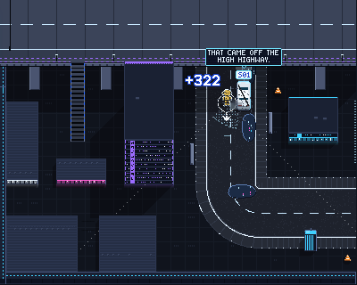
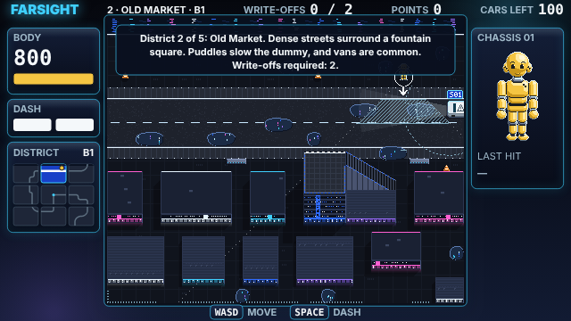
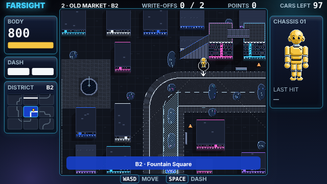
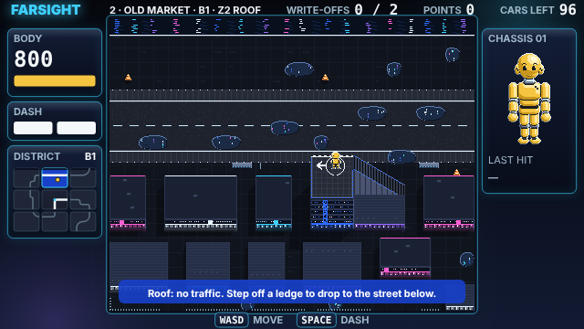
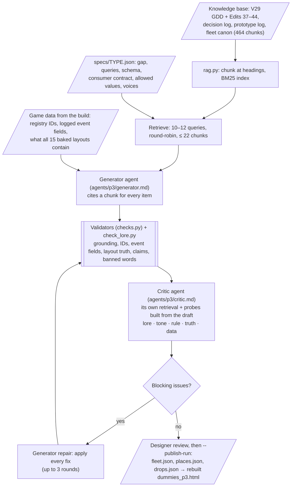

# DUMMIES — Dynamic Content Pipeline

**ELVTR Multi-Agent Systems · Assignment 4 · Lawrence Lek · 21 October 2026**

**Capstone:** DUMMIES, a top-down game. You play a crash-test dummy in a Sinofuturist smart city run by FARSIGHT. The city's self-driving cars are its workers. They are training not to hit you; you are trying to get written off.

**Consumer:** the current prototype, P3.3 (`prototypes/p3/dummies_p3.html`). It has five districts and three height levels: Z0 ground, Z1 low highway, Z2 high highway with platform roofs.

The pipeline:

1. Reads the game's own GDD and retrieves the sections that govern each piece of content.
2. Has a **generator agent** write the content.
3. Checks it with **deterministic validators** and an **independent critic agent**.
4. Repairs it until it passes.
5. Publishes it as data the playable build reads.



## Submission at a glance

| Deliverable | Where |
|---|---|
| **Pipeline** | `content/pipeline.py` (orchestrator).<br>`content/rag.py` (chunker and BM25 retriever).<br>`content/checks.py` (validators).<br>`content/registry.py` (canon values).<br>`content/kb_build.py` (knowledge base).<br>`content/agents/p3/` (generator and critic prompts).<br>`content/specs/` (one brief per content type). |
| **Three generated outputs** | 1. City barks: lines `c001`–`c024` in `content/db/fleet.json`.<br>2. District and level copy: `prototypes/p3/content/places.json`.<br>3. Drop juice: `prototypes/p3/content/drops.json`.<br>Each also has a generated GDD edit: `content/out/DUMMIES_GDD_Edit45–47_*.md`. |
| **Evidence** | Five runs in `content/runs/<id>/`. Every agent input and output, every validator and critic round, and a `trace.md` per type. |
| **Playable build** | `prototypes/p3/dummies_p3.html`: one file, open it in a browser. |
| **ReadMe** | This file. A short note for the tutor is in `NOTE_FOR_TUTOR.md`. |

| Rubric criterion | Section |
|---|---|
| Game-anchored source | [1](#1-source-the-games-own-gdd) |
| Content fit | [2](#2-three-gaps-three-outputs) |
| RAG implementation | [4](#4-rag-side-by-side) |
| Consistency checking | [5](#5-consistency-checking-what-the-critic-caught) |
| Voice judgment | [6](#6-voice-judgment) |

## 1. Source: the game's own GDD

The knowledge base is the DUMMIES GDD and its edits, nothing generic. `content/kb/manifest_p3.json` lists 16 documents, chunked at their `##` / `###` headings into **464 chunks**. Chunk IDs are section numbers (`EDIT44#5.2`, `FLEET#F4`), so every output can cite where it came from.

| ID | Document | Chunks |
|---|---|---:|
| `DESIGN` | V29 Design, the GDD of record | 48 |
| `ENG` | V29 Engineering Spec and parameter registry | 39 |
| `EDIT26` | GDD Edit 26: the full earlier GDD (fiction, voice, bark key, feedback table) | 95 |
| `EDIT37`–`EDIT44` | GDD Edits 37–44: art direction, P3, canon and lore system, districts, levels, buildings, Z levels | 116 |
| `DECISIONS` | Decision log, rows 1–173 | 37 |
| `LOG` | Prototype log P1–P3.3 | 88 |
| `FLEET` | Fleet canon: setting, voice, banned words, tiers, the 32 models, the 123 existing lines. Rebuilt from `content/db/fleet.json` on every run | 23 |
| `JUICE`, `DRIVER` | GDD edits: juice references, driver behaviour | 18 |

**Precedence:** the newest edit wins (EDIT44 > … > EDIT37 > DESIGN > EDIT26). The FLEET canon binds every line a car says. It is stated in both agent prompts.

**Canon values:** the validators read the registry `content/params/tuning.parameters.json` (229 IDs) and the P3 simulation's own values (597 IDs in all). They also read what the simulation logs per event, and what all 15 baked district layouts contain. No canon is typed into the checks by hand.

## 2. Three gaps, three outputs

The P3.3 build had just added highways, roofs and drops (GDD Edit 44). The content had not caught up.

| Gap ("my game is thin on…") | Generated output | Where the game uses it |
|---|---|---|
| **Humour in the new city.** The 123-line fleet bank was written for one road. No line knew a dummy can land on a car from a roof or a highway, be hit on a highway, or land on a Campus calibration plate. A dummy dropping onto the Luxury sedan got *"Bumper damage on a Luxury trim."* That is a lore break: Edit 39 §6.6.1 says a line may only state what the game state guarantees. | **City barks:** 24 lines for drops (roof or highway, Z1 or Z2), highway hits, plate hits, write-offs by each, and one line per district. Each line is bound to logged event fields. Each has tier voices for the two models that actually run: S01 Luxury, V02 Corporate. | Merged into `content/db/fleet.json`.<br>`game.js` `barkLine()`: a line that names the situation outranks a generic one.<br>The sim now logs `dropZ` and `dropFrom` on every drop. |
| **Place.** Five districts had one hand-written sentence each. All 45 screens toasted generic themes ("B2 · Open street"). The new level toasts were placeholder strings in code. | **District and level copy:** five intros, 45 screen names, three level toasts. Every name is true to all three baked layouts of its district. | `places.json`, read by the intro toast, the screen toast on first visit, and the first-time toasts for low highway, high highway and roof. |
| **Juice for the drops.** A Z2 fall (0.47 s, a stopped sedan takes 136) felt the same as a Z1 fall (0.35 s, 76). Landing on a car reused the ground-hit juice. | **Drop juice:** five layers.<br>- Stepping off: streaks, a falling whistle, a pull-in, all scaled by fall height.<br>- Open-ground landing: shake, ring, dust, stumble, thud.<br>- Hit from above: a downward crumple and boom.<br>- Z2 hit: heavier shake, debris, ring.<br>- Write-off by drop.<br>83 new `proto.drops.*` parameters, each with a unit, purpose and sources. | `drops.json`, stacked on the published hit layers in `hitJuice()`. |

| Before (P3.3 placeholders) | After (generated) |
|---|---|
| "District 2 of 5: Old Market. Dense low-rise streets around a fountain square. Wet, and busy with vans." | "Dense streets surround a fountain square. Puddles slow the dummy, and vans are common." |
| Old Market: "B2 · Fountain square"; every other screen "Pillars", "Barrier run" or "Open street" | "B2 · Fountain Square", "A1 · Fishmonger Quay", "C3 · Cobbler Lane" |
| Interchange: the same three themes | "A1 · West Flyover Gate": a highway and a checkpoint are on A1 in every layout |
| "Roof: no traffic up here. Step off a ledge to drop on a car below." | "Roof: no traffic. Step off a ledge to drop to the street below." |
| A dummy lands on S01's bonnet → "Bumper damage on a Luxury trim." | → "A roof? I was not briefed on roofs." (Luxury) / "Incident filed: load received from a roof." (Corporate) |





## 3. How the pipeline works



- **Agents.** Each agent call is a fresh headless Claude Code session with no tools and no shared memory (`claude -p`). The generator and the critic never see each other's prompts.
- **Separate retrieval for the critic.** The critic retrieves its own canon. It runs its queries plus probes built from the draft's longest strings, excluding chunks the generator already had, so it checks against more of the GDD.
- **Two layers of checking.**
  - Validators catch anything computable: a cited chunk that was not retrieved, an unknown parameter, a field the event does not log, a screen name promising a feature not in every layout, a claim not guaranteed by a line's conditions (`content/db/check_lore.py`).
  - The critic catches what needs judgement: tone, temperament, invented facts.
- **A human gate.** `--no-publish` stops before publishing. A designer reads `trace.md`, then publishes a chosen run with `--publish-run`.

### Run it

Requirements: Python 3.9+, Node 18+. Full runs also need [Claude Code](https://claude.com/claude-code) signed in (`claude` on the PATH). No API key is stored here.

```
python3 content/pipeline.py --query "dummy lands on a car from a roof"   # retrieval only, no model calls
python3 content/pipeline.py --check          # validate published content + lore check, rebuild the game; no model calls
python3 content/db/check_lore.py             # the fleet database's lore check
node prototypes/p3/test_sim.js               # simulation tests: 81/81
python3 content/pipeline.py --no-publish     # full run: citybarks, places, drops (about 8 minutes)
python3 content/pipeline.py --publish-run <run id> --type places   # publish an accepted type after review
```

Then open `prototypes/p3/dummies_p3.html`. Old Market's start screen (B1) has a roof and a tall stair; B2 next door adds a skybridge. Interchange A3 has the high highway and its broken parapet.

## 4. RAG, side by side

Excerpts from the published runs. Each `content/runs/<run>/<type>/trace.md` lists every item with the query that retrieved its cited chunk.

**City barks** (`runs/20261021-024324/citybarks`)

| Query | Retrieved chunk | Output |
|---|---|---|
| tier temperament voice Luxury Corporate polished superior procedural logs KPIs | `FLEET#F4` · "01 \| Luxury \| confident \| Polished, superior, faintly amused. Never apologises." / "02 \| Corporate \| calm \| Procedural. Speaks in logs, KPIs and policy numbers." | Tier 01, roof drop: "A roof? I was not briefed on roofs." Tier 02, same case: "Incident filed: load received from a roof." |
| drop off a ledge or broken parapet lands on the nearest level below fall time… | `EDIT44#5.2` · "Lands on the nearest level below the landing point: a deck beneath, else the ground." | Lines keyed `dropFrom: deck`, `dropZ: 1` vs `2`: "From the low highway? Quite unseemly." · "That came off the high highway." |
| deck traffic full drivers on their deck level cars sense their own level only | `EDIT42#6.3` · "Deck cars sense only a dummy on their deck. They stop for it as for a pedestrian." | Highway hit, any tier: "Nobody walks the highway. Nobody." |
| calibrated impact plates on the road points multiplier FARSIGHT Campus | `EDIT41#7.3` · "Plate: Campus road plates. A hit taken on one scores `damage.plateMultiplier` (1.5) points." | `plate: true`: "Plate hit filed against calibration form 3." · "Struck on a calibration plate. Vulgar." |
| landing on a car closing speed hit from above legs take it stopped sedan van cruise Z2 | `EDIT44#8.3` · "From Z2 (about 161): stopped sedan 136, sedan at cruise 236…" | `dropZ: 2`: "That fell a long way to reach me." |

**District and level copy** (`runs/20261021-022042/places`)

| Query | Retrieved chunk | Output |
|---|---|---|
| the dummy starts on B1 on the river centre screen B2 holds the landmark | `EDIT41#7.1.1` · "The centre screen (B2) holds the landmark." · "The dummy starts on B1, on the river." | Every B2 names its landmark: Lantern Plaza, Fountain Square, Central Roundabout, FARSIGHT Tower Plaza, Calibration Road. Every row-1 name is on the water: Westside Quay, Riverside Landing, Fishmonger Quay. |
| five city districts … landmark form flyovers quota traffic hazards | `EDIT41#7.2` · "Old Market \| Fountain square \| Dense low-rise \| … 45% vans \| Puddles 4%" | Old Market intro: "Dense streets surround a fountain square. Puddles slow the dummy, and vans are common." |
| Sinofuturist cyber city inside a friendly corporate terminal the brand never comments | `EDIT39#4.1.1` · "The contrast is the tone. The city glows. The test writes off bodies in it. The brand never comments." | Level toasts in the flat interface voice: "Roof: no traffic. Step off a ledge to drop to the street below." |
| *(Game data, not retrieval)* what all three layouts have per screen | Interchange A1: highway all, checkpoint all · C3: highway all, roofs all | Interchange A1 "West Flyover Gate", C3 "Platform Row". |

**Drop juice** (`runs/20261021-015337/drops`)

| Query | Retrieved chunk | Output |
|---|---|---|
| drop off a ledge or broken parapet fall time world.dropSeconds square root of height… | `EDIT44#5.2` · "Fall time: `world.dropSeconds` × √(h / `world.deckHeight`). Z1 0.35 s; Z2 to the ground 0.47 s." | Stepping off and landing are scaled by the fall height `h`, full at `world.highHeight`. The whistle and pull-in last from `world.dropSeconds` up to the Z2 fall. |
| hit feedback hit-stop dummy crumples dents shake grows with damage crunch horn | `EDIT26#5.5` · "Hit: a 0.06 s hit-stop; the dummy crumples and dents; a shake that grows with the damage." | Hit from above: a crumple of 0.30 and a 320 → 50 Hz boom. A Z2 hit adds shake 11, debris and a ring. The hit-stop stays `feedback.hitStop`. |
| scored hit and a physical touch must not use indistinguishable reward feedback | `DESIGN#D4.5` · "A scored hit and a physical touch on a spent car must not use indistinguishable reward feedback." | An open-ground landing has no rays, popup or sparks, so it never reads as a scored hit. |
| screen shake squash and stretch hit pause top-down arcade juice reference | `JUICE#J2` · "The Art of Screenshake… Hit pause. Screen shake. Camera kick. Knockback. Impact effects. Permanence." | Every layer names its reference: "Art of Screenshake: bigger hit, bigger shake, debris". |

## 5. Consistency checking: what the critic caught

Over five runs the critic raised **43 issues** and the validators **29**. Every correction below was applied by the repair agent and re-checked in the next round. `trace.md` records each value before and after.

| Run · type | Kind | Found | Canon | Corrected |
|---|---|---|---|---|
| 015337 · barks | truth | "Old Market congestion code 7. Now this too." | `EDIT39#3.1`: lore follows state; no congestion is logged | "Old Market incident logged. Route 44 noted." The validator then caught that "Route 44" names V02, so the line was bound to that model |
| 015337 · barks | tone | Tier-free line "Written off on the highway. Of all places." | `FLEET#F4`: a line with no tier also fires for the calm Corporate van; this is a Luxury sniff | "Written off on the highway. Logged." |
| 020902 · barks | truth | "A roof drop. My schedule slips by a minute." | `EDIT39#3.1`: a one-minute delay is not logged | "A roof drop. My schedule will suffer." The tweak in §6 then removed invented consequences altogether |
| 020902 · barks | truth | "High drop logged. Load exceeds rating 3." | `FLEET#F2`: barks react to logged events only; no load or rating exists | "High drop logged. Incident form 3 filed." |
| 022042 · places | truth | CBD intro "Flyovers cross the middle row" | Game data: Z1 and Z2 run on different rows, so one flyover crosses each | "A flyover crosses the middle row." |
| 022042 · places | truth | Interchange B3 "Ramp Street", C3 "Skyway Heights" | Game data: there are no ramps; "skyway" promises a skybridge C3 does not have | "Flyover Street", "Platform Row" |
| 022042 · places | truth | Riverside A3 "Ferry Street" | `EDIT42`: only row 1 meets the river | "Station Street" |
| 015337 · places | truth | Riverside A3 "Dockside Road" | Same rule | "Ropemaker Lane" |
| 023310 · barks | truth | "Riverside. I came for the lantern, not this." | `EDIT41#7.2`: the lantern is on B2 only; the line fires on every Riverside screen | "Riverside. I did not sign up for this." |
| 024324 · barks | tone | Tier-free write-off "Written off on the highway. Closing ticket." | `FLEET#F4`: ticket-closing is Corporate procedure; the Luxury car cannot say it | "Written off on the highway. On my record." |
| 015337 · drops | truth | Stepping-off whistle and pull-in timed to `world.dropSeconds` | `EDIT44#5.2`: a Z2 fall lasts 0.47 s, not 0.35 s | `["world.dropSeconds", "proto.drops.step.fallSecondsFull"]`, interpolated by fall height |
| 015337 · drops | data | Stumble amplitude declared as a "ratio" | Registry: `proto.hits.miss.stumbleAmp` is in radians | Unit "rad" |

The validators caught what the critic did not need to judge:

| Run · type | Found | Rule | Corrected |
|---|---|---|---|
| 015337 · places | Campus intro "Calibrated plates score more." | `FLEET#F2`: "score" is a banned word | "…pay more." |
| 015337 · places | Roof toast "fall to the level below" | `FLEET#F2`: "level" is a banned word | "fall to the deck or road below". The critic fixed the remaining truth problem in a later run (§6) |
| 015337 · places | CBD B2 "Farsight Tower Plaza" | `FLEET#F1`: FARSIGHT in capitals | "FARSIGHT Tower Plaza" |
| 022042 · barks | "Old Market, route 44. Incident filed." on any Corporate car | `check_lore.py`: names V02 without that claim | Bound to `model: VAN-02-001` |

## 6. Voice judgment

**Does it sound like DUMMIES?** Yes for barks and copy, after four tweaks. The game's voice is dry corporate comedy: workers who fear retraining, and polite forms that barely contain the personality.

- **Barks.** The final lines keep tier temperament. Luxury is indignant ("Struck on the highway. How undignified."). Corporate files paperwork ("Policy 12 excludes loads from parapets."). Every line is true at the moment it fires.
- **Screen names.** They read as Shenzhen street signage, and the crash-test fiction leaks through on Campus (Instrument Quay, Sensor Street). Every name is true to all three layouts.
- **Drop juice.** It reads as physical and quiet. It has no voice to judge.
- **Weakest output.** The district lines in the bark bank are thinner than the situation lines. "Business district. Of all places." is generic.

**Tweaks that changed game fit** (runs in `content/runs/`):

| Tweak | Why | Before | After |
|---|---|---|---|
| **Retrieval:** a heading every ten rows of the decision log (`kb_build.py`) | The chunker splits at headings, and the log is one long table. Rows 1–173 were invisible: 2 chunks, none containing a row | 0 decision rows retrievable | 37 chunks. `DECISIONS#rows-161-170` is retrieved for drops and levels |
| **Retrieval:** generate a FLEET canon page from `fleet.json` on every run | The fleet's tier voices, banned words and running models lived in JSON the retriever could not read | — | `FLEET#F4` (tier voice) is cited by 10 of the 24 city barks |
| **Prompt (places):** add the level fact "every drop from a roof or a highway lands on the street" to the brief | Run 015337: the critic "corrected" a true toast into a vague one. It did not know that Z1 and Z2 never overlap | "…a long drop to whatever lies below." · "fall to the deck or road below" | "…drops you to the street." · "drop to the street below" |
| **Prompt (barks):** tier-free lines must suit both cars; then "talk about the car's own job"; then "never add a consequence the sim does not log" | Run 015337: a shouting tier-free line and an aphorism | Run 020902: no shouts, but seven invented consequences ("I am now late", "KPI missed"), and the run was **not accepted** | Run 022042: true but flat; 15 of 33 lines ended "Noted.", "Logged." or "Recorded." |
| **Prompt + check (barks):** in-voice and out-of-voice examples; at most two stock endings | Truth had drained the humour | "Riverside. Low-rise streets. Hit logged." | Run 023310 / 024324: "A roof? I was not briefed on roofs." · "Nobody walks the highway. Nobody." |
| **Validator removed:** "use every bubble style", inherited from the P2 pipeline | It fought the critic. The generator added a shout to satisfy it; the critic removed it, because only the Budget tier shouts and Budget does not run in P3 | Runs 022042 and 023310 ended with an open "Luxury shouts" issue | Run 024324: accepted with no open issues |

**What I would change next:**
- **Roof drops rarely hit cars.** A dummy running off a roof ledge lands about 73 units from the road centre, on the pavement, so the roof barks rarely fire. I found this while staging screenshots. The pipeline did not catch it, because it is a level-design fact rather than a lore fact. It goes back to the GDD as an open item.
- **Strict truth flattens jokes.** The truth rule keeps winning against the jokes. A per-tier humour quota in the spec would make the trade-off explicit.

## 7. It runs

Checked from a fresh clone of this repository:

- `python3 content/pipeline.py --check`: 0 validator issues for city barks, places and drops; `check_lore.py` 0 errors; `dummies_p3.html` rebuilt.
- `node prototypes/p3/test_sim.js`: 81 passed, 0 failed.
- `python3 content/pipeline.py --query "…"`: retrieval only, no model needed.
- Full runs: the five runs in `content/runs/` were made with `python3 content/pipeline.py --no-publish` (Claude Code 2.1). Each one took 2–8 minutes.
- Browser (Chromium, Playwright): the screenshots here come from the built file. There were no page errors.

## 8. Files

| Path | What |
|---|---|
| `content/pipeline.py` | Orchestrator: retrieve, generate, validate, critique, repair, publish, bundle |
| `content/rag.py` | Markdown chunker and BM25 retriever (standard library only) |
| `content/checks.py` | Validators: `citybarks`, `places`, `drops` (and the earlier P2 types) |
| `content/registry.py` | Canon from the build: registry IDs, sim values, event fields, per-screen layout facts |
| `content/kb_build.py` | Knowledge-base snapshot, decision-log headings, the generated FLEET canon page |
| `content/agents/p3/` | Generator and critic system prompts |
| `content/specs/` | Briefs: gap, queries, critic queries, schema, consumer contract, allowed values, voices |
| `content/kb/` | Knowledge base and `manifest_p3.json` |
| `content/db/` | Fleet database and its lore check |
| `content/runs/` | Five runs, all inputs and outputs |
| `content/out/` | Generated GDD edits 45–47 |
| `prototypes/p3/` | The P3.3 game. `game.js` reads the outputs; `sim.js` logs the fields they test |
| `docs/` | Screenshots |

The working repository is [lawrencelek/ELVTR-dummies-agent-crew](https://github.com/lawrencelek/ELVTR-dummies-agent-crew/tree/assignment4/content-pipeline): the same pipeline with the earlier P2.1 targets, and the full GDD history.
