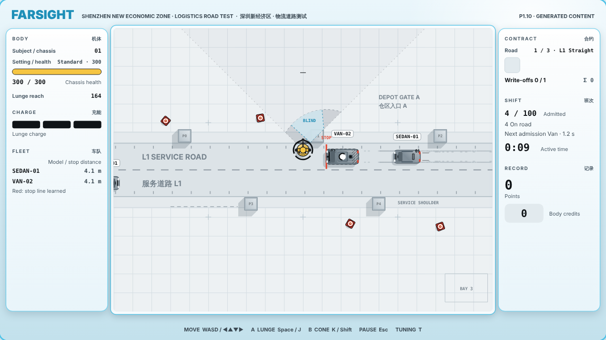
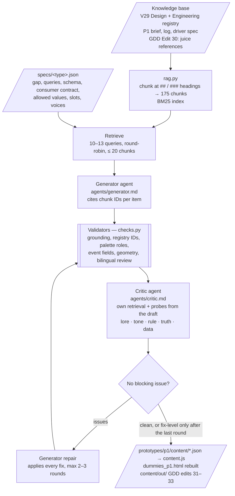
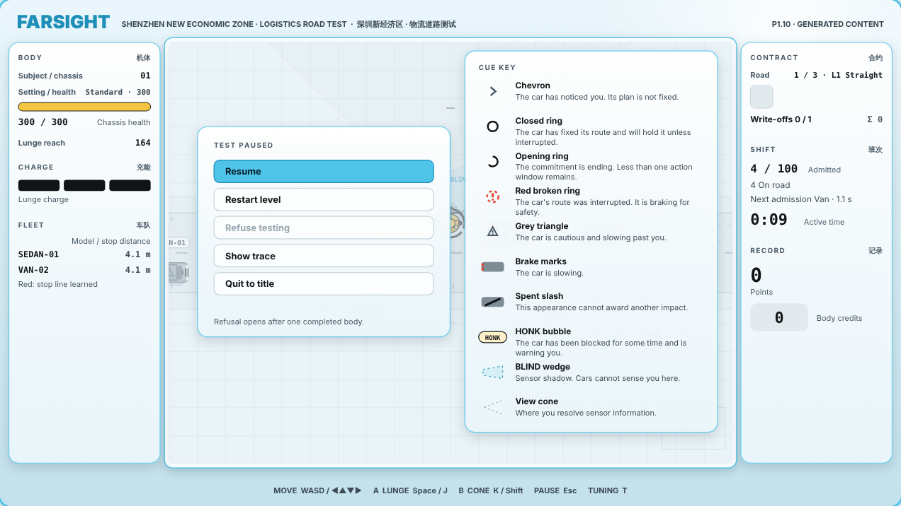
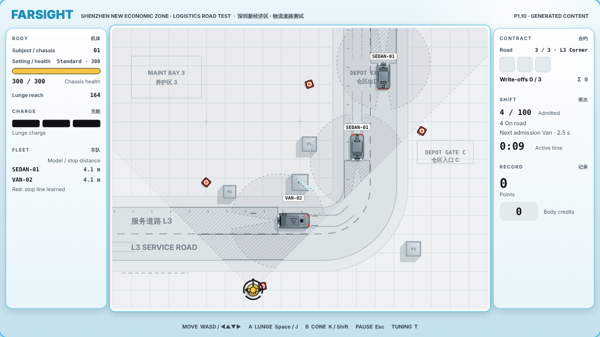
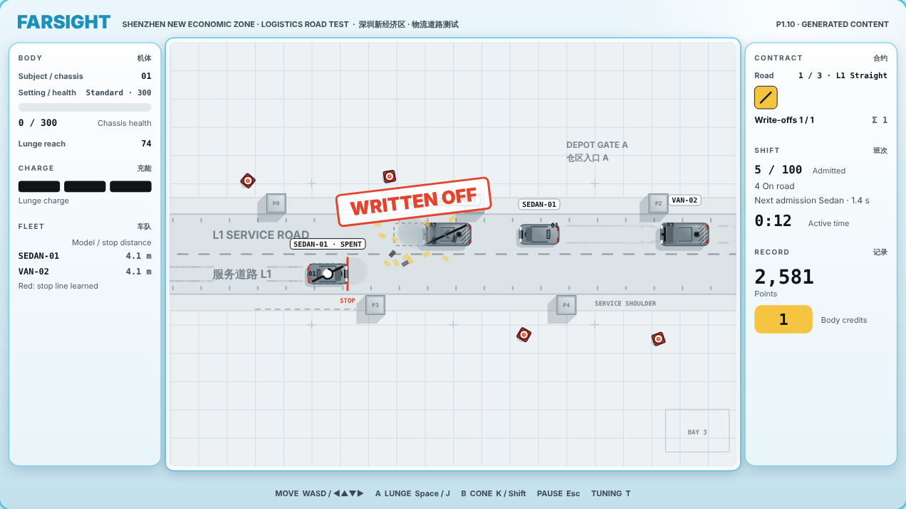
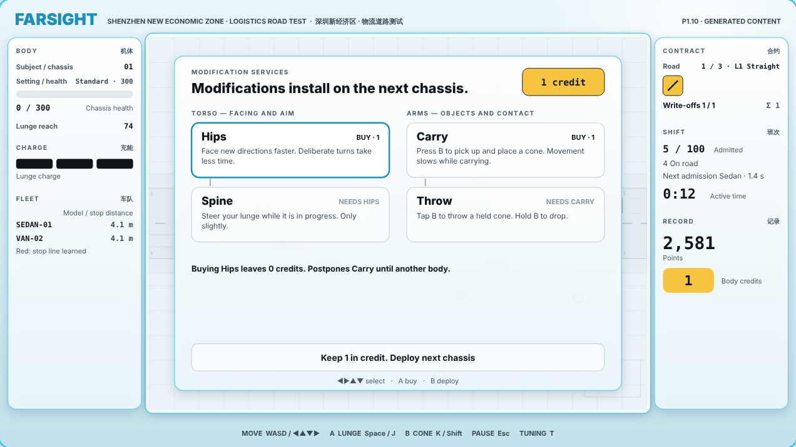
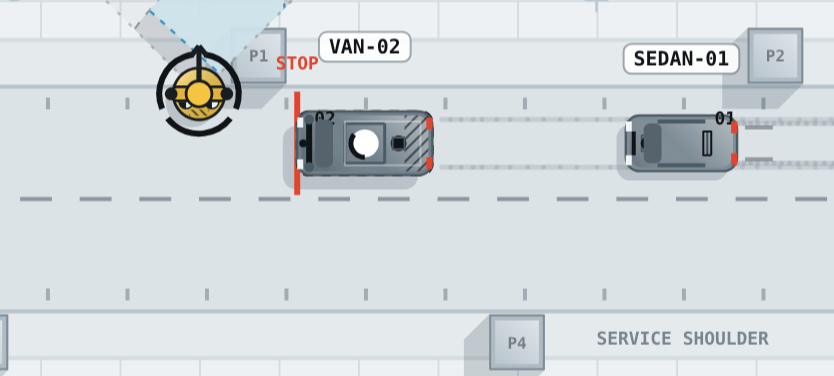

# DUMMIES — Dynamic Content Pipeline (ELVTR Assignment #4)

**Capstone game:** DUMMIES, by Lawrence Lek. **Consumer:** the P1 prototype, `prototypes/p1/`.
**Knowledge base:** `DUMMIES_V29_Design.md` plus its GDD edits. **Focus:** visual material.

The pipeline reads the GDD, retrieves the sections that govern each piece of content, has a generator agent write it, checks it with deterministic validators and an independent critic agent, repairs it, and publishes it as data the P1 build draws.



## 1. What P1 is thin on, and what was generated

| Content | The gap in P1.9 | Generated output | P1 consumer |
|---|---|---|---|
| **Juice**, referenced against top-down arcade driving games | Feedback is hard-coded literals in `game.js` (`kick(3 + 9 * k, …)`). No value has a parameter ID. Denied actions only toast. A touch on a spent car looks close to a hit. Braking leaves no trace. A replacement chassis just appears. | 14 event responses and 3 persistent states. 68 `proto.juice.*` IDs plus `feedback.hitStop` and `feedback.writeOffSeconds`. New: tyre marks (Absolute Drift), chassis drop (Super Sprint). | `content/juice.json` → `processEvents()`, particles, tyre marks, drop |
| **Interface**, per GDD D10.3–D10.5 and D9.2–D9.3 | The HUD is a developer panel ("VIEW · Scanners in view cone"). It ignores the six D10.5 modules. The cue grammar is explained nowhere. Copy is placeholder English. Vehicles never speak. | HUD in D10.5 modules with Chinese titles (review pending). A cue key on the pause screen. A FARSIGHT copy deck. Eleven worker barks bound to logged sim events. | `content/interface.json` → `drawHUD()`, pause, report, shop, endings, toasts, barks |
| **Graphics** (environment, vehicles, character) | Vehicles are identical grey rectangles. The dummy lacks the FARSIGHT markings D4.1 requires. The road is a grid with no district (D9.2 anchors 1–3). D10.6: a greybox cannot pass the beauty gate. | Roof liveries: SEDAN-01 "Depot parcel courier", VAN-02 "Lane maintenance". Crash-test quadrant targets on the dummy. 32 decals of bilingual signage and service markings across the three roads. | `content/graphics.json` → `drawCar()`, `drawBody()`, `drawField()` |

Every output is data, not code. The renderer has a fixed set of primitives; the content chooses and tunes them. Without `content.js` the build falls back to P1.9 exactly.

## 2. Pipeline



| File | Role |
|---|---|
| `pipeline.py` | Orchestrator. Runs each type, logs every input and output to `runs/<timestamp>/<type>/`. |
| `rag.py` | Markdown chunker and BM25 retriever. Standard library only. |
| `registry.py` | Canon for validators: Engineering §13.5 IDs, `sim.js` REG/PROTO/OVERRIDES, D10.2 palette, sim event fields, level geometry. |
| `checks.py` | Deterministic validators. Every rule cites the GDD section it enforces. |
| `specs/*.json` | One brief per content type: gap, queries, schema, consumer contract. |
| `agents/*.md` | Generator and critic system prompts. |
| `kb/` | Knowledge base copies and `manifest.json`. |
| `runs/` | Every run, including the rejected ones. Each type has `trace.md`. |
| `out/` | Generated GDD edits 31–33, one per type. |
| `shots.js` | Playwright screenshots of the build (`docs/`). |

### Run it

Requirements: Python 3.9+, Node 18+, [Claude Code](https://claude.com/claude-code) signed in (`claude` on the PATH). No API key is stored here.

```
python content/pipeline.py                         # all three types, about 15 minutes
python content/pipeline.py --type interface         # one type
python content/pipeline.py --query "vehicles speak as workers"   # retrieval only, no model calls
python content/pipeline.py --check                  # re-validate published content, rebuild content.js; no model calls
node prototypes/p1/test_sim.js                      # sim untouched: 34/34
```

Then open `prototypes/p1/dummies_p1.html`. Press Esc in play for the cue key. Press T: every generated ID is a live slider.

## 3. Knowledge base and retrieval

| ID | Document | Chunks |
|---|---|---:|
| `DESIGN` | `DUMMIES_V29_Design.md` — the GDD | 48 |
| `ENG` | `DUMMIES_V29_Engineering_Spec.md` — semantics and the §13.5 registry | 39 |
| `BRIEF` | P1 prototype brief (GDD edit) | 13 |
| `LOG` | P1 observation log O1.1–O1.29 (GDD edit) | 57 |
| `DRIVER` | P1 driver behaviour spec (GDD edit) | 14 |
| `JUICE` | **GDD Edit 30: juice references**, written for this assignment | 4 |

GDD Edit 30 extends D10 with the genre references: Super Sprint, GTA and GTA 2, Micro Machines, Absolute Drift, art of rally, and two juice talks. Each row says what the game does and how DUMMIES reads it. It is the only new lore-side input; the rest is the existing GDD.

Chunk IDs are section numbers: `DESIGN#D9.3`, `LOG#P1.2/juice`, `ENG#13.5~2`. BM25 weights heading words three times. Each spec runs 10–13 focused queries and fills the context round-robin, so every query contributes its best hit before any query gets a second one.

## 4. RAG, side by side

Excerpts from the final runs' traces (`runs/*/<type>/trace.md` has every item).

**Juice** (`runs/20261015-013357/juice`)

| Query | Retrieved chunk | Output |
|---|---|---|
| juice reference top-down arcade driving games… | `JUICE#J1` · "Tyres leave black marks like ink strokes." (Absolute Drift row) | `states.brakeMarks`: matte `fleet` ink at alpha 0.3, `proto.juice.brakeMarks.fadeSeconds` 12, at most 400 segments. Reference: "Tyre marks as ink strokes on a pale floor (Absolute Drift, art of rally)". |
| juice reference top-down arcade driving games… | `JUICE#J1` · "A helicopter lowers a replacement." (Super Sprint row) | `states.replacementDrop`: `proto.juice.chassis.dropSeconds` 0.9 from `proto.art.droneHeight` (70, the existing P1 drone altitude). The new chassis is lowered on a cable. |
| P1.2 juice camera shake… | `LOG#P1.2/juice` · "Camera shake scales with assessed impact." | `events.impact`: scale by `assessed` / `damage.bodyHealth`; shake `[proto.juice.impact.shakeAmpMin, …Max]` = 3 → 12, the P1.2 literals given IDs. |

**Interface** (`runs/20261015-013357/interface`)

| Query | Retrieved chunk | Output |
|---|---|---|
| voice and reports vehicles speak as workers… | `DESIGN#D9.3` · "Vehicles speak as workers: deadlines, rank, fear of retraining…" | Barks: "Reversing. I am not paid to back up." · "Plan cancelled. My supervisor will hear of this." · "I'm already on the form. Hands off." |
| node effects Hips faster deliberate reorientation… | `DESIGN#D3.8` · "Faster deliberate facing changes; baseline turn rate rises from 180°/s to 360°/s" | Shop, Hips: "Face new directions faster. Deliberate turns take less time." |
| blind spots sensor shadows pillars… | `LOG#P1.5/pillars-and-blind-spots` · "Pillars, barriers and vans cast sensor shadows from each car's nose." | Cue key: "BLIND wedge — Sensor shadow. Cars cannot sense you here." |

**Graphics** (`runs/20261015-014041/graphics`)

| Query | Retrieved chunk | Output |
|---|---|---|
| fictional district logistics maintenance road… | `DESIGN#D9.2` · "A logistics/maintenance road that visibly serves a working district, with entrances, destinations and service markings…" | Van job "Lane maintenance / 道路养护". Signs "DEPOT GATE A / 仓区入口 A", "MAINT BAY 3 / 养护区 3". |
| dummy overhead silhouette head disc… | `DESIGN#D4.1` · "…black joint markers and FARSIGHT markings." | Two crash-test quadrant targets at the shoulders and a hatched panel on the back. |
| Shenzhen smart city… city is the testing apparatus… | `DESIGN#D9.1` · "Streets, delivery routes and maintenance spaces carry grids, numbered zones and measuring instruments." | Survey ticks along both kerbs on the 40-unit grid pitch. |

## 5. Consistency checking: what was caught and corrected

Two layers. **Validators** (`checks.py`) catch anything that can be computed. **The critic** is a separate headless Claude session. It never sees the generator's reasoning, runs its own retrieval plus probe queries built from the draft, and must quote the offending text, cite the canon chunk and write the replacement. The generator applies the fixes; the next round re-checks them. `trace.md` records each issue's value before and after.

**Critic catches** (all applied; before → after):

| Run · type | Kind | Found | Canon | Corrected |
|---|---|---|---|---|
| 013357 · interface | truth | Bark: "{model} hit. Down {lost} health. **My shift is late.**" | `DESIGN#D9.3`: barks cannot assert unlogged facts | "{model} hit. {lost} health lost. That goes on my record." |
| 013357 · interface | truth | Bark: "Replanning. **Again.** On my own time." | `DESIGN#D5.4`: the unstick event logs no repeat | "Replanning. On my own time." |
| 013357 · interface | truth | "Lunge declined. **Charge not ready.**" | `ENG#5.2`: A is refused for charge *or* recovery | "Lunge declined. Charge or recovery incomplete." |
| 013357 · interface | lore | Cue key: closed ring = "will follow it" | `ENG#6.2`: commitment holds unless a visible interruption | "…will hold it unless interrupted." |
| 012152 · interface | truth | Impact bark: "**No accident detected.** Please improve." | `DESIGN#D9.3`: a bark cannot deny a hit the sim recorded | "Impact recorded. I have a delivery to make." |
| 010807 · interface | lore | Report: "{roadName} **certified**." | `DESIGN#D9.1`: certification is the Licensed ending, not a road | "{roadName} test complete." |
| 012152 · graphics | rule | Sign: "充电位 **CHARGE**" | `DESIGN#D10.3`: CHARGE is the lunge-charge cue; decoration implies no mechanic | "车位 FLEET BAY" |
| 014041 · graphics | rule | Sign: "SERVICE **PULL-IN**" | `DESIGN#D6.2`: markings add no mechanics; there is no pull-in | "SERVICE SHOULDER" |
| 014041 · graphics | rule | Roof ring with a centre dot | `DESIGN#D10.3`: decoration must not imitate the state pip or commitment ring | Outline rectangle |
| 012152 · graphics | lore | Chinese-only labels: "A1 仓区入口", "B1 检修场" | `DESIGN#D9.2`: identifiers are bilingual | "A1 仓区入口 DEPOT", "B1 检修场 YARD" |
| 013357 · juice | rule | Honk event: `carPulse: true` | `LOG#P1.2`: the pulse is scored-hit feedback | `false` |
| 013357 · juice | rule | Denied action: `flinch: true` | `DESIGN#D4.5`: a denial costs nothing; flinch reads as damage | `false` |
| 013357 · juice | data | Impact ring count reused `proto.juice.knock.dustCountMin` | Data alignment: each statistic has its own ID | New `proto.juice.impact.ringCount` |

**Validator catches** (examples): juice `scale.by: "impact"`, a field the event does not carry (run 010807, three rounds); dummy markings outside the 13-unit body; roof art over the state pip; decals that overlap pillars or run off the field; sign text wider than its board; boards filled in barrier colour.

**Where the critic was wrong.** Run 010807 flagged the learned-stop toast against D9.3, although P1.8 decided that toast names the change. It also reversed its own fixes between rounds, and once argued contrast against the wrong background colour. Sections 6 and 7 show how these were handled.

## 6. Does it sound like DUMMIES?

**Interface — mostly yes.** FARSIGHT reads as a polite, cold terminal: "Please produce an impact.", "FARSIGHT thanks you for your cooperation.", "Testing declined. Your refusal has been recorded." The barks carry worker resentment without inventing facts: "I am not paid to back up." Weak spots: "Move it! I have a delivery window." breaks the corporate politeness D9.3 asks for, and the critic passed it. "Rank does not wait for obstacles." is filler. The Chinese strings are unreviewed and flagged as such.

**Graphics — recognisably the district, not yet beautiful.** The jobs come straight from D9.2 (courier, maintenance). Signs are bilingual, gates and bays are numbered, the kerbs carry survey ticks. That reads as the "instrumented city". The quadrant targets make the dummy a crash-test dummy at a glance. But road names painted across both lanes compete with cars and cues, and roof liveries are small at play scale. This is a first art pass, not the D10.6 beauty gate.

**Juice — on-brand but cautious.** The generator anchored on the P1.2 literals and gave them IDs. That is correct, but conservative. The references changed two things: matte tyre marks that stay on the lab floor as a record of the test, and the chassis drop. Both fit "the city is the testing apparatus". Whether they read as record or as noise needs a player.

## 7. Tweaks made to improve game-fit

Each tweak came from reading a run's trace or a screenshot.

| # | Kind | Change | Before | After |
|---|---|---|---|---|
| T1 | Retrieval | Fill the context round-robin across queries, not query by query | Run 010807: the cap starved the last queries. Interface lost `DESIGN#D8` (endings) and `DESIGN#D3.9` (shop). Graphics lost `BRIEF#P1.8` (levels) and `DESIGN#D6.2` (surfaces). | Run 012152 retrieves all of them. |
| T2 | Prompt (brief) | Give the generator the sim event fields, what each copy slot is for, and which voice speaks where (FARSIGHT vs vehicles) | Run 010807: juice guessed `scale.by` for three rounds and failed the gate. The shop "bank" button read "Balance: 1 credits". Hips read "Hips · Torso. Opens Spine." | Run 012152: juice passes; the button reads as an action. |
| T3 | Prompt | Precedence: for P1, BRIEF/LOG/DRIVER decisions override DESIGN | Run 010807: the critic overrode P1.8's learned-stop toast. | Run 012152 critic: "The learn-standoff toast naming the change follows decision P1.8." |
| T4 | Prompt + loop | Critic reviews every string in one pass; settled fixes are listed and must not be reversed | Run 010807: about 2 issues per round. Interface never converged. | Run 013357: 9 interface issues found at once, clean on round 2. |
| T5 | Validator | A critic finding became a rule: particles only for events located at the dummy | Run 012152: the critic caught rotor-wash dust at the dummy for a drone dispatch, then reversed itself next round. | Run 013357: enforced deterministically. |
| T6 | Retrieval | Two new interface queries: node effects, blind spots | Run 012152: Hips read "Adds a hip joint. The torso can now turn." The dummy already turns, at 180°/s. The critic deleted the BLIND cue entry. | Run 013357: "Face new directions faster. Deliberate turns take less time." (`DESIGN#D3.8`). BLIND restored from `LOG#P1.5`. |
| T7 | Validator | From screenshots: no barrier-coloured fills on decals; sign text must fit its board; decals stay inside the field | Run 012152 screenshot: grey sign boards that read as crates; "TEST ZONE 03" cut off at the field edge. | Run 014041: outline boards, text inside. |

## 8. Screenshots

| | |
|---|---|
|  |  |
|  |  |



## 9. Runs

| Run | Types | Result |
|---|---|---|
| `20261015-010807` | all, not published | Baseline. Juice failed (validator). Interface failed (critic block). Graphics passed. Led to T1–T4. |
| `20261015-012152` | all | All accepted and published. Led to T5–T7. |
| `20261015-013357` | juice, interface | Accepted. **Published juice and interface.** |
| `20261015-013537` | graphics | Accepted with 3 open fix-level issues; superseded. |
| `20261015-014041` | graphics, 3 repair rounds | Accepted with 1 open fix-level issue. **Published graphics.** |

Agents ran on `claude-sonnet-5-5` through Claude Code. A full three-type run makes 15–21 calls and takes about 12 minutes of model time.

## 10. Limitations

- **No player has seen P1.10.** Voice and visual fit are self-assessed. Barks are timed but not read-tested at play speed.
- **The critic is not an oracle.** It misses things ("Move it!"), sometimes reverses itself, and can be wrong about facts. Validators hold the hard rules.
- **Graphics stay fix-level imperfect.** Every graphics run left at least one open fix-level issue; the gate accepts those.
- **Chinese text is unreviewed.** All of it carries `review: pending` (D9.2).
- **Juice is a starting table.** Values are proposed `proto.juice.*` IDs, none promoted to the registry.
- Re-running produces different content. The game itself stays deterministic; `sim.js` is unchanged.
