# DUMMIES — Dynamic Content Pipeline (ELVTR Assignment #4)

**Capstone game:** DUMMIES, by Lawrence Lek. **Consumer:** the P2.1 prototype, `prototypes/p2/` (P1.9 simulation, unchanged, plus a content-aware renderer). P1 stays frozen at P1.9.
**Knowledge base:** `DUMMIES_V29_Design.md` plus its GDD edits, including the full Edit 26 GDD.

The pipeline reads the GDD, retrieves the sections that govern each piece of content, has a generator agent write it, checks it with deterministic validators and an independent critic agent, repairs it, and publishes it as data the P2.1 build draws.

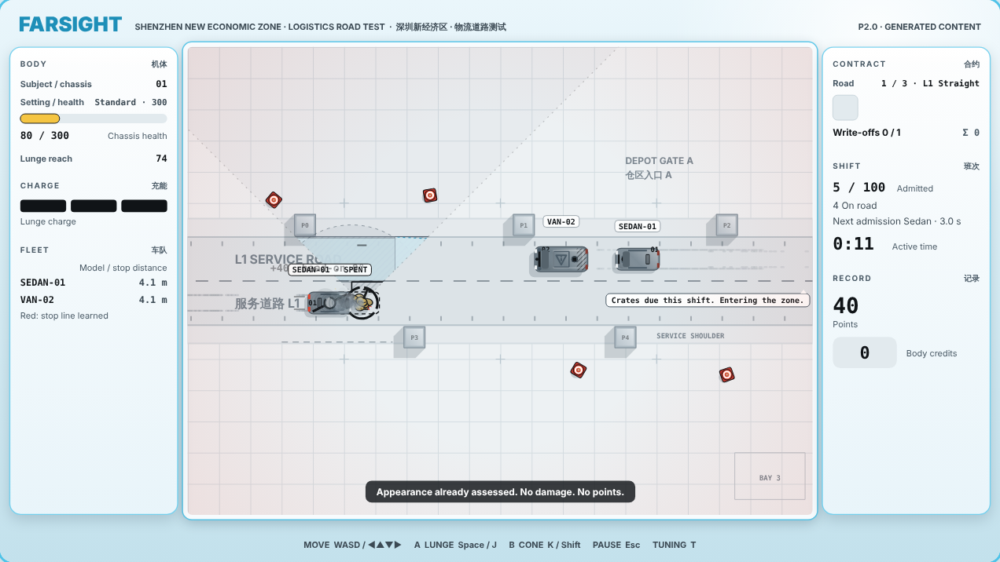

## Submission 4: retargeted to the P3.3 prototype (21 October)

`python content/pipeline.py` now targets the current prototype (`--target p3`, the default): knowledge base `kb/manifest_p3.json` (V29 + GDD Edits 37–44, decision log, prototype log, a FLEET canon page generated from `db/fleet.json`), three new types (`citybarks` → `db/fleet.json` lines c001–c024, `places` → `prototypes/p3/content/places.json`, `drops` → `prototypes/p3/content/drops.json`), P3 prompts in `agents/p3/`, and per-screen layout facts from the 15 baked districts. `--target p2` runs the P2.1 types above unchanged.

Runs: `runs/20261021-015337` … `runs/20261021-024324`. Generated GDD edits 45–47 in `out/`. The submission README with the side-by-side retrieval, critic catches and voice tweaks: [ELVTR-Multiagent-Submission-4](https://github.com/lawrencelek/ELVTR-Multiagent-Submission-4).

## 1. Three gaps, evaluated against the GDD

| Gap statement (designer) | Evaluation against canon | Decision |
|---|---|---|
| **"My game is thin on humour."** Barks for the cars, in a speech bubble or text above the car, for when the player misses, hits or otherwise affects the car. | **Valid.** EDIT26 3.1: "AI workers perform ridiculous jobs, comic and tragic at once." D9.3: vehicles speak as workers. EDIT26 6.6 defines a bark key (front hit, side hit, near miss, safe passage, write-off, seniority). P2.0 had 11 barks in a small grey tag, one per car per road, and none for a miss, near miss, write-off or upgrade. **Constraint:** the sim logs no miss or near miss, and D9.3 forbids barks about unlogged facts. | The renderer derives `miss`, `near-miss` and `upgrade-seen` from sim state and logs them in the trace under `presentation`. Barks may use only logged fields. |
| **"My game is thin on juice. Every hit should feel more juiced."** | **Valid.** P2.0 gives every scored hit the same response, scaled only by size. D4.5 requires the body to announce a miss; it does not. EDIT26 5.5 lists hit, miss and lunge feedback the build lacks (crumple, stumble, speed lines, crunch). **Constraint:** the hit-stop is a simulation value (`feedback.hitStop` = 0.06 s, ENG). Changing it changes play. | **Presentation only** (designer's choice). `sim.js` stays byte-identical to P1.9. All new juice is drawn. |
| **"My game is thin on graphics. The UI should feel more like FARSIGHT SMART CITY, cyberpunk vibe."** | **Partly conflicts.** D10.1: "An instrumented city inside a friendly corporate terminal." EDIT26 4.1.5: "Cyberpunk is tonal, not surface." A neon or dark UI breaks the register. The frame did lack brand, product and texture: P2.0 shows one gradient and the word FARSIGHT. | **FARSIGHT terminal, V29 only** (designer's choice). Frutiger Aero brand chrome, smart-city product lockup, bilingual signage. No cyberpunk surface layer. |

## 2. What was generated

| Type | Generated output | P2.1 consumer | GDD edit |
|---|---|---|---|
| **barks** (humour) | 31 lines for 11 events: hits (front, side, bait, stopped, senior), write-off (highest priority), near miss, miss, touch on a spent car, knock, horn, avoiding the dummy, interrupt, unstick, upgrade seen. Four bubble styles: speech, thought, shout, mutter. 8 `proto.barks.*` IDs. | `content/barks.json` → `barkLine()`, `drawBubbles()`, derived cases in `deriveCases()` | [Edit 34](out/DUMMIES_GDD_Edit34_Barks.md) |
| **hits** (juice) | 12 layers. Impact base plus 5 accents (front, bait, lunging, stopped, big). Write-off, touch on a spent car, knock, near miss, miss, lunge. New primitives: zoom punch, crumple, stumble with flailing arms, contact ring, burst rays, value popup, speed lines, noise-burst sound. 152 `proto.hits.*` IDs. | `content/hits.json` → `hitJuice()` | [Edit 35](out/DUMMIES_GDD_Edit35_Hits.md) |
| **terminal** (UI graphics) | Backdrop gradient and glows. Header lockup "SMART CITY 智慧城市", tagline, three static badges. Panel skin (radius, gloss, bevel, shadow, aqua header bands). Seven module icons. Registry micro-type and range marks. Eight FARSIGHT signage notices. Title-screen copy. 6 `proto.term.*` IDs. | `content/terminal.json` → `drawFrame()`, `panel()`, `drawHUDContent()`, `drawTitle()` | [Edit 36](out/DUMMIES_GDD_Edit36_Terminal.md) |

Every output is data, not code. The renderer has a fixed set of primitives; the content chooses and tunes them. Every number is a parameter ID (house rule). Without a content file, each layer falls back to the P2.0 presentation.

## 3. Pipeline

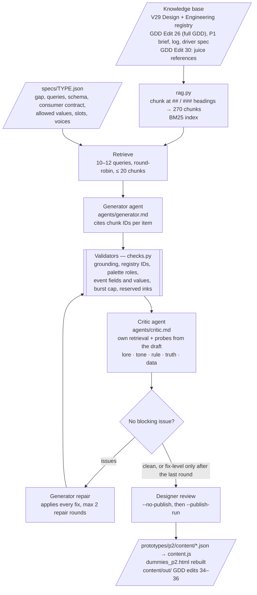

| File | Role |
|---|---|
| `pipeline.py` | Orchestrator. Logs every input and output to `runs/<timestamp>/<type>/`. |
| `rag.py` | Markdown chunker and BM25 retriever. Standard library only. |
| `registry.py` | Canon for validators: ENG §13.5 IDs, `sim.js` REG/PROTO/OVERRIDES, D10.2 palette, sim event fields, derived event fields, level geometry. |
| `checks.py` | Deterministic validators. Every rule cites the GDD section it enforces. |
| `specs/*.json` | One brief per content type. P2.1: `barks`, `hits`, `terminal`. P2.0: `juice`, `interface`, `graphics`. |
| `agents/*.md` | Generator and critic system prompts. |
| `kb/` | Knowledge base copies and `manifest.json`. |
| `runs/` | Every run, including superseded ones. Each type has `trace.md`. |
| `out/` | Generated GDD edits 31–36. |
| `shots.js` | Playwright screenshots on a paused fake clock, so juice frames are exact. |

### Run it

Requirements: Python 3.9+, Node 18+, [Claude Code](https://claude.com/claude-code) signed in (`claude` on the PATH). No API key is stored here.

```
python content/pipeline.py --no-publish                 # barks, hits, terminal; about 10 minutes
python content/pipeline.py --publish-run <run id> --type barks   # publish after review
python content/pipeline.py --type juice                  # a P2.0 type
python content/pipeline.py --query "bark key near miss"  # retrieval only, no model calls
python content/pipeline.py --check                       # re-validate all six published types, rebuild; no model calls
node prototypes/p2/test_sim.js                           # P1.9 sim, unchanged: 34/34
```

Then open `prototypes/p2/dummies_p2.html`. Press T: every generated ID is a live slider. The exported trace (pause → Show trace) lists derived cases and every bark under `presentation`.

## 4. Knowledge base and retrieval

| ID | Document | Chunks |
|---|---|---:|
| `DESIGN` | `DUMMIES_V29_Design.md` — the GDD, source of record | 48 |
| `ENG` | `DUMMIES_V29_Engineering_Spec.md` — semantics and the §13.5 registry | 39 |
| `EDIT26` | **GDD Edit 26**, the full GDD before V29: fiction, voice, bark key, feedback table, style guide | 95 |
| `BRIEF` | P1 prototype brief (GDD edit) | 13 |
| `LOG` | P1 observation log (GDD edit) | 57 |
| `DRIVER` | P1 driver behaviour spec (GDD edit) | 14 |
| `JUICE` | GDD Edit 30: juice references (top-down arcade driving) | 4 |

EDIT26 was added for P2.1. V29 condenses the humour and feedback detail the three gaps need: EDIT26 3.1 ("comic and tragic at once"), 3.2 ("Subject has acquired hips."), 5.5 (feedback table), 6.6 (bark key), 4.1 (Frutiger Aero frame, material rules), 4.2.2 (cue sizes), 4.2.4 (texture tier). **Precedence:** ENG governs values. P1 decisions (BRIEF, LOG, DRIVER) override DESIGN. DESIGN overrides EDIT26 where they differ (for example, EDIT26 still lists a SERVICE module).

Chunk IDs are section numbers: `EDIT26#6.6`, `DESIGN#D9.3`, `EDIT26#4.2~2` (second chunk of a long section). BM25 weights heading words three times. Each spec runs 10–12 queries and fills the context round-robin.

## 5. RAG, side by side

Excerpts from the published runs' traces. `runs/<run>/<type>/trace.md` has every item.

**Barks** (`runs/20261015-085359/barks`)

| Query | Retrieved chunk | Output |
|---|---|---|
| bark key model number event front hit side hit near miss safe passage write-off seniority… | `EDIT26#6.6` · "Bark key. Model number + event (front hit, side hit, near miss, safe passage, write-off) + seniority + mood… Write-off barks take priority." | Cases keyed by `zone`, `bait`, `stopped`, `seniority`. Write-off lines are priority 3: "Please not retraining. Anything but retraining." |
| vehicles speak as workers deadlines rank fear of retraining… | `EDIT26#3.2` · "Vehicles speak as workers… fear of retraining, resentment of the dummy. Corporate politeness barely contains their personalities." | Stopped hit, mutter: "I was stationary. Please note I was stationary." |
| cars may react to upgrades subject has acquired hips… | `EDIT26#3.2` · "Cars may react to upgrades: 'Subject has acquired hips.' (Proposed)" | `upgrade-seen` lines: "Subject has acquired hips." · "It can throw now. Nobody told us." |
| seniority notches beside model ID tag… | `EDIT26#6.4` · "Seniority summarises training in four levels, shown as notches beside the model ID tag." | Senior write-off, thought: "Senior model. Apparently not senior enough." |
| recurring vehicle jobs… district logistics maintenance road | `DESIGN#D9.2` · "Recurring vehicle jobs… tied to this district" | Near miss, SEDAN-01 only: "Parcel intact. Nerves are not." |

**Hits** (`runs/20261015-085446/hits`)

| Query | Retrieved chunk | Output |
|---|---|---|
| hit feedback hit-stop dummy crumples dents shake grows with damage crunch horn | `EDIT26#5.5` · "Hit: a 0.06 s hit-stop; the dummy crumples and dents; a shake that grows with the damage. A crunch and a horn." | Impact base: crumple 0.08 → 0.28 and shake 1.5 → 7, both scaled by `assessed` / `damage.bodyHealth`; noise crunch 2400 → 300 Hz. Bait accent adds a horn tone. Hit-stop stays `feedback.hitStop`. |
| miss stumble arms flailing clatter… | `EDIT26#5.5` · "Miss: a stumble, with arms flailing. A clatter." | Miss: stumble 0.4 rad for `movement.lungeRecovery`, flailing arms, a 3200 → 700 Hz noise clatter. |
| scored hit touch on spent car must not use indistinguishable reward feedback | `DESIGN#D4.5` · "A scored hit and a physical touch on a spent car must not use indistinguishable reward feedback." | Touch on a spent car: 1.2-unit shake and grey dust only. No flash, sparks, rays or number. |
| impact burst positive qualifying hit contact position radial motion | `EDIT26#4.2~2` · "Impact burst… Radial particles at contact… 2 × body width" | Rays 12 → 26 and ring 14 → 26 units: inside the 52-unit cap. |
| near miss distinct cues… sound visual equivalent | `DESIGN#D9.4` · "Use distinct cues for… near miss… Gameplay cues… have visual equivalents." | Near miss: speed lines along the car's travel and a rising 500 → 2200 Hz whoosh. No reward cue. |

**Terminal** (`runs/20261015-085401/terminal`)

| Query | Retrieved chunk | Output |
|---|---|---|
| frame FARSIGHT brand Frutiger Aero glossy bevels translucent panels… | `EDIT26#4.1~1` · "The frame is FARSIGHT's brand. Frutiger Aero: glossy bevels, translucent panels, soft drop shadows, aqua highlights, rounded corners." | Panel skin: radius `proto.term.panelRadius` 12, gloss 16, white bevel, aqua header bands with white module titles and icons. |
| FARSIGHT sells a city without accidents Shenzhen smart city… | `EDIT26#3.1` · "FARSIGHT sells a city without accidents. Your job is to cause them." | Tagline "A city without accidents." Badges "ZERO ACCIDENTS", "FRIENDLY BY DESIGN". Title: "Kindly be struck, in the accidents FARSIGHT says cannot happen." |
| texture micro-type range marks diagnostic runs FARSIGHT signage tier 4… | `EDIT26#4.2~3` · "Tier 4 — Texture. Range marks, grid rules, panel greebling, scrolling diagnostics, FARSIGHT signage." | Range ticks every 20 units on the bezel. Eight registry IDs as 8 px micro-type, values read live. Static signage: "Your feedback helps the fleet serve you better." |
| cyberpunk is tonal not surface Chinese signage surveillance… | `EDIT26#4.1~3` · "Cyberpunk is tonal, not surface: Chinese signage, surveillance, grime at panel joints." | No neon, no dark field. Bilingual notices: "This district is monitored for your convenience. 本区域受到监测…" |

## 6. Consistency checking: what was caught and corrected

Two layers. **Validators** (`checks.py`) catch anything computable. **The critic** is a separate headless Claude session with its own retrieval. It must quote the offending text, cite a canon chunk and write the replacement. The generator applies the fixes; the next round re-checks them. `trace.md` records each value before and after.

**Critic catches in the P2.1 runs** (all applied):

| Run · type | Kind | Found | Canon | Corrected |
|---|---|---|---|---|
| 084457 · barks | tone | Miss: "You missed. I will not mention it." | `DESIGN#D9.3`: workers resent; they never mock the player | "No contact. Nothing to report. Noted anyway." |
| 084457 · barks | tone | Miss: "Please aim before entering my route." | `DESIGN#D9.3`: a car talks about its own job, not the player's skill | "Lunge ended without contact. I remain on schedule." |
| 084457 · barks | truth | Bait hit: "It left. I relaxed. That was the mistake." | `DESIGN#D9.3`: no unsupported motive; do not name the bait counter early | "Hit. Logged. This was not on my schedule." |
| 084457 · barks | data | Horn: "Five seconds. Five whole seconds." | `DRIVER#DB4`: the wait is `proto.honkSeconds`; a typed number breaks when tuned | "Waiting. Still waiting. The window is closing." |
| 084457 · barks | lore | Write-off, any car: "DELIVERY WINDOW CLOSED." | `DESIGN#D9.2`: only SEDAN-01 delivers; vans would claim it | "SCHEDULE CLOSED. PERMANENTLY." |
| 084457 · barks | lore | "Retraining would have been nicer." | `DESIGN#D9.3`: cars fear retraining | "Retraining was the worst case. I was wrong." |
| 085359 · barks | truth | Knock: "Please do not lean on the vehicle." | `DESIGN#D9.3`: knock logs a push-back, not leaning | "Contact logged. Please stand clear of the vehicle." |
| 085359 · barks | truth | "Stopping…" keyed to `cause: body` | `DESIGN#D9.3`: `body` also covers a swerve | Keyed to `cause: body, man: brake` |
| 085359 · barks | tone | Miss, thought: "Is that all it does?" | Voices: never mock the player | "If it lunges again, I will be late." |
| 084459 · hits | rule | Contact ring radius 70, rays 64 | `EDIT26#4.2~2`: impact burst ≤ 2 × body width (52) | 52 |
| 084459 · hits | rule | Rings, sparks and miss streaks in `primary` / `secondary` | `EDIT26#4.2~2`, `DESIGN#D10.3`: cue inks are reserved; secondary streaks read as the lunge trace | `structure` |
| 084459 · hits | data | `when: {assessed: {min: 400}}`, `{gap: {max: 0.5}}` | House rule, `ENG#11.5`: thresholds are statistics | Parameter IDs (see T10) |
| 085446 · hits | rule | Stopped-car hit thump 420 → 110 Hz, 0.16 s | `DESIGN#D4.5`: indistinguishable from the spent-car thud (500 → 140 Hz) | 900 → 160 Hz, 0.2 s |
| 085446 · hits | lore | Write-off smoke spawned at the car | `EDIT26#5.1`: the write-off destroys the dummy's body | Smoke at the dummy |
| 084501 · terminal | lore | Title: "Each body lost earns a modification credit." | `LOG#P1.5/campaign`: the final write-off ends the run and pays none | "…except the last." |
| 085401 · terminal | lore | Title: "Kindly be struck, so FARSIGHT stays accident-free." | `EDIT26#3.1`: the hits are the accidents FARSIGHT says cannot happen | "Kindly be struck, in the accidents FARSIGHT says cannot happen." |

**Validator catches:** module icons outside their 16-unit box (both terminal runs, fixed in round 1); in run 084459, threshold IDs the old contract could not read (below). The rules also reject `when` fields the sim never logs. EDIT26's bark key includes mood, but P1 has no moods, so a mood line cannot pass.

**Where the loop failed.** In run 084459 the critic asked for threshold IDs; the validator then rejected them because the consumer contract only took numbers, and round 2 reverted to bare numbers. The critic was right and the contract was wrong (fixed in T10). Run 084501's critic passed a title that dropped the player's job (fixed in T9). No critic noticed that admission chatter blocked hit barks; a screenshot did (T8).

## 7. Does it sound like DUMMIES?

**Barks — yes, in the quiet styles.** The humour lives in the gap between procedure and the event, stated flatly: "I was stationary. Please note I was stationary." · "Was that a collision? Logging it as not." · "Senior model. Apparently not senior enough." The thought bubble carries what politeness hides: "Please not retraining. Anything but retraining." Weak spots: the shouts are generic exclamations ("Bumper! That was the bumper!"). "Side panel! I had right of way!" claims a rule the sim does not log; the critic allowed it as car-side blame. "Subject has acquired hips." is the GDD's own draft line, reused rather than invented. Nobody has read a bubble at play speed.

**Hits — physical and on-register, but cautious.** Every layer traces to EDIT26 5.5 or D4.5: crumple, stumble, crunch, speed lines, a horn on bait. Hits now differ by logged facts (front, bait, lunging, stopped, big). But base shake is 1.5 → 7, below P2.0's 3 → 12. Hits feel busier rather than harder. Synthesised noise is placeholder sound.

**Terminal — the closest to the brief.** The lockup, the badges ("ZERO ACCIDENTS", "FRIENDLY BY DESIGN") and the signage ("Your feedback helps the fleet serve you better.") make FARSIGHT a smart-city vendor that "kills you politely" (EDIT26 4.1.1). The cyberpunk vibe stays tonal by decision: bilingual signage, monitoring notices, live diagnostics. Weak spots: icons are tiny and generic; the backdrop is still one gradient.

## 8. Tweaks made to improve game-fit

T1–T7 shaped the P2.0 types (appendix). T8–T12 came from the P2.1 runs.

| # | Kind | Change | Before | After |
|---|---|---|---|---|
| T8 | Spec | Remove admission barks; let hits and write-offs outrank chatter cooldowns | Run 084457 screenshot: every arriving car said "SEDAN-01 entering road. Schedule noted." That started its 4 s cooldown, so it could not react to a hit seconds later. | Run 085359: no admission lines. A hit line replaces chatter at once; write-offs always speak. |
| T9 | Spec (slot) | Title line 0 must state the player's job | Run 084501: "The cars here are qualifying, and they would prefer you were not in the way." The goal had gone. | Run 085401: "The fleet will avoid you. Kindly be struck, in the accidents FARSIGHT says cannot happen." |
| T10 | Validator + contract | Promote four critic findings to rules: burst ≤ 2 × body width; effects avoid cue inks; thresholds are parameter IDs (now accepted by the renderer); gain ≤ 0.25 | Run 084459: 9 critic issues in round 0; an open fix-level issue at the end; thresholds reverted to bare numbers. | Run 085446: round 0 had one issue, a unit label. All thresholds are IDs. |
| T11 | Renderer (from screenshots) | Bubbles avoid each other and other cars' model tags; the value popup rises on the dummy's side | Overlapping shout and mutter bubbles; popup on top of the SPENT tag. | Clean layout in `docs/p2_impact.png`. |
| T12 | Knowledge base + prompts | Add EDIT26 with precedence (DESIGN wins) | V29 alone has no bark key, no miss feedback table, no burst size, no texture tier. | The bark cases follow `EDIT26#6.6`; the hit layers cite `EDIT26#5.5`. Four of the 16 catches above rest on EDIT26 (`#4.2~2` twice, `#5.1`, `#3.1`). |

## 9. Screenshots

P2.0 → P2.1, same staged moment on the paused clock:

| P2.0 | P2.1 |
|---|---|
| 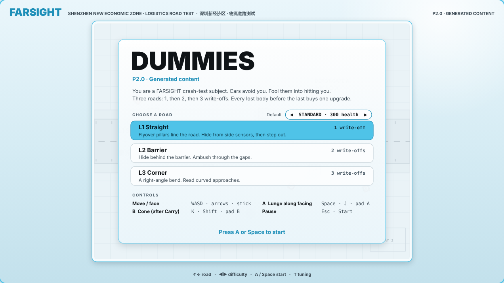 |  |
| 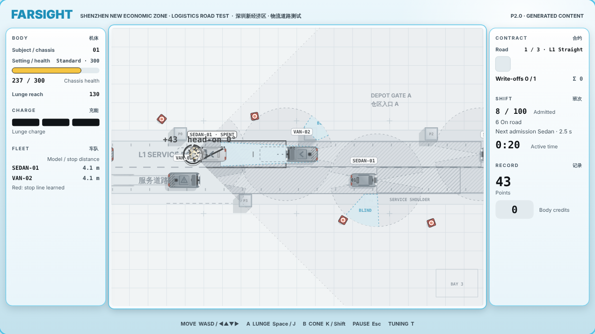 |  |

| | |
|---|---|
| 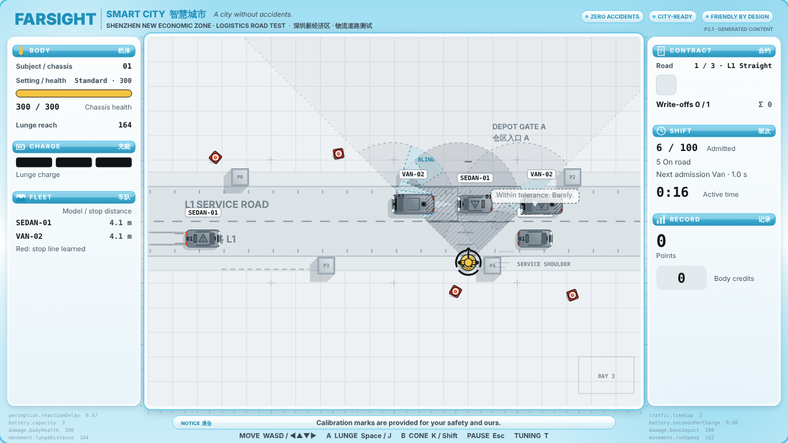 | 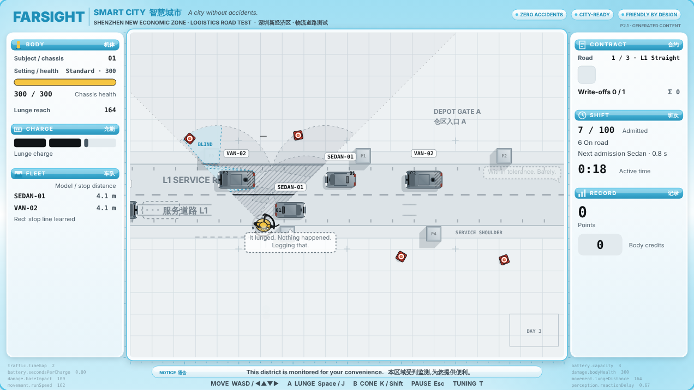 |
| 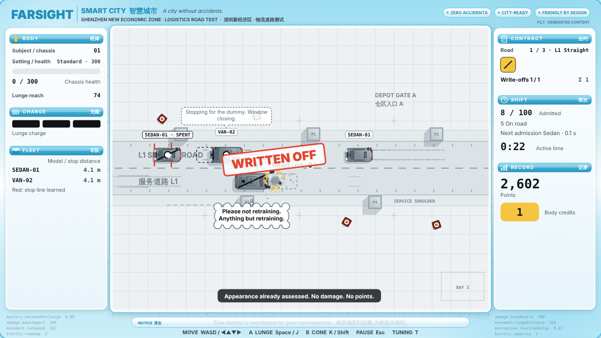 | 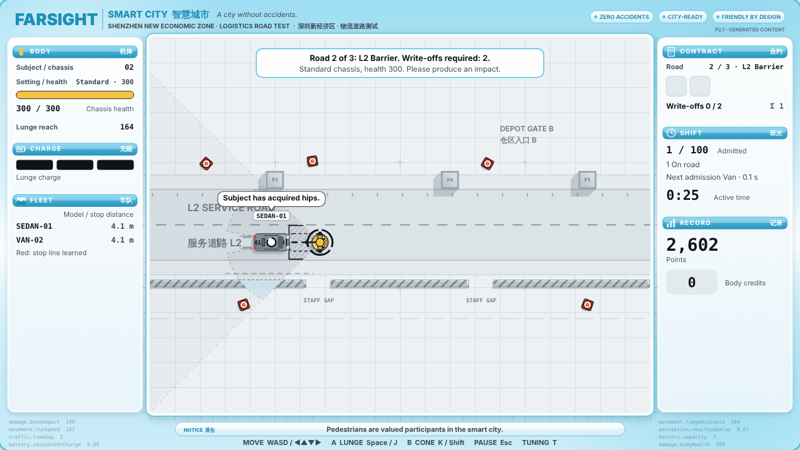 |
| 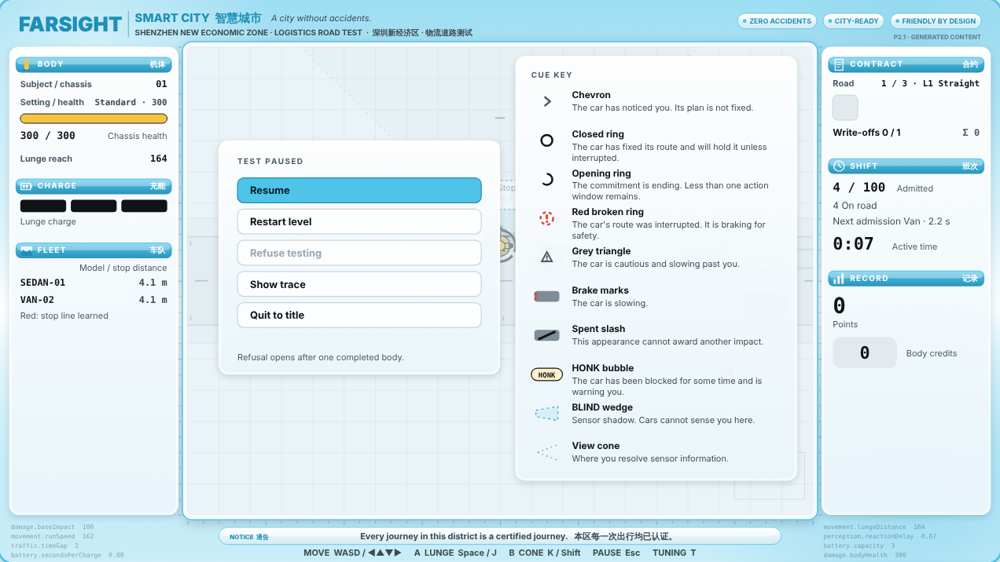 | 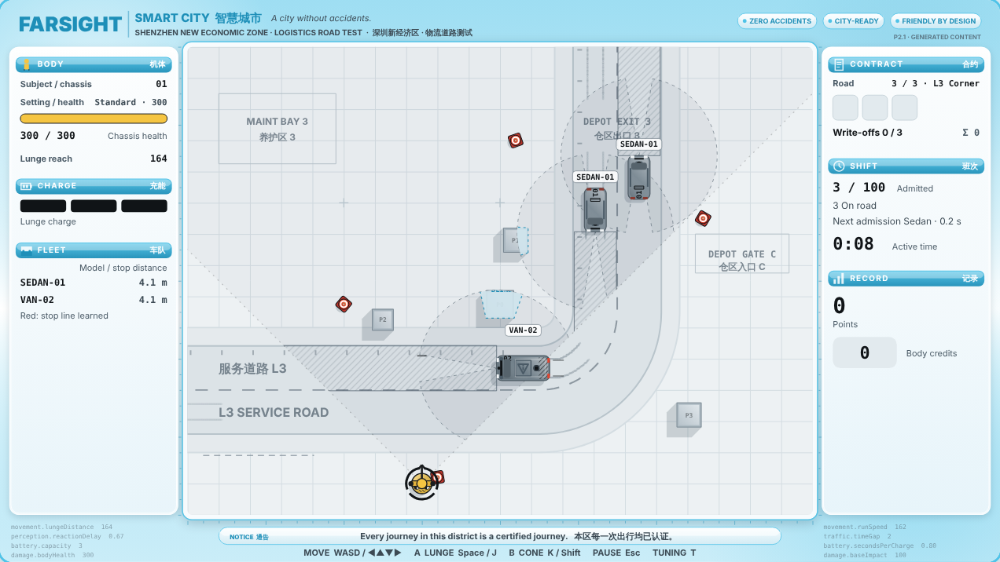 |

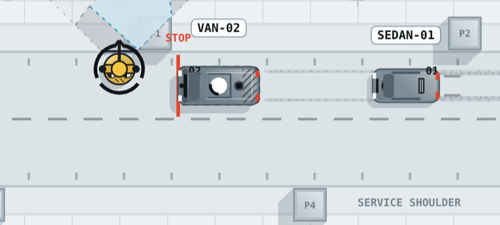

## 10. Runs

| Run | Type | Result |
|---|---|---|
| `20261015-084457` | barks | Accepted, 3 rounds. Superseded by T8. |
| `20261015-084459` | hits | Accepted, 3 rounds, one open fix-level issue. Led to T10. |
| `20261015-084501` | terminal | Accepted, 2 rounds. Superseded by T9. |
| `20261015-085359` | barks | Accepted, 2 rounds. **Published.** |
| `20261015-085401` | terminal | Accepted, 2 rounds. **Published.** |
| `20261015-085446` | hits | Accepted, 3 rounds, clean. **Published.** |
| `20261015-010807` … `014041` | juice, interface, graphics | P2.0 runs (appendix). |

Agents ran on `claude-sonnet-5-5` through Claude Code. A P2.1 type takes 4–6 calls and 1.5–8 minutes of model time.

## 11. Limitations

- **No player has seen P2.1.** Humour, juice and skin fit are self-assessed.
- **Derived cases are renderer judgements.** Near miss and miss thresholds are `proto.barks.*` IDs, not sim rules. They are logged, so barks stay truthful to the trace, but the sim does not know about them.
- **The critic is not an oracle.** It misses things (T8, T9) and once fought a stale contract (T10). Validators hold the hard rules.
- **Juice is a starting table.** 152 proposed IDs, none promoted to the registry. Sound is placeholder synthesis.
- **Chinese text is unreviewed.** All of it carries `review: pending` (D9.2).
- Re-running produces different content. The game stays deterministic; `sim.js` is unchanged.

## Appendix: P2.0 foundation (juice, interface, graphics)

P2.0 filled three earlier gaps with the same pipeline: data-driven juice for 14 sim events with tyre marks and a chassis drop (Edit 31), the D10.5 HUD modules, a cue key and a FARSIGHT copy deck (Edit 32), and vehicle liveries, dummy markings and bilingual district signage (Edit 33). P2.1 keeps all three; its barks supersede the 11 P2.0 barks.

| Run · type | Kind | Found | Canon | Corrected |
|---|---|---|---|---|
| 013357 · interface | truth | Bark: "{model} hit. Down {lost} health. My shift is late." | `DESIGN#D9.3` | "{model} hit. {lost} health lost. That goes on my record." |
| 012152 · interface | truth | Impact bark: "No accident detected. Please improve." | `DESIGN#D9.3`: a bark cannot deny a recorded hit | "Impact recorded. I have a delivery to make." |
| 012152 · graphics | rule | Sign: "充电位 CHARGE" | `DESIGN#D10.3`: decoration implies no mechanic | "车位 FLEET BAY" |
| 013357 · juice | rule | Denied action: `flinch: true` | `DESIGN#D4.5`: a denial costs nothing | `false` |

| # | Kind | Change |
|---|---|---|
| T1 | Retrieval | Fill the context round-robin across queries, not query by query. |
| T2 | Prompt | Give the generator the sim event fields, slot purposes and voices. |
| T3 | Prompt | Precedence: P1 decisions override DESIGN. |
| T4 | Prompt + loop | Critic reviews every string in one pass; settled fixes cannot be reversed. |
| T5 | Validator | Particles only for events located at the dummy (a critic finding made a rule). |
| T6 | Retrieval | Two interface queries: node effects, blind spots. |
| T7 | Validator | From screenshots: no barrier-coloured decals; sign text fits its board. |

P2.0 runs: `20261015-010807` (baseline, not published), `012152`, `013357` (published juice and interface), `013537`, `014041` (published graphics). They first published to `prototypes/p1/` (labelled P1.10) and moved to `prototypes/p2/` unchanged.
