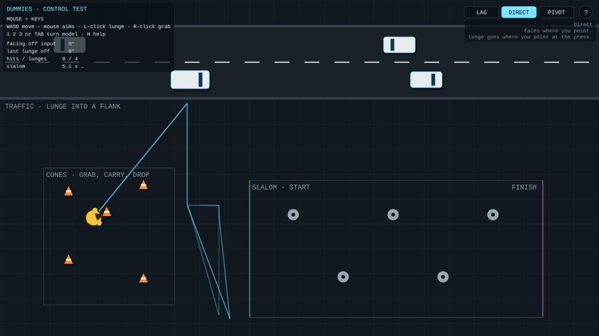
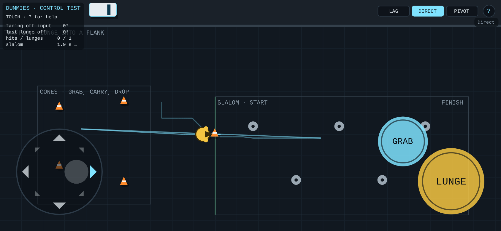
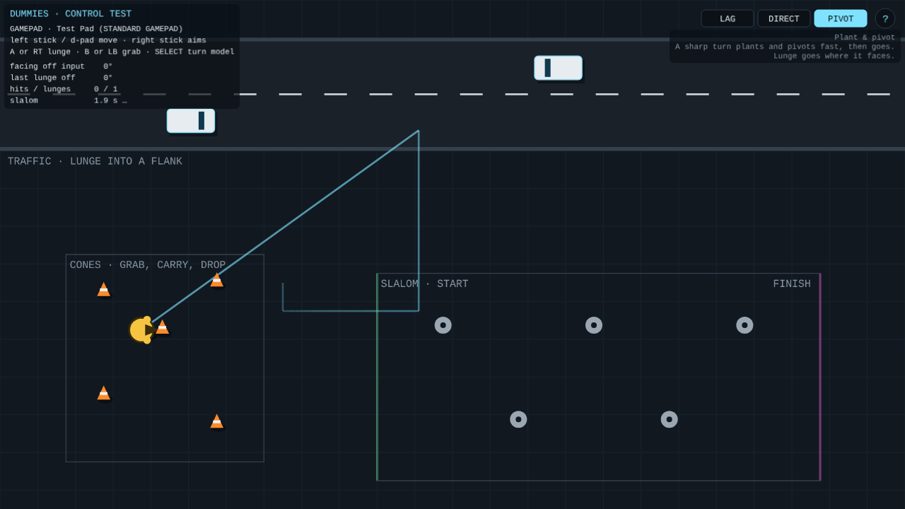
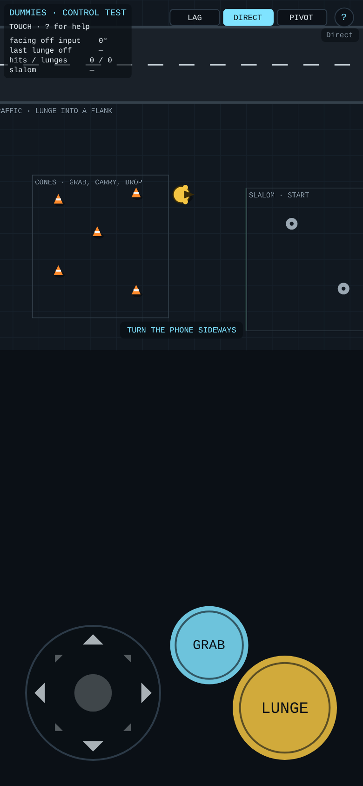
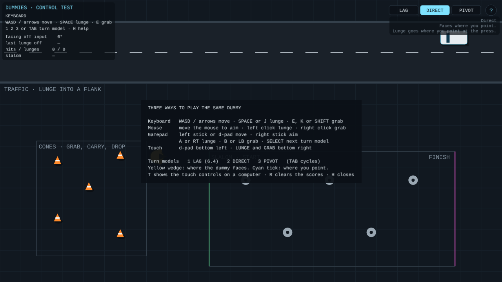

# DUMMIES — Controls prototype (Phaser)

**27 October 2026 · Lawrence Lek** · Spec: GDD Edit 73 (proposed). A small test yard, separate from the game. Prototype 6.4 is unchanged.

One dummy, three ways to play it, three ways for it to turn. Traffic to lunge at, cones to grab, a slalom to turn through.

- **`dummies_controls.html`:** the test, one file with Phaser 3.90.0 inside. Opens offline in a browser; no server. Use this one with a gamepad.
- **`controls_page.html`:** the same page for hosting (Phaser from jsDelivr). Published as a page to open on a phone.
- **`core.js`:** the dummy's movement and the three turn models. No Phaser; the tests run it headless.
- **`app.js`:** the Phaser yard and HUD: input from keys, mouse, gamepad and touch merged into one intent.
- **`build.js`:** `node build.js` → both pages. Reads every number from `content/params/tuning.parameters.json`.
- **`test_controls.js`:** `node test_controls.js [folder]` → the checks; screenshots into the folder.
- **`vendor/`:** Phaser 3.90.0 (MIT, `PHASER_LICENSE.md`).

## Controls

| | Move | Lunge | Grab | Aim | Turn model |
|---|---|---|---|---|---|
| Keyboard | WASD / arrows | SPACE or J | E, K or SHIFT | — | 1 2 3, TAB |
| Mouse + keys | WASD | left click | right click | the pointer, for `proto.input.mouseAimSeconds` after it moves | 1 2 3, TAB |
| Gamepad (standard) | left stick or d-pad | A or RT | B or LB | right stick | SELECT |
| Touch | d-pad, bottom left | LUNGE, bottom right | GRAB, above LUNGE | — | tap a chip, top right |

- **Stick:** radial dead zone `proto.input.deadzone` (0.2); full at `proto.input.stickOuter` (0.9); speed scales with tilt.
- **Aim stick:** past `proto.input.aimDeadzone` (0.35).
- **Touch d-pad:** `proto.input.dpadDirections` (8) directions; dead centre `proto.input.dpadDead` (0.25 of the radius). The whole lower left takes the thumb; it may slide.
- **Touch sizes (CSS px):** d-pad `ui.touch.dpadRadius` (72); LUNGE `ui.touch.lungeRadius` (56); GRAB `ui.touch.grabRadius` (42); `ui.touch.margin` (28) from the edges and safe areas.
- **Phone:** the view follows the dummy, about 430 units tall. A computer shows the whole yard.
- **H** or **?**: help. **T**: touch controls on a computer. **R**: clear the scores.

## Turn models (`proto.turnModel`)

| | 1 LAG (6.4) | 2 DIRECT | 3 PIVOT |
|---|---|---|---|
| Movement | Where the input points, at once | Same | Same; plants past `movement.pivotAngle` (90°) |
| Facing | Follows at `movement.turnRate` (180°/s) | Follows at `movement.directTurnRate` (1080°/s) | Follows at `movement.pivotRate` (720°/s) |
| Speed while turning | × `movement.turningSpeedFraction` (0.6) past `movement.alignThreshold` (30°) | Full | Full; 0 while planted |
| Reversal | Stops (`movement.counterPressAngle` 135°) | No stop | Plants and pivots |
| Lunge goes | Where it faces | Where the player points at the press | Where it faces |
| Lunge 0.1 s after a 90° turn | 72° off | 0° | 18° off |
| Lunge 0.1 s after a 180° turn | 162° off | 0° | 108° off |
| Ground covered 0.5 s after a 180° turn | 15 | 82 | 28 |

- **The wander in 6.4:** the body moves at once, but faces the old way for half a second. It crabs, slows to 60%, and a lunge goes where it faced.
- **Default:** DIRECT. The yellow wedge shows the facing; the cyan tick shows where the player points.

## Evidence

- `node test_controls.js docs` → 22/22.
  - Headless: the three models' lunge error and turn cost (table above).
  - Keyboard: D moves; per model, a lunge 0.1 s after a 90° turn: LAG 72° off, DIRECT 0°, PIVOT 6–18°.
  - Mouse: the pointer aims; left click lunges toward it; right click grabs.
  - Gamepad (emulated, standard mapping): half tilt walks, full tilt runs; A lunges; B grabs; the right stick aims; SELECT steps the model.
  - Touch (844 × 390, two fingers): the d-pad moves and slides to diagonals; LUNGE while the thumb holds the d-pad; GRAB.
  - No page errors.

## Known gaps

- Gamepads need the downloaded file in a desktop browser. A hosted page may block the gamepad feature.
- No battery, damage or scoring: this yard tests input and turning only.
- Torso damage slows turning in 6.4. Under DIRECT, turning costs nothing; damage needs another outlet (D46).
