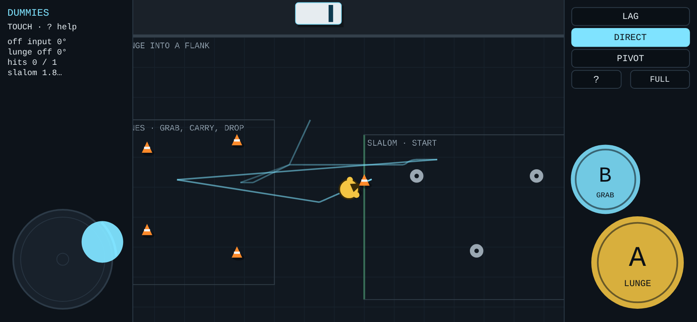
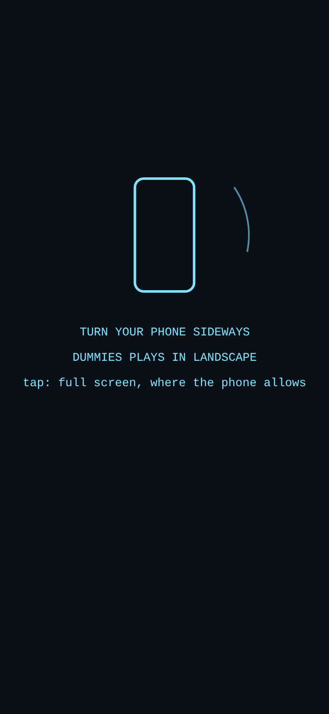
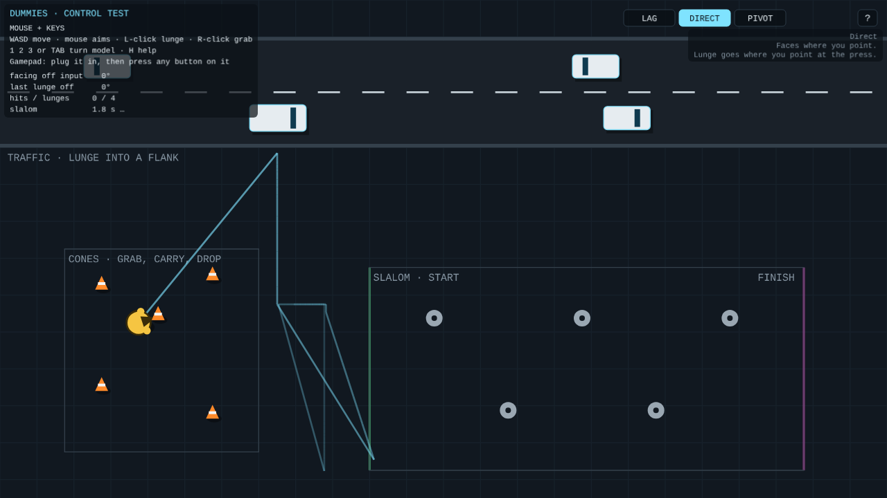
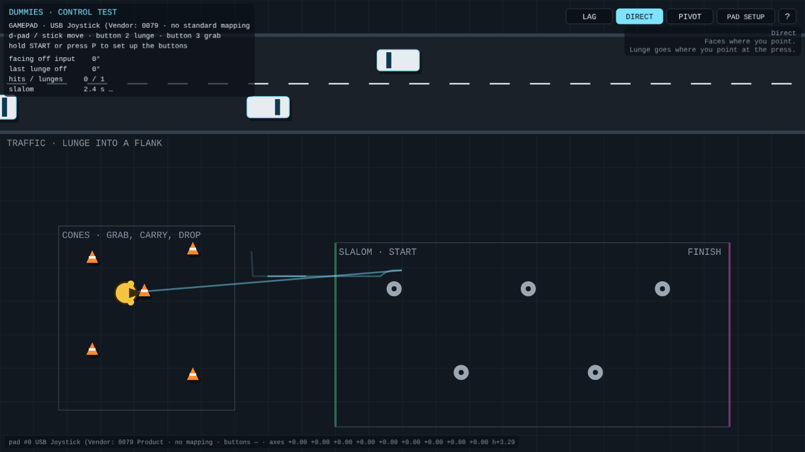
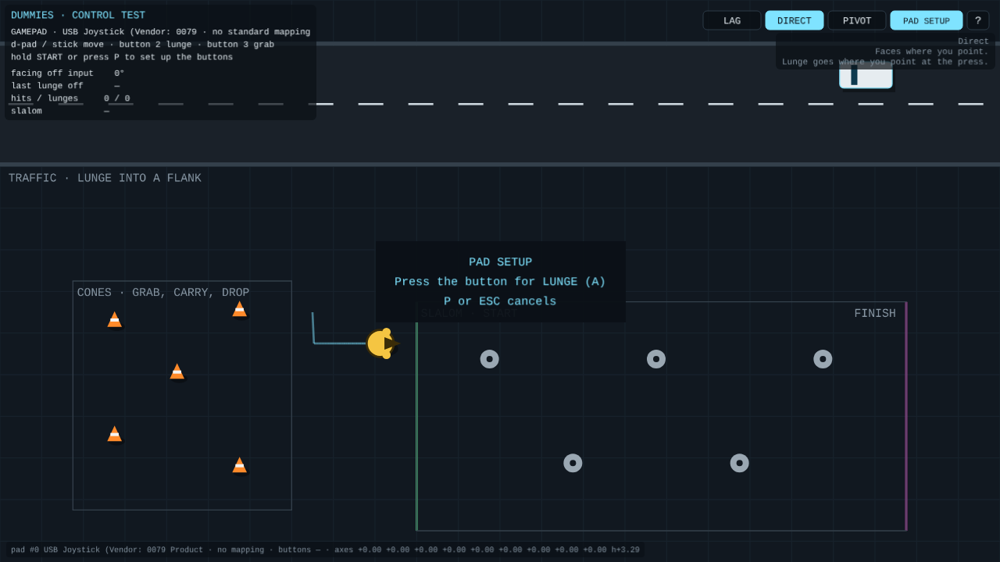
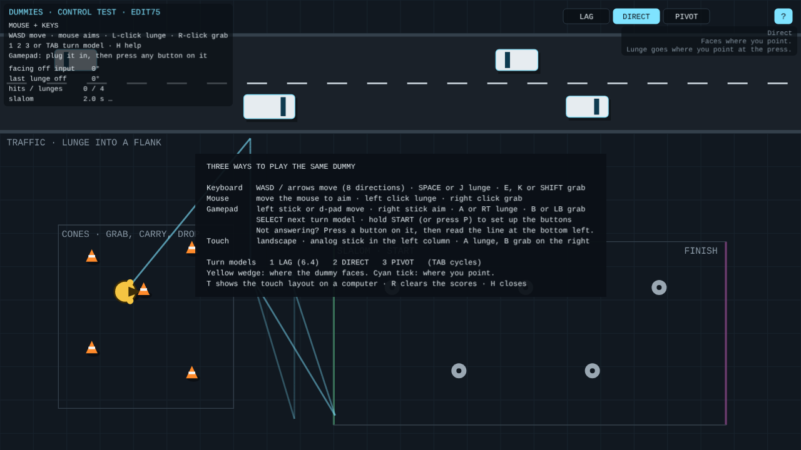

# DUMMIES — Controls prototype (Phaser)

**27 October 2026 · Lawrence Lek** · Spec: GDD Edits 73 and 74 (proposed). The title shows the build ("CONTROL TEST · EDIT78"). DIRECT went into the game in Prototype 6.5 (Edit 75). The jump has its own yard, `../jump/` (Edit 76), on this folder's `core.js` and `pads.js`. A small test yard, separate from the game. Prototype 6.4 is unchanged.

One dummy, three ways to play it, three ways for it to turn. Traffic to lunge at, cones to grab, a slalom to turn through.

- **`dummies_controls.html`:** the test, one file with Phaser 3.90.0 inside. Opens offline in a browser; no server. Use this one with a gamepad.
- **`controls_page.html`:** the same page for hosting (Phaser from jsDelivr). Published as a page to open on a phone.
- **`core.js`:** the dummy's movement, the three turn models, the stick curve. No Phaser; the tests run it headless.
- **`pads.js`:** gamepads of any kind: phantom devices, no standard mapping, hat d-pads, button setup, the monitor line. Shared with Prototype 6.5 (four actions; Edit 75).
- **`app.js`:** the Phaser yard and HUD: keys, mouse, gamepad and touch merged into one intent.
- **`build.js`:** `node build.js` → both pages. Reads every number from `content/params/tuning.parameters.json`; fails on a missing or retired ID.
- **`test_controls.js`:** `node test_controls.js [folder]` → the checks; screenshots into the folder.
- **`vendor/`:** Phaser 3.90.0 (MIT, `PHASER_LICENSE.md`).

## Controls

| | Move | Lunge | Grab | Aim | Turn model |
|---|---|---|---|---|---|
| Keyboard | WASD / arrows (8 directions) | SPACE or J | E, K or SHIFT | — | 1 2 3, TAB |
| Mouse + keys | WASD | left click | right click | the pointer, for `proto.input.mouseAimSeconds` after it moves | 1 2 3, TAB |
| Gamepad (standard) | left stick or d-pad | A or RT | B or LB | right stick | SELECT |
| Joypad (other mapping) | stick, or d-pad (hat axis or axes 6/7) | button 0, or set up | button 1, or set up | — | SELECT (button 8) |
| Touch (landscape) | analog stick, left column | A, right column, bottom | B, above-left of A | — | tap a chip, right column |

- **Stick:** radial dead zone `proto.input.deadzone` (0.2); full at `proto.input.stickOuter` (0.9); speed scales with tilt.
- **Aim stick:** past `proto.input.aimDeadzone` (0.35).
- **Touch stick:** analog. Any angle; speed scales with deflection.
  - Dead zone `proto.input.touchDeadzone` (0.12 of the radius); full at `proto.input.touchOuter` (0.85).
  - Floats (`proto.input.touchFloat` 1): centres where the thumb lands in the left column. Follows a thumb past its rim. Goes home on release.
- **Touch sizes (CSS px):** stick `ui.touch.stickRadius` (60); A `ui.touch.lungeRadius` (56); B `ui.touch.grabRadius` (42); `ui.touch.margin` (16) from the edges and safe areas.
- **Phone:** landscape only. A column each side; the yard between, about `ui.touch.viewHeight` (430) units tall, following the dummy. Upright: a full-screen "turn your phone sideways"; the dummy waits. FULL asks for full screen and a landscape lock, where the phone allows.
- **Gamepads:** every connected pad is read; the last one used drives. A phantom device in slot 0 no longer hides the real pad.
- **Pad setup:** P, the PAD SETUP chip, or hold START `proto.input.padSetupHoldSeconds` (1 s). Press the button for LUNGE, then GRAB. Saved per pad name in this browser. A short START press toggles help.
- **Pad monitor:** bottom left. Pad name, mapping, buttons held, axes (`h` marks a hat d-pad).
- **H** or **?**: help. **T**: touch controls on a computer. **R**: clear the scores. **ESC**: closes help or setup.

## If a joypad does nothing

1. Open `dummies_controls.html` from the computer, in Chrome or Edge. Not the hosted page.
2. Press any button on the pad. Browsers list a pad only after a press.
3. Read the monitor line, bottom left.
   - No line: the browser sees no pad. Re-plug it; try another USB port or browser.
   - A line, but no movement: move the d-pad and stick. Note which axes change.
   - Buttons do nothing: press P, then press LUNGE, then GRAB.
4. Send the monitor line if it still fails.

## Turn models (`proto.turnModel`)

| | 1 LAG (6.4) | 2 DIRECT | 3 PIVOT |
|---|---|---|---|
| Movement | Where the input points, at once | Same | Same; plants past `movement.pivotAngle` (90°) |
| Facing | Follows at `movement.turnRate` (180°/s) | Follows at `movement.directTurnRate` (1080°/s) | Follows at `movement.pivotRate` (720°/s) |
| Speed while turning | × `movement.turningSpeedFraction` (0.6) past `movement.alignThreshold` (30°) | Full | Full; 0 while planted |
| Reversal | Stops (`movement.counterPressAngle` 135°) | No stop | Plants and pivots |
| Lunge goes | Where it faces | Where the player points at the press | Where it faces |
| Lunge 0.1 s after a 90° turn | 72° off | 0° | 18° off |
| Lunge 0.1 s after a 180° turn | 162° off | 0° | 108° off |
| Ground covered 0.5 s after a 180° turn | 15 | 82 | 28 |

- **The wander in 6.4:** the body moves at once, but faces the old way for half a second. It crabs, slows to 60%, and a lunge goes where it faced.
- **Default:** DIRECT. The yellow wedge shows the facing; the cyan tick shows where the player points.

## Evidence

- `node test_controls.js docs` → 34/34.
  - Headless: the three models' lunge error and turn cost (table above).
  - Touch stick, headless: 360 angles keep their direction exactly; halfway between dead zone and outer edge → 0.50.
  - Pads, headless: a phantom resting at −1 in slot 0 does not take over; a hat d-pad on axis 9 moves right and up-left; setup maps buttons 2 and 3; a short START press toggles help.
  - Keyboard: D moves; per model, a lunge 0.1 s after a 90° turn: LAG 72° off, DIRECT 0°, PIVOT 18°.
  - Mouse: the pointer aims; left click lunges toward it; right click grabs.
  - Gamepad (standard, behind a phantom): half tilt walks (32 in 0.6 s), full tilt runs (91); A, B, right stick, SELECT.
  - Joypad (no mapping, hat on axis 9): the hat moves; P, then buttons 2 and 3, set LUNGE and GRAB; both work; holding START opens setup without help.
  - Touch, 844 × 390: columns 161 px; the yard 523 px between. Half deflection walks (27 in 0.5 s), full runs (55). Pushed at 20°, −65°, 160°: moves at 20°, −65°, 160°. The stick floats, drags, goes home. A while the thumb holds the stick: 0° off. B grabs.
  - Touch, 390 × 844: the sideways prompt covers the screen; the dummy stays put.
  - No page errors.

## Known gaps

- Gamepads need the downloaded file in a desktop browser. A hosted page may block the gamepad feature; the HUD says so when it does.
- iPhones refuse full screen and the orientation lock for pages; the sideways prompt still shows.
- No battery, damage or scoring: this yard tests input and turning only.
- Torso damage slows turning in 6.4. Under DIRECT, turning costs nothing; damage needs another outlet (D46).
