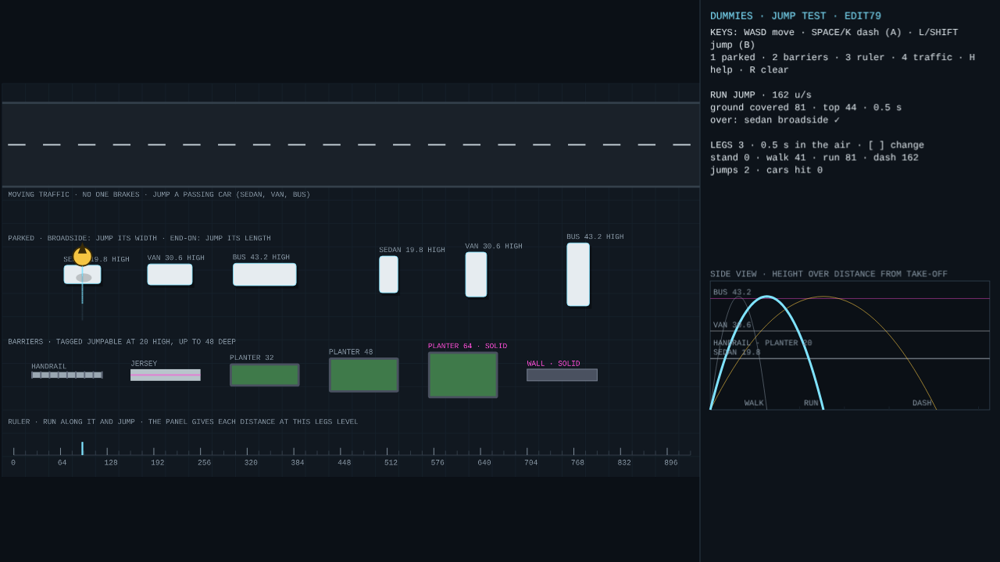
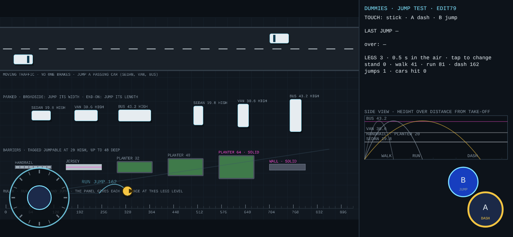
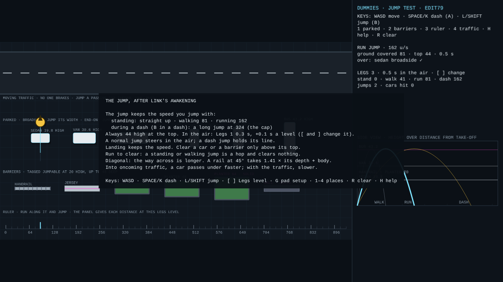

# DUMMIES — Jump test (Phaser)

**27 October 2026 · Lawrence Lek** · Spec: GDD Edits 76–79 (proposed). A small yard for the jump, separate from the game. The title shows the build ("JUMP TEST · EDIT79"). The same rules run in Prototype 6.9.

The jump after Link's Awakening: it keeps the speed it takes off with. Moving traffic, parked cars broadside and end-on, barriers from a handrail to a wall, a ruler. A side view charts each jump against the heights it must clear.

- **`dummies_jump.html`:** the test, one file with Phaser 3.90.0 inside. Opens offline in a browser; no server. Use this one with a gamepad.
- **Live (GitHub Pages):** https://lawrencelek.github.io/ELVTR-Multiagent-Submission-5/jump/
- **`jump_page.html`:** the same page for a host (Phaser from jsDelivr).
- **`jump.js`:** the jump's rules. No Phaser; shared with Prototype 6.6 (`sim.js`); the tests run it headless.
- **`app.js`:** the yard and the panel. Moves with `../controls/core.js` (DIRECT); pads through `../controls/pads.js`.
- **`build.js`:** `node build.js` → both pages. Reads every number from `content/params/tuning.parameters.json`; fails on a missing or retired ID.
- **`test_jump.js`:** `node test_jump.js [folder]` → the checks; screenshots into the folder.

## The jump

- **Height and time:** always `upgrades.jumpHeight` (44) at the top. Time in the air by Legs level (Edit 78): `abilities.legs.airtimeBase` (0.3 s) + `abilities.legs.airtimeStep` (0.1 s) per level: 0.3, 0.4, 0.5 s (`abilities.maxLevel` 3). The yard opens at Legs 3 (0.5 s); [ and ] change it, or tap the panel.
- **Distance = take-off speed × airtime.** Speed sets the distance; the arc's shape never changes.

| Take-off | Speed (u/s) | Ground covered | From |
|---|---|---|---|
| Standing | 0 | 0, straight up | — |
| Walking | 81 | 41 | `movement.walkSpeed` |
| Running | 162 | 81 | `movement.runSpeed`, after `movement.rampSeconds` (1 s) |
| Dash jump (B during a dash) | 324 | 162 | the dash's speed, capped at `upgrades.jumpMaxSpeed` |

- **Air steering:** a normal jump turns toward the stick at `upgrades.jumpAirAccel` (324 u/s²). A running jump bends about 28 across its flight. No input: momentum holds.
- **Dash jump:** committed. No steering.
- **Landing:** keeps the speed; the dummy runs on. No dash or jump for `upgrades.jumpRecovery` (0.1 s).
- **Run to clear** (`proto.jump.runToClear`; decided 27 October): a standing or walking jump is a hop. It rises, but meets everything as on the ground. Only a running jump or a dash jump clears.
- **Clearing:** the dummy passes over a thing only while above its top. Cars: `vehicles.<class>.height` × `vehicles.scale`. Jumpable barriers: `world.jumpableHeight` (20).
  - The whole body (`body.radius` 13, so 26 wide) must cross while above it.
  - Ground needed above the top = depth + 26.

## By Legs level (run / dash jump, square on)

| Thing | Legs 1 (0.3 s) | Legs 2 (0.4 s) | Legs 3 (0.5 s) |
|---|---|---|---|
| Handrail | ✓ / ✓ | ✓ / ✓ | ✓ / ✓ |
| Jersey | ✗ / ✓ | ✓ / ✓ | ✓ / ✓ |
| Planter 32 | ✗ / ✓ | ✗ / ✓ | ✓ / ✓ |
| Planter 48 | ✗ / ✗ | ✗ / ✓ | ✗ / ✓ |
| Sedan broadside | ✗ / ✓ | ✗ / ✓ | ✓ / ✓ |
| Van broadside | ✗ / ✗ | ✗ / ✓ | ✗ / ✓ |
| Sedan end-on | ✗ / ✗ | ✗ / ✓ | ✗ / ✓ |
| Van end-on | ✗ / ✗ | ✗ / ✗ | ✗ / ✓ |
| Bus | ✗ / ✗ | ✗ / ✗ | ✗ / ✗ |

- A running jump covers 49, 65, 81; a dash jump 97, 130, 162.
- Legs 1's running jump over a handrail has 2 to spare: about one frame at a run.

## What clears what at Legs 3 (best take-off point)

| Thing | High | Deep | Walk (hop) | Run | Dash jump |
|---|---|---|---|---|---|
| Handrail | 20 | 8 | ✗ | ✓ | ✓ |
| Jersey barrier | 20 | 16 | ✗ | ✓ | ✓ |
| Planter | 20 | 32 | ✗ | ✓ (+2) | ✓ |
| Planter | 20 | 48 (`world.jumpableDepth`) | ✗ | ✗ | ✓ |
| Planter (not tagged) | 20 | 64 | ✗ | ✗ | ✗ |
| Wall | 40 | 16 | ✗ | ✗ | ✗ |
| Sedan, broadside | 19.8 | 25.2 | ✗ | ✓ | ✓ |
| Van, broadside | 30.6 | 28.8 | ✗ | ✗ | ✓ |
| Bus, broadside | 43.2 | 30.6 | ✗ | ✗ | ✗ |
| Sedan, end-on | 19.8 | 50.4 | ✗ | ✗ | ✓ |
| Van, end-on | 30.6 | 61.2 | ✗ | ✗ | ✓ (+2) |
| Bus, end-on | 43.2 | 86.4 | ✗ | ✗ | ✗ |

- Brackets: units to spare (+) or short (−) at the best take-off. Within 4 of the edge, the timing decides.
- **Moving traffic:** crossing a lane is a broadside jump. Time it so the car is under the dummy at the top.
- **Standing jump in a lane:** a sedan passes 51 under the dummy while it is above the roof. It needs 76. Jump across a car, not over one in place.
- **A walking jump clears nothing:** the rule, and the sums agree (a handrail is 4 short).

## Diagonal jumps

- **Off square, the way across is longer:** the path over a long rail at angle θ is (depth + 26) ÷ cos θ. At 45°: × 1.41.
- **Short things:** a steep line exits through the side. The path is the shorter of (depth + 26) ÷ cos θ and (length + 26) ÷ sin θ. `jump.js` `inside()`.

| Thing | Run 0° | Run 30° | Run 45° | Dash 0° | Dash 30° | Dash 45° |
|---|---|---|---|---|---|---|
| Handrail | ✓ | ✓ | ✓ | ✓ | ✓ | ✓ |
| Jersey | ✓ | ✓ | ✓ | ✓ | ✓ | ✓ |
| Planter 32 | ✓ | ✗ | ✗ | ✓ | ✓ | ✓ |
| Planter 48 | ✗ | ✗ | ✗ | ✓ | ✓ | ✓ |
| Sedan broadside | ✓ | ✓ | ✗ | ✓ | ✓ | ✓ |
| Van broadside | ✗ | ✗ | ✗ | ✓ | ✓ | ✓ |
| Sedan end-on | ✗ | ✗ | ✗ | ✓ | ✓ | ✓ |
| Van end-on | ✗ | ✗ | ✗ | ✓ | ✗ | ✓ |
| Bus, either way | ✗ | ✗ | ✗ | ✗ | ✗ | ✗ |

- **Widest angle for a running jump:** a handrail 55°; a sedan broadside 32°.
- **Van end-on at 45°:** the line cuts across the van's side, not its length. Shorter than at 30°.
- **Moving cars:** what counts is the jump's speed against the car's. A sedan at cruise (138):
  - Square on (running): 0.32 s over its footprint; above its roof 0.37 s. Clears.
  - 45° into its path: 0.30 s. Clears, with more room.
  - 45° with the traffic: 0.45 s. The car follows the dummy. Struck.
- **Keys:** 8 directions, so diagonals are 45°. A stick gives any angle.

## Controls

| | Keys | Gamepad | Touch (phones and tablets, landscape) |
|---|---|---|---|
| Move | WASD / arrows | left stick or d-pad | stick, floats to the thumb, left 45% |
| Dash | SPACE or K | A (or RT) | A, bottom right |
| Jump | L or SHIFT | B | B, above-left of A |
| Places | 1 parked · 2 barriers · 3 ruler · 4 traffic | — | — |
| Clear the record | R | — | — |
| Help | H | START (short press) | — |
| Diagonal | two keys (45°) | stick, any angle | stick, any angle |
| Legs level | [ and ] | — | tap the panel |
| Pad setup | G | hold START 1 s | — |

- **Touch shows only on touch devices:** `(hover: none) and (pointer: coarse)`, or `#touch` in the address.
- **Sizes:** stick `ui.touch.stickRadius` (60 CSS px); A 1.2 × `ui.touch.faceRadius` (30); B 0.86 × A; `ui.touch.margin` (16). Shrink below 480 px tall.
- **Upright phone:** "turn your phone sideways".
- **Panel:** the last jump (kind, speed, ground covered, top, what it cleared ✓ or struck ✗). The side view: walk, run and dash arcs; the last six flights; heights of a handrail, sedan, van and bus.

## Evidence

- `node test_jump.js docs` → 28/28.
  - Edits 78–79: the table by Legs level, by sum; a running jump on the ruler covers 49, 65, 81 at Legs 1–3.
  - Headless: the rule; the cap; the arc; the table above.
  - Yard, stepped at 120 Hz: the ruler gives 0, 41, 81, 162 and a 44 top. A running jump bends 28 toward the stick; a dash jump holds its line. Landing keeps 162; a jump at once is refused.
  - Yard, every thing above × walk, run, dash: 34 of 34 firm cases match the sums. The two edge cases cleared.
  - Moving traffic: a running jump crosses a passing sedan; a walking jump strikes it. A dash jump crosses a van; a running jump does not. A bus strikes every jump. A standing jump as a sedan arrives: struck.
  - Run to clear: a walking jump at a rail 1 deep hops and is held; with `proto.jump.runToClear` 0 its arc clears it.
  - At 45°, stepped: handrail (run), jersey, planters 32 and 48, sedan and van broadside (dash) clear; a sedan broadside on a run does not. 7 of 7 firm cases match the sums.
  - A moving sedan at 45°: running into its path clears; running with the traffic is struck.
  - Keys, a standard gamepad (B; A then B), touch at 844 × 390, upright; no touch at 1280 × 720. No page errors.

## Decided

- **D51 (27 October):** run to clear. A walking jump hops and clears nothing.
