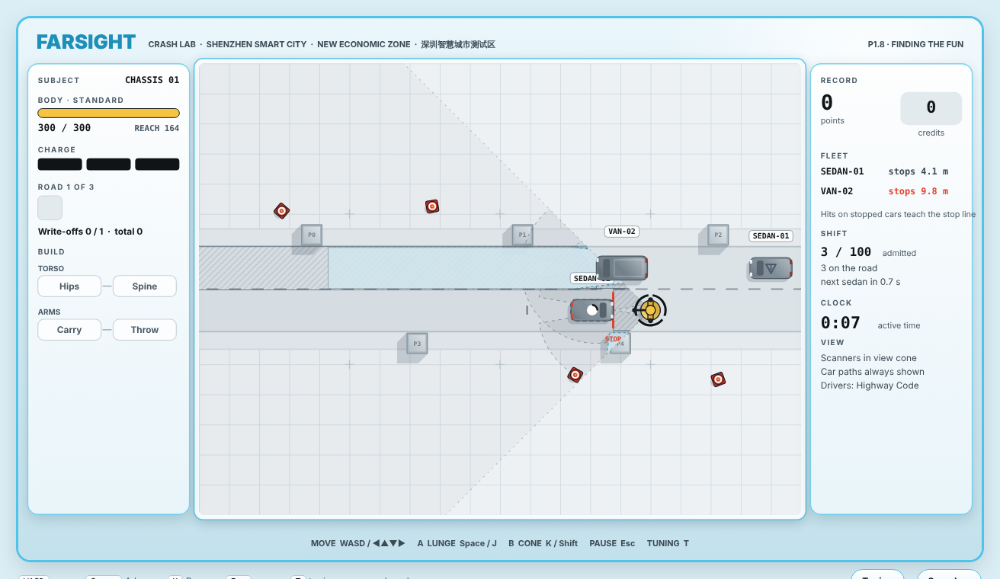
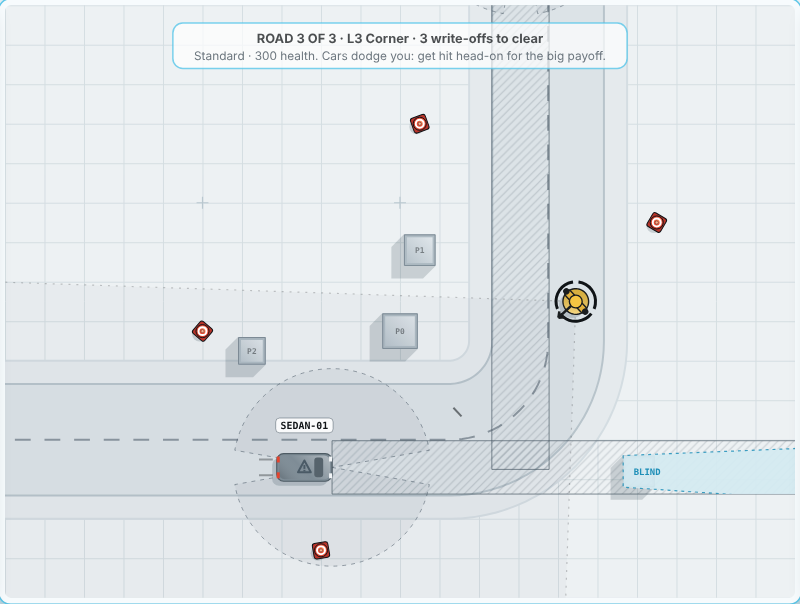

# DUMMIES — P1 Prototype: Finding the Fun

**Frozen at P1.9 · 15 October 2026 · Lawrence Lek**

**P1.10 · Generated content.** Presentation only; `sim.js` unchanged. Juice, HUD, copy, barks and art come from `content/*.json`, written by the [content pipeline](../../content/README.md). Delete `content.js` and rebuild to get P1.9 back.

A loose greybox prototype for one question: is baiting and lunging into cars fun? It covers dummy movement, two upgrade branches (Hips → Spine, Carry → Throw), three roads, Sedan and Van, and Highway Code drivers.

## Play

Open `dummies_p1.html` in a browser. No install, no server.

| Control | Keys |
|---|---|
| Move | WASD or arrows |
| Lunge | Space or J |
| Cone (Carry/Throw) | K or Shift |
| Pause | Esc |
| Tuning panel | T |

- **Campaign:** L1 Straight → L2 Barrier → L3 Corner. 1, 2, then 3 write-offs to clear.
- **Difficulty:** Body health is constant across roads. Fragile 200, Standard 300, Reinforced 600.

## Files

| File | Role |
|---|---|
| `dummies_p1.html` | Playable build. Single file. |
| `sim.js` | Deterministic 60 Hz simulation. No DOM. |
| `game.js` | Renderer, input, UI, audio, tuning panel. |
| `shell.html`, `build.py` | Page wrapper. `python3 build.py` bundles `sim.js` + `content.js` + `game.js` into the HTML. |
| `content/*.json`, `content.js` | Generated juice, interface and graphics content (P1.10). Regenerate with `python content/pipeline.py`. |
| `test_sim.js` | Headless tests. `node test_sim.js` → 34/34. |
| `policy_check.js` | Bot play styles: stand in lane, blind lunge, read and lunge. |
| `car_metrics.js` | Car predictability: swerves per car, interrupts, yaw. |
| `DUMMIES_P1_Prototype_Brief.md` | Slice brief. |
| `DUMMIES_Prototype_Log.md` | Designer observations O1.1–O1.29, each build P1.0–P1.9, freeze record. |
| `DUMMIES_Driver_Behaviour.md` | Driver spec: Highway Code numbers, keep-right rules, sensors, unsticking, profiles. |
| `history/` | Source snapshot per build. |

## Where it ended

- **Drivers:** UK Highway Code numbers, mirrored for right-hand traffic. Stop 4 m short of the dummy. Pass slowly after 8 s.
- **Fleet learning:** A hit on a stopped car pushes that model's stop line back. Carries across roads.
- **Sensors:** Straight along the heading. Bends become blind corners.
- **Unsticking:** A car in the wrong lane reverses and returns. A stalled plan is dropped after 3 s.
- **Damage:** Newtonian impulse with recoil.

## Carried to P2

- Scanner view as an unlock (O1.2).
- Chassis progression (O1.3).
- Handling loss with wear (O1.4).
- Road surfaces (O1.5).
- Vehicle profiles: Courier, Learner, Emergency, Rattled, Bus (O1.24).
- Open: bend speed, L3 balance, patient-pass loophole, roadside diagonal lunge.
