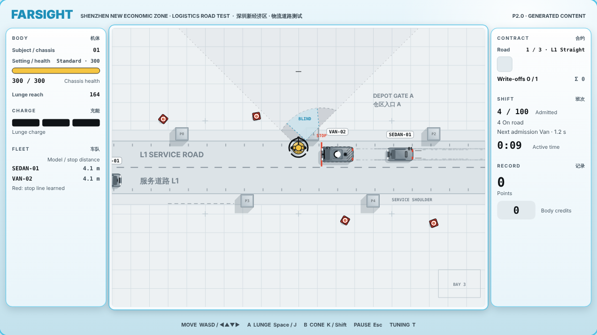

# DUMMIES — P2 Prototype: Generated Content

**P2.0 · 15 October 2026 · Lawrence Lek**

P1.9's simulation with a presentation layer generated from the GDD. Gameplay is unchanged. Juice, HUD, copy, vehicle barks and art come from `content/*.json`, written by the [content pipeline](../../content/README.md). P1 stays frozen at P1.9.



## Play

Open `dummies_p2.html` in a browser. No install, no server.

| Control | Keys |
|---|---|
| Move | WASD or arrows |
| Lunge | Space or J |
| Cone (Carry/Throw) | K or Shift |
| Pause and cue key | Esc |
| Tuning panel | T. Generated `proto.juice.*` and `proto.ui.*` IDs appear as sliders. |

- **Campaign:** L1 Straight → L2 Barrier → L3 Corner. 1, 2, then 3 write-offs. Same as P1.9.
- **Difficulty:** Fragile 200, Standard 300, Reinforced 600. Same as P1.9.

## What P2 adds over P1.9

| Layer | Source | In play |
|---|---|---|
| Juice | `content/juice.json` | 14 event responses, all on parameter IDs. Persistent tyre marks. Replacement chassis lowered on a cable. |
| Interface | `content/interface.json` | HUD in the D10.5 modules. Cue key on pause. FARSIGHT copy. Worker barks bound to logged events. |
| Graphics | `content/graphics.json` | Roof liveries: SEDAN-01 depot parcel courier, VAN-02 lane maintenance. Quadrant targets on the dummy. Bilingual signage per road. |

- **Unchanged:** `sim.js` is byte-identical to P1.9. `node test_sim.js` → 34/34.
- **Fallback:** Without `content.js` the build runs the P1.9 presentation.
- **Chinese text:** All marked review pending (D9.2).

## Files

| File | Role |
|---|---|
| `dummies_p2.html` | Playable build. Single file. |
| `sim.js` | P1.9 simulation, unchanged. |
| `game.js` | P1.9 renderer plus the content layer: data-driven juice, HUD modules, cue key, copy, barks, vector art. |
| `content/*.json`, `content.js` | Generated content and its bundle. Do not hand-edit. |
| `shell.html`, `build.py` | `python3 build.py` bundles `sim.js` + `content.js` + `game.js`. |
| `test_sim.js`, `policy_check.js`, `car_metrics.js` | P1.9 tests and bots, run against the same sim. |

## Regenerate

```
python content/pipeline.py              # all three types; republishes here and rebuilds dummies_p2.html
python content/pipeline.py --check      # re-validate published content, no model calls
```

## Prototype-only parameters

| ID group | Count | Spec |
|---|---:|---|
| `proto.juice.*` | 68 | `content/out/DUMMIES_GDD_Edit31_Juice.md` |
| `proto.ui.barkSeconds`, `proto.ui.barkCooldown` | 2 | `content/out/DUMMIES_GDD_Edit32_Interface.md` |

None promoted to the registry.

## Questions for the P2 session

- Do tyre marks read as the test's record, or as noise?
- Does anyone read a bark at play speed? Do barks sound like workers?
- Does the HUD answer "how am I doing" without the old VIEW panel?
- Does the road feel like a district? Does any sign read as cover?

## Known issues

- No player has seen P2.
- Bark "Move it! I have a delivery window." breaks the polite worker voice (D9.3).
- Graphics: one open fix-level item. A corner kerb line is declared shoulder but sits on the verge.
