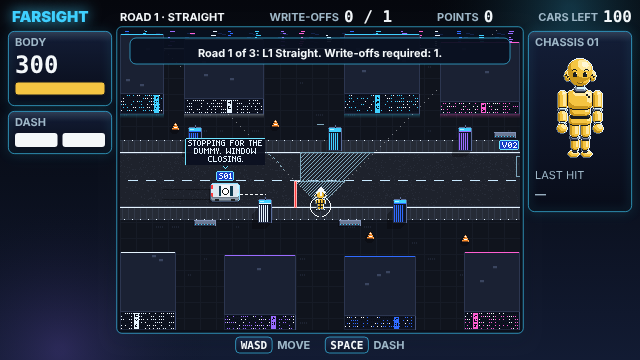

# DUMMIES — P3 Prototype: 16-bit Aero

**P3 · 20 October 2026 · Lawrence Lek**

P2.2's simulation in the GDD Edit 37 art direction, with the Sinofuturist cyber city as canon (Edit 39). Pixel-art field inside the FARSIGHT glass frame. Screen 640 × 360 art pixels. Field 400 × 300 at (120, 30).

- **Simulation changes:** solid city statics (city v2, ~25% buildings); part damage that cuts abilities; two dash charges, shortened by leg damage.
- **Voice:** barks from `content/db/fleet.json`, checked by `check_lore.py`.
- Everything else is P2.2.

## Play

Open `dummies_p3.html` in a browser. No install, no server. **Full screen** fills the display at the largest whole scale.

| Control | Keys |
|---|---|
| Move | WASD or arrows |
| Dash (the lunge) | Space or J |
| Cone (after Carry) | K or Shift |
| Pause and cue key | Esc |
| Tuning panel | T |

Campaign, difficulty and quotas match P2.2.

## Display grids

| Grid | Size | Unit |
|---|---|---|
| Simulation | 800 × 600 | world units (`ui.playWidth` × `ui.playHeight`) |
| Art | 400 × 300 field, 640 × 360 screen | 1 art px = 2 world units (`ui.artScale` = 2) |
| Reference | 1280 × 720 | HUD and screens; 1 reference unit = 1 world unit |
| Device | 640 × 360 × k | k = whole number: 720p ×2, 1080p ×3, 1440p ×4, 4K ×6 |

- **Integer only.** The canvas is always a whole multiple of 640 × 360. Spare space shows sky.
- **Verified.** At 1080p every art pixel is a clean 3 × 3 block (120,000 of 120,000 cells).
- **Colliders unchanged.** `body.radius` 13 = dummy sprite 13 px wide. Sedan 28 × 14, van 34 × 16 art px.

## Pixel rules (Edit 37 §4.1.3)

- **No anti-aliasing.** Every mark is a whole art pixel. Translucency is colour math on whole pixels.
- **Generated, not painted.** `pixel.js` builds every sprite and ground at load. No image files.
- **Cars:** footprint extruded by `vehicles.<cls>.height` × `proto.art.extrusion` ÷ `ui.artScale`. 32 headings (11.25°). South face, 1-px outline, white roof, blue glass. Tail lights brighten when braking.
- **Pods:** 9-px towers, depth-sorted with cars and the dummy.
- **Dummy:** 13 × 19, four facings, six wear tints, dents and a cracked head. Eyes and ear nubs face south; one eye in profile. The nose vector gives the exact facing. Rim outline on dark ground (below).
- **Ground:** road, kerbs, dashes and paving from each level's centre line. Canal, lawns, flowers, hedges, trees. Hard shadows down-left (`proto.art.shadowScale`).

## Palettes

| Switch | Field | Frame | Cues |
|---|---|---|---|
| Default, `?palette=cyber` | Chongqing cyberpunk: dark deck plates, LED city blocks, neon spill, jersey barriers | Dark glass, cyan LED edges | Light on dark. Blue LED model tags. Red STOP line with a pink halo |
| `?palette=day` | Edit 37 eco-city: lawns, canal, white pods | FARSIGHT light glass | Dark on light |
| `?palette=night` | Chongqing night: dark lawns, lime-lit trees, LED-striped towers, river reflections, light strings | As cyber | As cyber |

- **Exclusive hues hold in both.** Yellow is the dummy alone. Red is the warning alone.
- **Night contrast (on road):** `cue.primary` 14.9:1 · `cue.secondary` 6.2:1 · `cue.warning` 4.5:1 (halo 9.2:1) · `dummy.body` 9.8:1.
- **Palettes never change play.** The city below is the same in all three.
- **X-ray pass (all palettes).** An occluded car or dummy shows as a checker of its own pixels.
- **Sinofuturist cyber is canon** (decision 113) and the default. Day and night stay as options.

### Outline on dark ground (cyber and night)

A black outline vanishes on a dark field. The background owns the darkest values. No sprite edge is black on dark ground.

- **Rim, not ink.** Every sprite's outer silhouette pixels become a rim. Edges facing up or right (the sun) take the light rim; others take the dark rim.
- **Inner lines stay dark.** Joints, seams and inner details keep their inks.
- **Value hierarchy.** The brighter the rim, the more the actor matters:

| Sprite | Light rim | Dark rim | Light rim on road |
|---|---|---|---:|
| Dummy, field and HUD | `dummy.rimLight` `#E6F4FF` | `dummy.rimDark` `#5E7080` | 14.2:1 |
| Cars | `fleet.rim` `#8FDFFF` | `fleet.rimD` `#3A4A66` | 10.7:1 |
| Cones | `prop.coneRim` `#F2A65A` | `prop.coneRimD` `#7A4420` | 7.9:1 |
| Jersey barriers | `structure.jerseyRim` `#8494B8` | `structure.jerseyRimD` `#2C3550` | 5.2:1 |
| Pods | `structure.podRim` `#5B6E9C` | `structure.podRimD` `#262F48` | 3.1:1 |
| City blocks | `structure.bldgRim` `#46557D` | `structure.bldgRimD` `#1E263B` | 2.2:1 |

- **Every rim is lighter than the ground** (road `#1E222C`, deck `#10141D`, pavement `#262B36`). The old black edge was 1.1–1.4:1.
- **A broken HUD part's outline still turns `cue.warning`.**
- **Night trees:** foliage outline `#1F4A22`, lighter than the lawn.
- **Day keeps the black outline.** Dark on light needs no change.

## City v2 (Fix A, `proto.city` = 1; 20 October)

Blocks and jersey barriers are level statics in `sim.js` (`LEVELS.<road>.city`), generated by `tools/city_gen.js`. Anything that looks solid is solid.

| Road | Blocks | Share of level | Jersey barriers | Share of road edge | All solids |
|---|---:|---:|---:|---:|---:|
| L1 Straight | 8 | 26.8% | 3 | 8.2% | 27.8% |
| L2 Barrier | 8 | 25.6% | 3 | 8.2% | 28.1% |
| L3 Corner | 10 | 25.3% | 3 | 7.0% | 26.4% |

- **Targets** (decision 118): buildings about 25% of the level; barriers about 5–10% of the road edge.

- **Collide** with the dummy and cones. **Cast sensor shadows** (`occluded`). Cars never swerve into them.
- **Blocks:** off the road band (pavement + 16 units); alleys at least `world.pedestrianGap` (40); flush to an edge or 40 clear of it. Largest legal block first, on an 8-unit grid. Height (60–140 units) only sets the drawing.
- **Jersey barriers:** 44 × 8 units, 4 units off the pavement, straight stretches only, spread along the road.
- **Access checked:** every open spot connects to a spawn; the road is reachable.
- **Looks:** eco blocks with roof gardens by day; LED blocks with lit windows, vertical glyph signs and neon spill by night and in cyber.
- **X-ray pass.** An occluded car or dummy shows as a checker of its own pixels (tier 1: never occluded).
- **`proto.city` = 0** restores the P2.2 roads (tuning panel; applies on the next road or restart).
- **Not rebalanced.** Blocks add cover and sensor shadows. Quotas, traffic and pod layout are P2.2 values.
- **Occlusion cap** raised to 0.30 (`world.occludedFractionMax`) to admit the 25% city.
- **Level design** still needs a focused pass: landmarks, sightlines, ambush routes.

## HUD v3 (20 October)

| Place | Shows |
|---|---|
| Top bar | Road · WRITE-OFFS n / quota · POINTS · CARS LEFT (the shift's clock; no separate timer) |
| Left | BODY: health at 48 px with its bar. DASH: two charge blocks (`battery.capacity` 2) |
| Right | CHASSIS: front-view doll, 64 × 108 art px on the field's grid. Each part shows its own damage; owned modules show. LAST HIT: part and health lost. Cut abilities in `cue.warning` |
| Bottom | Controls that apply now |

- **Locational damage.** Every impact records `part` (head, torso, armL, armR, legL, legR); `body.parts` sums health lost per part.
  - **Height** from the hit's size: below `proto.parts.torsoFrom` (100) the legs; up to `proto.parts.headFrom` (250) the torso, or an arm when the hit comes from the side; above, the head.
  - **Side** from the contact point against the dummy's facing.
  - **Doll levels:** any damage dents the part; `proto.parts.crackedShare` (0.2 of `damage.bodyHealth`) cracks it; `proto.parts.brokenShare` (0.4) turns its outline to the warning ink. The hit part flashes white.
  - **Health stays one pool.** Parts only decide which ability the damage cuts.
- **Modules** show on the doll as components (below).

### Part damage cuts abilities (`proto.parts.effects` = 1)

Share = health lost by the part ÷ `damage.bodyHealth`. Each ability falls linearly to a floor.

| Part | Ability | Rule | Loss | Floor |
|---|---|---|---:|---:|
| Legs (L + R shares) | Ground speed: walk, run, carry | × (1 − loss × share) | `proto.parts.legSpeedLoss` 1 | `proto.parts.legSpeedFloor` 0.5 |
| Torso | Turn rate | × (1 − loss × share) | `proto.parts.torsoTurnLoss` 1.5 | `proto.parts.torsoTurnFloor` 0.5 |
| Head | View cone width (`sensing.coneWidth`) | × (1 − loss × share) | `proto.parts.headConeLoss` 1.5 | `proto.parts.headConeFloor` 0.5 |
| Arms (L + R shares) | Throw distance (`upgrades.throwDistance`) | × (1 − loss × share) | `proto.parts.armThrowLoss` 1 | `proto.parts.armThrowFloor` 0.5 |
| Both arms broken | Pick up a cone | Denied while each arm ≥ `proto.parts.brokenShare` | — | — |

- **Examples (Standard 300):** 75 lost to the legs → speed 75%. 40 lost to the head → cone 72° of 90°. Floors: speed 50%, cone 45°.
- **On screen:** the chassis panel lists each cut ability: SPEED %, TURN %, VIEW °, THROW %, or CONE NO GRIP. The view cone narrows in the field.
- **Dash reach** shrinks with leg damage only: × max(`movement.wearFloor` 0.45, 1 − `proto.parts.legDashLoss` 1.5 × leg share). Torso, arm and head damage leave it alone. With part effects off, total wear shortens it as before (D19).
- **Two charges** (`battery.capacity` 2, decision 112). The battery limit stays.
- **New chassis resets every part.**
- **`proto.parts.effects` = 0** restores display-only parts (tuning panel).

### Chassis doll (20 October)

- **Native resolution.** 64 × 108 art px, drawn at `ui.artScale` on the art grid. Never upscaled.
- **Appeal from the real dummy:** glossy yellow, dot eyes with a glint, arched brows, small smile, ears with quartered decals, black neck, chrome collar, elbows, wrists, knees and ankles.
- **Built from shapes, not painted.** Each shape is a shaded rounded box tagged with a body part. Sun top right: three tones plus one glint.
- **Seams** fall on the shape underneath. The outer edge is the 1-px outline, or the rim on dark ground.
- **Damage per part:** worn tint and dents on any loss, cracks at `proto.parts.crackedShare`, a warning outline and spark at `proto.parts.brokenShare`. The hit part flashes white.

| Branch | Tier 1 | Tier 2 | Tier 2 |
|---|---|---|---|
| Head | Wider view: goggles | Memory: crown cartridge | Ears: dish ears, antennae |
| Torso | Hips: swivel bearing | Spine: ribbed bellows | Neck: gimbal collar |
| Legs | Spring start: ankle coils | Jump: thigh pistons | Grip: tread soles, cleats |
| Arms | Carry: grip gloves | Throw: shoulder pistons | Hold on: forearm clamps |
| Battery | Big battery: five-cell chest pack | Kinetic charge: flank plates | Fast charge: belt port, plugged cable |

- **Components use the brand accent** (`mod` ramp). Each sits on its branch's body part.
- **Cyber ramps:** gunmetal chrome (`#7D8AA3`, `#D6F6FF`, `#353D52`); module LEDs glow magenta `#FF5FD2` (battery cells, cartridge, bolt glyphs). Day LEDs `#E8FAFF`.
- **Tree per V29 D3.2.** Legs is Spring start → Jump, Grip. Strafe was withdrawn on 12 October (R10).
- **Owned nodes show.** P3 sells Hips, Spine, Carry and Throw; the other eleven are designed and drawn.
- **Shop try-on.** The selected node blinks onto the doll before you buy.
- **Preview:** tuning panel, "Preview all 15 modules" (display only; the run is untouched).

Day version: `docs/p3_chassis_modules.png`.
- **DASH** is the on-screen name for the lunge. Registry IDs keep `movement.lunge*`.

## Type at registry size (GDD §4.2.3)

| Class | Parameter | Cap height | P3 use |
|---|---|---|---|
| Load-bearing | `ui.typeLoadBearing` | 24 units | HUD readouts (B612 Mono 32 px) |
| Field label | `ui.typeFieldLabel` | 12 units | Car tags and bark text: 6-art-px pixel face (half the old tag, decision 120) |
| Secondary | `ui.typeSecondary` | 16 units | Labels, menus, toasts (B612 22 px, cap 16.5) |
| Texture | `ui.typeTexture` | 9 units | Not used. Nothing on screen is below legibility |

## Essentials only (V29 D10.3)

- **Top:** road, WRITE-OFFS, POINTS, CARS LEFT. **Left:** BODY, DASH. **Right:** CHASSIS doll, LAST HIT, cut abilities.
- **Credits** show on the report and shop screens only.
- **Bottom:** move and dash keys during play; cone appears after Carry.
- **Field:** three-character tags (`S01`, `V02`, 4.2.2) at half size, seniority as square pips, roof pips, stop line, stop bracket, nose vector, charge ring.
- **Cut from P2.2:** slogan, badges, notice band, micro-type, bezel range marks, FLEET panel, active time, chassis number, ghost car, STOP word, BLIND word, zoom punch.
- **Barks back** (decision 119). Pixel bubbles in the 6-px face, ≤ 48 characters, from `content/db/fleet.json`.
  - Above the car's tag, else below the car. Never over a tag, a car or the dummy.
  - Speech solid edge; shout double edge; mutter dashed; thought dotted with trailing dots.
  - Cars name new modules and broken parts when they notice the dummy. A model that learned says so when it returns.

## New parameters

| ID | Value | Status |
|---|---|---|
| `ui.artScale` | 2 | Registry (`edit39-2026-10-20`), in `OVERRIDES` |
| `ui.typeFieldLabel` | 12 units | Registry. Tags and barks |
| `battery.capacity` | 2 | Registry (D19) |
| `proto.parts.legDashLoss` | 1.5 | Registry, prototype group. Dash reach per leg share |
| `ui.playWidth`, `ui.playHeight` | 800, 600 | Registry values, now in `REG` |
| `ui.typeLoadBearing`, `ui.typeSecondary`, `ui.typeTexture` | 24, 16, 9 | Registry values, now in `REG` |
| `proto.art.extrusion` | 0.3 | Proposed. Share of height drawn as a screen-up offset |
| `proto.city` | 1 | Proposed. City blocks and jersey barriers are statics; 0 = P2.2 roads |
| `proto.parts.torsoFrom`, `proto.parts.headFrom` | 100, 250 | Proposed. Assessed damage that reaches the torso, then the head |
| `proto.parts.crackedShare`, `proto.parts.brokenShare` | 0.2, 0.4 | Proposed. Share of body health lost by one part to crack, then break it |
| `proto.parts.effects` | 1 | Proposed. Part damage cuts abilities; 0 = display only |
| `proto.parts.legSpeedLoss`, `proto.parts.legSpeedFloor` | 1, 0.5 | Proposed. Ground speed per leg share; lowest multiplier |
| `proto.parts.torsoTurnLoss`, `proto.parts.torsoTurnFloor` | 1.5, 0.5 | Proposed. Turn rate per torso share; lowest multiplier |
| `proto.parts.headConeLoss`, `proto.parts.headConeFloor` | 1.5, 0.5 | Proposed. View cone per head share; lowest multiplier |
| `proto.parts.armThrowLoss`, `proto.parts.armThrowFloor` | 1, 0.5 | Proposed. Throw distance per arm share; lowest multiplier |
| `dummy.rimLight`, `dummy.rimDark` (palette roles) | `#E6F4FF`, `#5E7080` | Proposed. Night and cyber only. Dummy rim on dark ground |
| `fleet.rim*`, `prop.coneRim*`, `structure.jerseyRim*`, `structure.podRim*`, `structure.bldgRim*` (palette roles) | Outline table above | Proposed. Night and cyber only |
| `chassis.chrome*`, `chassis.mod*`, `chassis.modGlow` (palette roles) | Chassis doll above | Proposed. Day and cyber ramps |

## Files

| File | Role |
|---|---|
| `sim.js` | P2.2 simulation plus the presentation IDs above |
| `pixel.js` | Art grid: buffer, primitives, 8 × 12 and 6-px faces, chassis doll, sprite and ground generators |
| `game.js` | Input, events, juice, HUD, screens, tuning. P2.2 logic; new renderer |
| `shell.html` | Integer-scaled stage, full-screen button, tuning drawer |
| `build.py` | Bundles into `dummies_p3.html`, with `content/db/fleet.json` as `window.FLEET_DB` |
| `tools/city_gen.js` | City v2 generator: `node tools/city_gen.js .` prints block and barrier data |
| `test_sim.js` | `node test_sim.js`: 48 checks: 8 for the city, 2 for body parts, 4 for part effects and the dash |
| `../../content/db/` | Fleet database and `check_lore.py` (lore consistency) |

## Open

- **Exhibition hardware.** Windows 11 gaming laptop (decision 121). 1080p draws ×3.
- **Animation.** Single frames: no walk, lunge or wreck cycles.
- **Seniority pips** need playtesting against `proto.learningEnabled` = 1.
- **Fonts.** B612 and Nunito load from Google Fonts. The laptop build must embed them.
- **Moods.** Lines exist in the database; the sim does not assign moods yet.
