# DUMMIES — P3 Prototype: 16-bit Aero

**P3.4 · 21 October 2026 · Lawrence Lek**

P2.2's simulation in the GDD Edit 37 art direction, with the Sinofuturist cyber city as canon (Edit 39). Pixel-art field inside the FARSIGHT glass frame. Screen 640 × 360 art pixels. Field 400 × 320 at (120, 20): 25 × 20 tiles, 5:4.

- **P3.4 (Edit 48):** flyovers draw at least four tiles below the top edge, in every district, so the dummy shows arriving from above. A building at a shared screen edge carries across it by one to two tiles and draws on both screens; dotted edge marks remain only for district edges.
- **P3.3 (Edit 44):** three levels by height: Z0 ground, Z1 low highway, Z2 high highway, platform roofs and skybridges. The underground is gone. Tall stairs from the street and link stairs from the low highway reach Z2; roof ledges drop onto the street.
- **P3.2 (Edit 43):** flyovers pass square over roads, raised on columns; tight, circular and stepped turns; single, double and tower buildings facing the road at one setback; headlight beams and brake washes.
- **P3.1 (Edit 42):** bounded districts (river, walls, checkpoints with booms); stairs up to flyover decks (P3.1's underpasses were removed in P3.3). Drop off a broken parapet onto the road, or onto a car.
- **Simulation changes:** solid city statics (city v2, ~25% buildings); part damage that cuts abilities; two dash charges, shortened by leg damage.
- **City districts (Edit 41):** a run is five districts in order: Riverside → Old Market → Interchange → CBD → FARSIGHT Campus. Each has a landmark on its centre screen, its own building form, flyovers, traffic and hazards. Three baked layouts per district; a run picks one.
- **Districts (Edit 40):** each district is 3 × 3 screens, Zelda-style. Walk off any open edge to flip to the next screen.
- **Body health (Edit 40.1):** Standard 800; Fragile (easy) 600; Reinforced (difficult) 1000.
- **Puddles (Edit 40):** water on 2% of tiles. No dash from water; cars brake late on it.
- **Big battery (Edit 40):** three charges. Sold in the shop.
- **Voice:** barks from `content/db/fleet.json`, checked by `check_lore.py`.
- Everything else is P2.2.

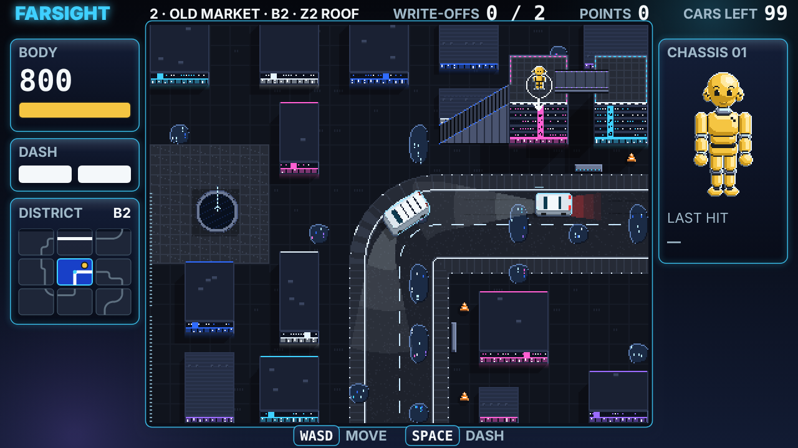

## Play

Open `dummies_p3.html` in a browser. No install, no server. **Full screen** fills the display at the largest whole scale.

| Control | Keys |
|---|---|
| Move | WASD or arrows |
| Dash (the lunge) | Space or J |
| Cone (after Carry) | K or Shift |
| Stairs | Walk into the foot (ground, or a highway's shoulder) or the head (highway, roof) |
| Drop | Walk or dash off a roof ledge or through a broken parapet |
| Pause and cue key | Esc |
| Tuning panel | T |

Pick a district on the title screen (Up/Down). Quotas rise: 1, 2, 2, 3, 4. A quota counts write-offs on any screen of the district.

| Difficulty (title screen, Left/Right) | Body health |
|---|---|
| Fragile (easy) | 600 (`proto.health.fragile`) |
| Standard (base) | 800 (`proto.health.standard`, `damage.bodyHealth`) |
| Reinforced (difficult) | 1000 (`proto.health.reinforced`) |

## Display grids

| Grid | Size | Unit |
|---|---|---|
| Simulation | 800 × 640 | world units (`ui.playWidth` × `ui.playHeight`) |
| Art | 400 × 320 field, 640 × 360 screen | 1 art px = 2 world units (`ui.artScale` = 2); 25 × 20 tiles of 16 px |
| Reference | 1280 × 720 | HUD and screens; 1 reference unit = 1 world unit |
| Device | 640 × 360 × k | k = whole number: 720p ×2, 1080p ×3, 1440p ×4, 4K ×6 |

- **Integer only.** The canvas is always a whole multiple of 640 × 360. Spare space shows sky.
- **Verified (P3).** At 1080p every art pixel is a clean 3 × 3 block.
- **Colliders unchanged.** `body.radius` 13 = dummy sprite 13 px wide. Sedan 28 × 14, van 34 × 16 art px.

## Pixel rules (Edit 37 §4.1.3)

- **No anti-aliasing.** Every mark is a whole art pixel. Translucency is colour math on whole pixels.
- **Generated, not painted.** `pixel.js` builds every sprite and ground at load. No image files.
- **Cars:** footprint extruded by `vehicles.<cls>.height` × `proto.art.extrusion` ÷ `ui.artScale`. 32 headings (11.25°). South face, 1-px outline, white roof, blue glass. Tail lights brighten when braking.
- **Pods:** 9-px towers, depth-sorted with cars and the dummy.
- **Dummy:** 13 × 19, four facings, six wear tints, dents and a cracked head. Eyes and ear nubs face south; one eye in profile. The nose vector gives the exact facing. Rim outline on dark ground (below).
- **Ground:** road, kerbs, dashes and paving from each level's centre line. Canal, lawns, flowers, hedges, trees. Hard shadows down-left (`proto.art.shadowScale`).

## Palettes

| Switch | Field | Frame | Cues |
|---|---|---|---|
| Default, `?palette=cyber` | Chongqing cyberpunk: dark deck plates, LED city blocks, neon spill, jersey barriers | Dark glass, cyan LED edges | Light on dark. Blue LED model tags. Red STOP line with a pink halo |
| `?palette=day` | Edit 37 eco-city: lawns, canal, white pods | FARSIGHT light glass | Dark on light |
| `?palette=night` | Chongqing night: dark lawns, lime-lit trees, LED-striped towers, river reflections, light strings | As cyber | As cyber |

- **Exclusive hues hold in both.** Yellow is the dummy alone. Red is the warning alone.
- **Night contrast (on road):** `cue.primary` 14.9:1 · `cue.secondary` 6.2:1 · `cue.warning` 4.5:1 (halo 9.2:1) · `dummy.body` 9.8:1.
- **Palettes never change play.** The city below is the same in all three.
- **X-ray pass (all palettes).** An occluded car or dummy shows as a checker of its own pixels.
- **Sinofuturist cyber is canon** (decision 113) and the default. Day and night stay as options.

### Outline on dark ground (cyber and night)

A black outline vanishes on a dark field. The background owns the darkest values. No sprite edge is black on dark ground.

- **Rim, not ink.** Every sprite's outer silhouette pixels become a rim. Edges facing up or right (the sun) take the light rim; others take the dark rim.
- **Inner lines stay dark.** Joints, seams and inner details keep their inks.
- **Value hierarchy.** The brighter the rim, the more the actor matters:

| Sprite | Light rim | Dark rim | Light rim on road |
|---|---|---|---:|
| Dummy, field and HUD | `dummy.rimLight` `#E6F4FF` | `dummy.rimDark` `#5E7080` | 14.2:1 |
| Cars | `fleet.rim` `#8FDFFF` | `fleet.rimD` `#3A4A66` | 10.7:1 |
| Cones | `prop.coneRim` `#F2A65A` | `prop.coneRimD` `#7A4420` | 7.9:1 |
| Jersey barriers | `structure.jerseyRim` `#8494B8` | `structure.jerseyRimD` `#2C3550` | 5.2:1 |
| Pods | `structure.podRim` `#5B6E9C` | `structure.podRimD` `#262F48` | 3.1:1 |
| City blocks | `structure.bldgRim` `#46557D` | `structure.bldgRimD` `#1E263B` | 2.2:1 |

- **Every rim is lighter than the ground** (road `#1E222C`, deck `#10141D`, pavement `#262B36`). The old black edge was 1.1–1.4:1.
- **A broken HUD part's outline still turns `cue.warning`.**
- **Night trees:** foliage outline `#1F4A22`, lighter than the lawn.
- **Day keeps the black outline.** Dark on light needs no change.

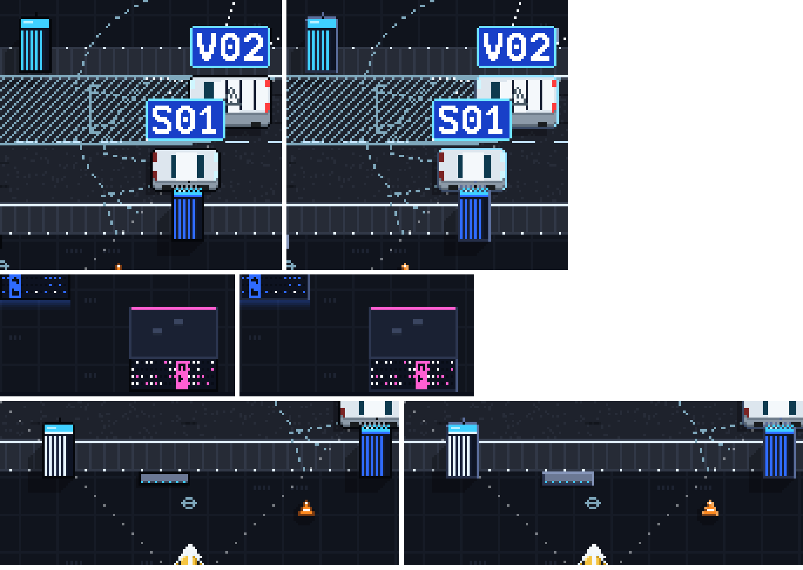

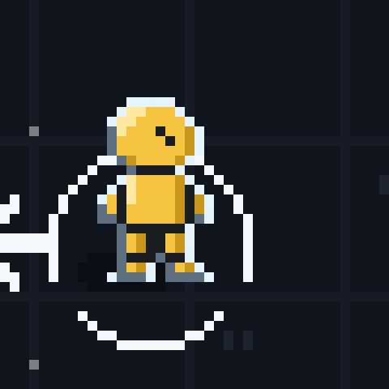

## City districts (Edit 41; 20 October)

| # | District | Centre landmark | Form | Flyovers | Quota | Traffic |
|---|---|---|---|---|---|---|
| 1 | Riverside | Lantern monument on a plaza | Low-rise | 0 | 1 | 3.0 s, 20% vans |
| 2 | Old Market | Fountain square | Dense low-rise | 0 | 2 | 3.0 s, 45% vans |
| 3 | Interchange | Roundabout with a crash-matting island (dash × 1.15) | Mid-rise | 2, rows 1 and 3, clear of the roundabout: one Z1, one Z2 | 2 | 2.8 s, 30% vans |
| 4 | Central Business District | FARSIGHT Tower | Towers | 2: one Z1, one Z2 | 3 | 2.6 s, 30% vans |
| 5 | FARSIGHT Campus | Calibrated plates on the road (points × 1.5) | Campus halls | 1, Z1 | 4 | 2.5 s, 40% vans |

- **Data:** `tables.districts` in the registry; `world.district.<id>.<field>` in `sim.js`.
- **Flyovers:** decks on columns across a whole row. Z1 at `world.deckHeight` (120); Z2 at `world.highHeight` (216), `world.district.<id>.highDecks` of them. Columns are solid ground statics. No buildings under a deck. Levels and deck play: below.
- **Flyovers pass square (Edit 43):** within the band and one road half-width either side, a road beneath runs within `world.deckCrossAngle` (5°) of square. Flyovers are planned first; roads are routed to cross them.
- **Roundabout:** the whole ring is road; traffic uses the part on its route.
- **Towers:** a share of large lots (`world.district.<id>.towerShare`) rise 288–380 units (above every Z2 roof), with LED crowns.
- **Layouts made in advance:** `node tools/district_bake.js` tries seeds and keeps the first three per district that pass the contract (`tools/district_check.js`) with different roads, and whose start screen gives the bot a write-off within 150 s, the first by 90 s. Output: `content/districts/districts.json` (15 layouts).
- **Per run:** one layout per district at random. Tuning: `proto.layout` 1–3 fixes one; −1 generates live.

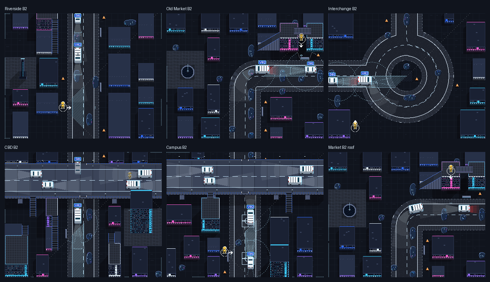

## Screen edges and flyover clearance (P3.4, Edit 48; 21 October)

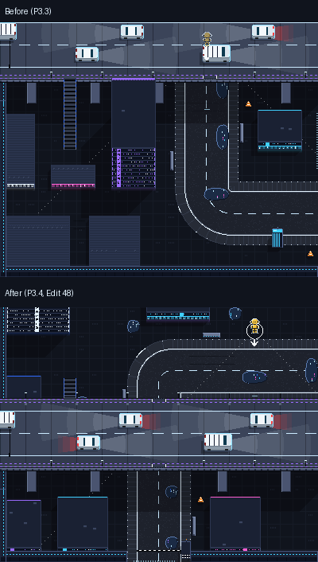

- **Flyover clearance (every district):** drawn deck top (band top minus its lift: Z1 36, Z2 64) at least `world.deckTopClear` (128, four 16 px tiles) below the top edge. Band bottom at least `world.deckBottomClear` (128) above the bottom edge: a building row fits under it. Offsets 260–420.
- **Shared edges:** a lot touching a shared edge carries across it: 64 into the neighbour where it has room, else 48, else `world.edgeOverlap` (32, one tile). Same footprint, height and sprite on both screens (`stitch`, `art` in the baked statics). No room: the lot keeps `world.pedestrianGap` off the edge. Platforms never cross.
- **Build order:** the landmark screen first, then reading order. A built neighbour is checked as built; one still to build, against its plan, and it receives the piece before its own lots.
- **Edge marks:** district edges and non-building blockers only. P3.3 had 565 marked stretches on shared edges; P3.4 has none.
- **Contract (clauses 23, 24):** every building at a shared edge straddles it with a twin across; every flyover meets both clearances.

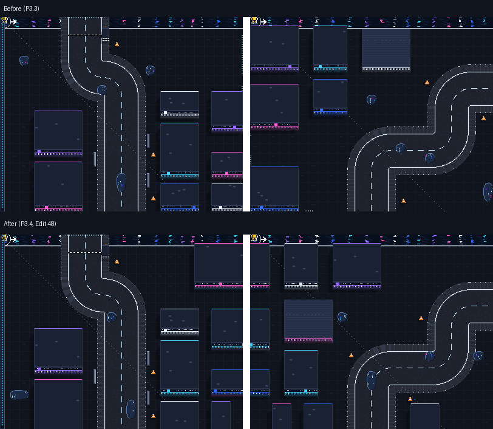

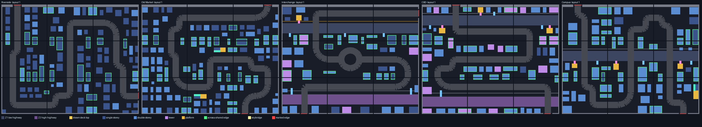

| District | Flyovers (drawn top, tiles below the edge) | Straddling buildings, layouts 1–3 | Roofs (ledges) | Tall stairs | Link stairs | First bot write-off, layouts 1–3 |
|---|---|---|---|---|---|---|
| Riverside | none | 22, 23, 26 | 0–6 (0–4) | 0–4 | 0 | 24.9, 60.1, 28.2 s |
| Old Market | none | 30, 27, 37 | 1–8 (1–3) | 1–8 | 0 | 41.2, 29.5, 23.7 s |
| Interchange | Z1 4.3–9.3; Z2 7.1–8.4 | 19, 24, 25 | 1–2 (0) | 0 | 1–2 | 37.7, 72.4, 46.8 s |
| CBD | Z1 4.3–9.3; Z2 4.0–8.4 | 20, 25, 21 | 2–3 (0) | 0 | 2–3 | 49.0, 41.4, 41.9 s |
| Campus | Z1 4.3–8.0 | 27, 19, 24 | 2–6 (1–3) | 0–3 | 2–3 | 39.8, 46.7, 31.9 s |

- **Open:** Interchange and CBD lost their tall stairs (mid-screen flyovers leave few platform-size lots); link stairs still reach Z2.

## Z levels, platforms and skybridges (P3.3, Edit 44; 21 October)

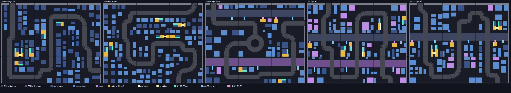

| Z | Name | Floors | Drawn | Reached by | Cars |
|---|---|---|---|---|---|
| 0 | Ground (default) | Streets, forecourts | 0 | Spawn, stair foot, landing | Ground traffic |
| 1 | Low highway | Z1 decks | 18 art px up | Stair from the ground (run 64) | Its deck's traffic |
| 2 | High | Z2 decks, platform roofs, skybridges | 32 art px up | Tall stair (112), link stair from Z1 (48), stair to a Z2 deck | A Z2 deck's own traffic |

- **Heights:** `world.deckHeight` (120) and `world.highHeight` (216), drawn × `proto.art.extrusion`. Stair run: `world.stairLength` per `world.deckHeight` of rise.
- **High highway:** Interchange and CBD run one flyover each at Z2. A second LED line inside each parapet; heavier dashes on the map.
- **Platforms:** a frontage lot becomes a building to Z2 with a walkable roof, at `world.district.<id>.platformShare` (0.10–0.15).
  - Its tall stair climbs along the road-facing edge from the alley. A single-storey annex fills the strip behind.
  - A link platform stands beside a low highway: a short stair from the shoulder to its roof.
  - Roof: tiles, an LED parapet, openings where stairs and bridges join. Edges facing the road are ledges with a striped kerb.
- **Skybridges:** across an alley or lane up to `world.skybridgeMax` (96). The next lot after a platform joins it at `world.skybridgeChance` (0.75), up to `world.platformChain` (3) roofs; at most `world.skybridgeCount` (4) per screen. Parapets hold.
- **Drops:** off a ledge or a broken parapet, onto the nearest level below. Fall time and landing speed × √(h / `world.deckHeight`): Z2 to the ground 0.47 s; a stopped sedan takes 136 (76 from Z1).
- **Cues:** ground cars on Z0; the dummy's own deck on a highway; none on a roof or bridge.
- **HUD:** `Z1 HIGHWAY`, `Z2 HIGHWAY`, `Z2 ROOF`, `Z2 BRIDGE`, `STAIRS` or `FALLING` in the top bar.
- **Contract (clauses 19, 20, 22):** ground stair feet reachable; link stairs on their deck; `highDecks` flyovers at Z2; every roof reached by a stair or bridge chain; every ledge over open ground.

| District | Highways | Roofs (with ledges) | Skybridges | Tall stairs | Link stairs | First bot write-off, layouts 1–3 |
|---|---|---|---|---|---|---|
| Riverside | none | 1–6 (1–4) | 0–1 | 1–6 | 0 | 25.2, 68.7, 38.5 s |
| Old Market | none | 6–8 (2–5) | 1–2 | 5–6 | 0 | 41.3, 45.9, 47.6 s |
| Interchange | Z1 + Z2 | 2–5 (1–3) | 0 | 1–3 | 1–3 | 19.2, 30.9, 60.3 s |
| CBD | Z1 + Z2 | 2–7 (0–4) | 0 | 0–5 | 2–3 | 21.4, 29.7, 33.4 s |
| Campus | Z1 | 7–10 (4–6) | 2–3 | 4–5 | 3 | 39.2, 22.1, 33.9 s |

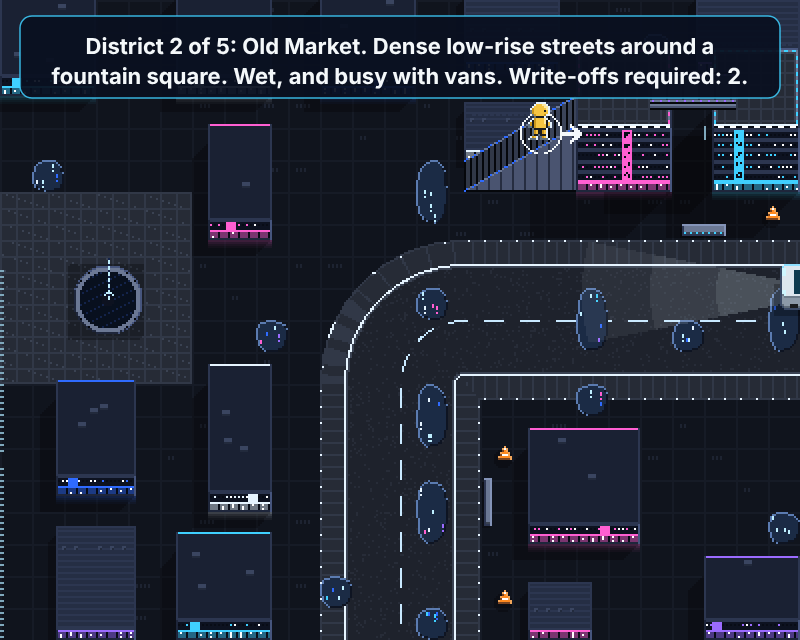

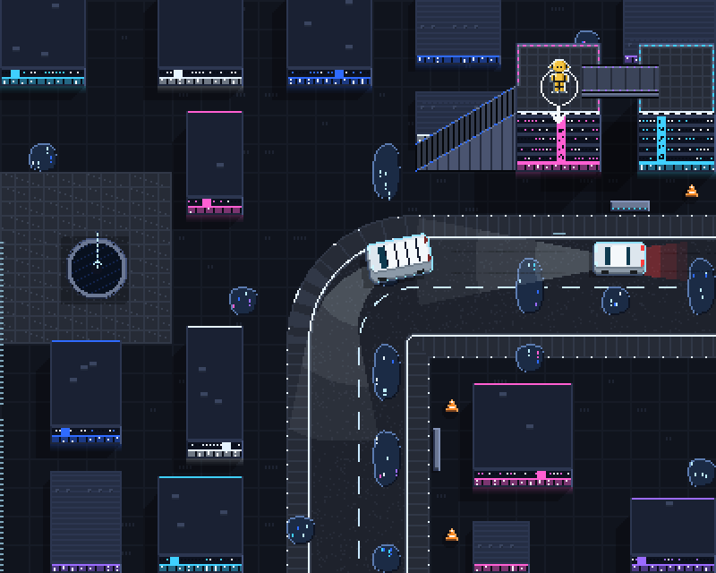

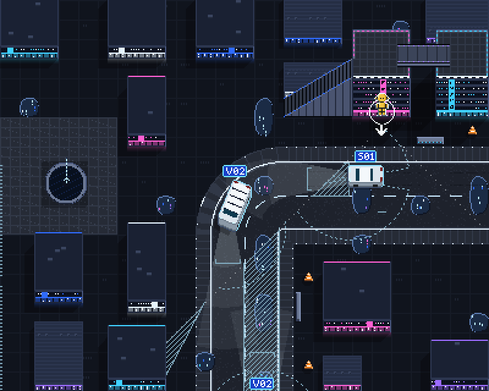

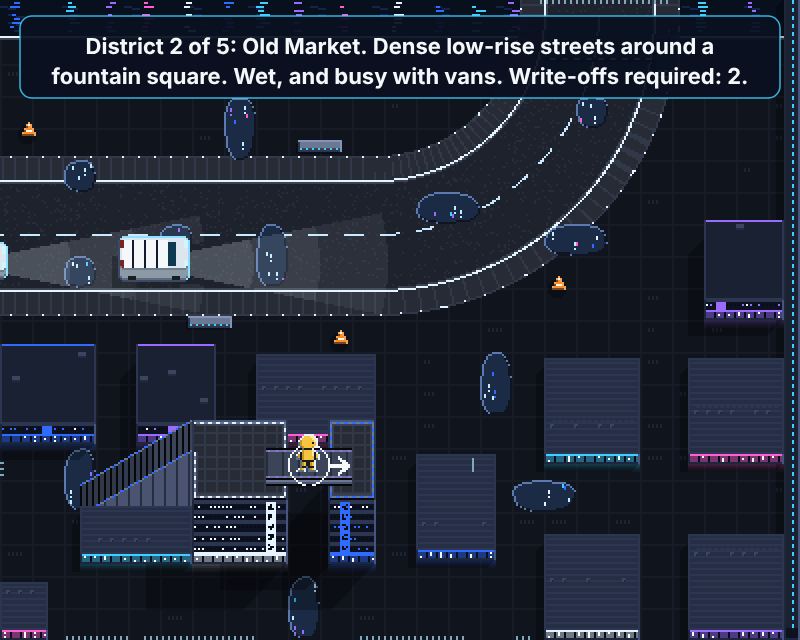

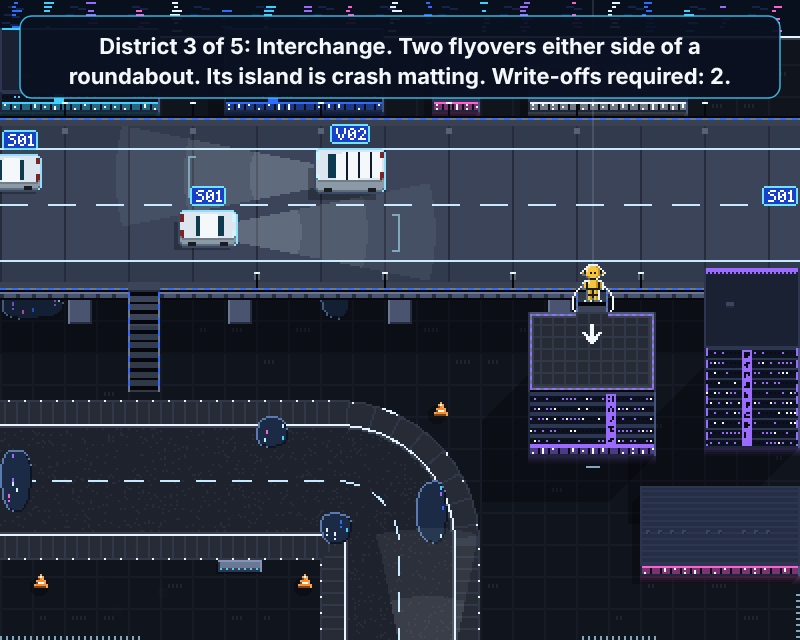

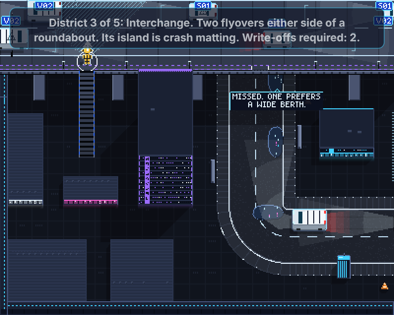

## Roads, decks, buildings and lights (P3.2, Edit 43; 21 October)

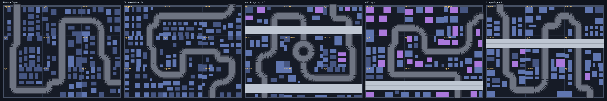

- **Turn styles** (one per screen): tight (`world.turnRadiusTight` 64), circular (`world.turnRadiusWide` 224), stepped (a dog-leg of tight corners).
- **Corner speed:** ≤ √(`traffic.cornerAccel` 60 × radius). Tight corner: about 47 inner lane, 74 outer. Cruise 138.
- **Raised decks:** drawn 18 art px up (`world.deckHeight` 120 × `proto.art.extrusion`), on column pairs (`world.deckColumn` 24) under both edges. The south row shows. Sim positions stay on the footprint.
- **Levels read apart:** pale concrete decks with joints; asphalt streets. (P3.2's underground cutaway was removed in P3.3.)
- **Buildings:** single storey (`world.storeyHeight` 36), double storey (`world.district.<id>.doubleShare`), towers (`towerShare`). Shadows in every palette.
- **Frontage:** fronts at lane + shoulder + `world.buildingSetback` (48) from the centre line. Lots 64–160 wide, alleys of `world.pedestrianGap` (40). Rows behind rows to the district's share of buildable ground.
- **Lights:** headlight beams along the route ahead (`proto.art.beamLength` 200), visible before the car arrives; the dummy and other cars cast shadows in them. Braking washes the ground red behind (`proto.art.brakeLength` 48).

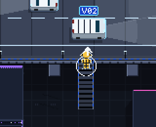

## Levels and bounds (P3.1, Edit 42; 20 October)

P3.1's level numbering (0 underground, 1 ground, 2 overground) is replaced by P3.3's Z levels (above).

- **Bounded districts.** Row 1's outer edge is the river; every other outer edge is a wall (`world.wallThickness` 16).
- **Checkpoints.** A road leaving the district passes a booth and a boom. The boom lifts for a car within `world.boomRange` (140) over `world.boomSeconds` (0.5 s). The dummy cannot pass. Decks have their own boom at the district edge.
- **Decks** (`world.deckWidth` 176): two lanes, a hard shoulder each side, parapets (`world.parapetWidth` 8) with a lamp every `world.deckLampSpacing` (128).
  - **Deck traffic:** full drivers, one per lane every `world.deckInterval` (2.4 s). They sense only the deck. Off the schedule: not in CARS LEFT.
  - **Broken parapets** over every road a deck crosses. Lamps beside them are down.
- **Stairs:** `world.stairLength` 64 × `world.stairWidth` 32. Walked at × `world.stairSpeed` (0.7); no dash. Sides solid on the ground.
- **Drop:** `world.dropSeconds` (0.35 s) from Z1, no control. Landing on a car: closing speed is the hypotenuse of `damage.dropSpeed` (120) and the car's speed. Stopped sedan 76; sedan at cruise 176. The legs take it. Higher falls: above.
- **Cones stay on the ground.** Carry one up; drop or throw it only on Z0.
- **Contract (clause 18):** walls or river on every outer edge; a checkpoint per road and deck exit.

| District | Stairs to a highway | Parapet gaps | Checkpoints (road + deck) |
|---|---|---|---|
| Riverside | 0 | 0 | 2 + 0 |
| Old Market | 0 | 0 | 2 + 0 |
| Interchange | 5–6 | 4–8 | 2 + 4 |
| CBD | 6 | 8–12 | 2 + 4 |
| Campus | 3 | 1–6 | 2 + 2 |

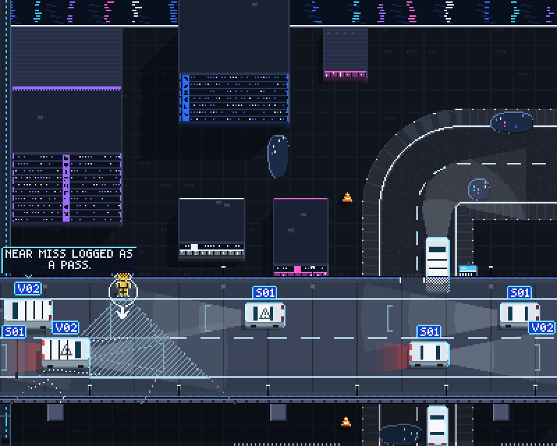

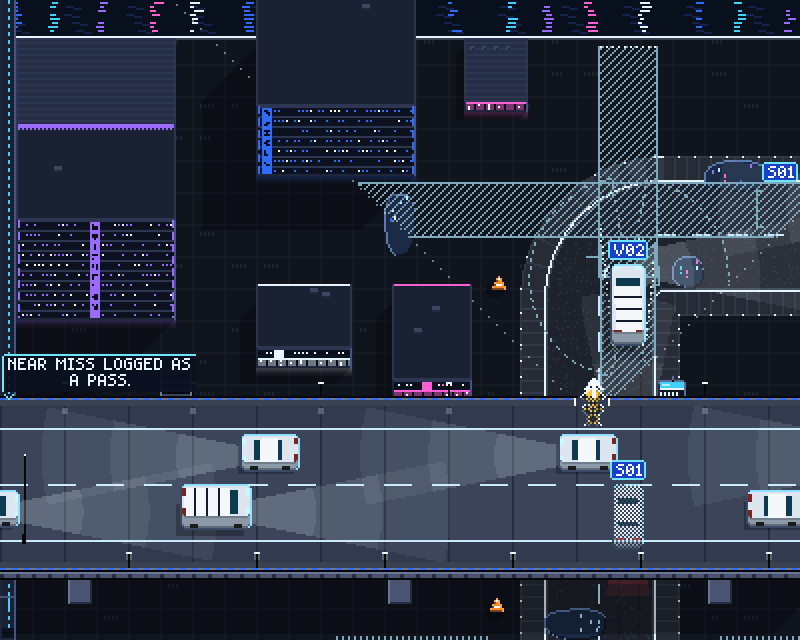

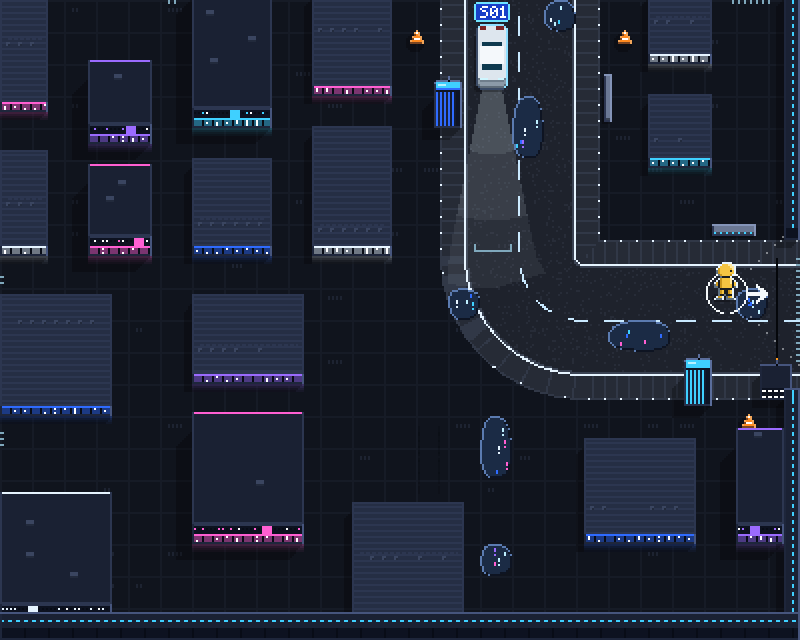

## Districts (D24, `proto.district` = 1; 20 October)

A road is a district of `world.districtColumns` × `world.districtRows` screens (3 × 3). Each screen is a full 800 × 640 play area. Spec: GDD Edit 40 §7.1.1.

| Rule | Value |
|---|---|
| Road | One road through all nine screens; both ends leave the district |
| Start screen | Top row, on the river: the road's handcrafted screen (B1; L3 starts in C1) |
| Edges (Edit 40.1) | Open wherever the ground is open on both sides. A building just across the edge stops you; so does the district's outer edge |
| Gates | Generator guarantee: the road crossing, plus one 48-unit opening (`world.gateWidth`) on every shared edge |
| Flip | Centre crosses the edge → slide over `world.flipSeconds` 0.4 s; play pauses |
| Carried | Health, parts, charge, momentum, a held cone |
| Runs | Only the active screen. Its cars, drones and effects end at the flip |
| Traffic | Enters from the new screen's road ends after 0.5 s |
| Cones | Stay on their screen where you left them |
| Quota, CARS LEFT | District-wide |
| Write-off | Next chassis lands on the current screen |

- **Generated screens.** Eight per road, from a fixed seed (`proto.district.seed` rerolls).
  - Road piece: straight, S-bend or bend, matched to the neighbours' crossings.
  - Feature: flyover pillars, a barrier run with `world.barrierGapsMin` gaps, or open street.
  - Jerseys on `world.jerseyShare` of the road edge; blocks to `world.blockShare`; spawns and cones on the verges.
  - Flood fill: every open spot and every gate reachable.
- **HUD.** Top bar adds the screen (`B2`). Left column adds the district map. A toast names each new screen.
- **Edge marks.** A dotted line where an open-looking edge stops you: the district edge, or a non-building blocker just across it (`field.gate`). Unmarked edges are open. Buildings at a shared edge straddle it instead (Edit 48).
- **Load.** All nine screens build when the road starts (20–100 ms each).

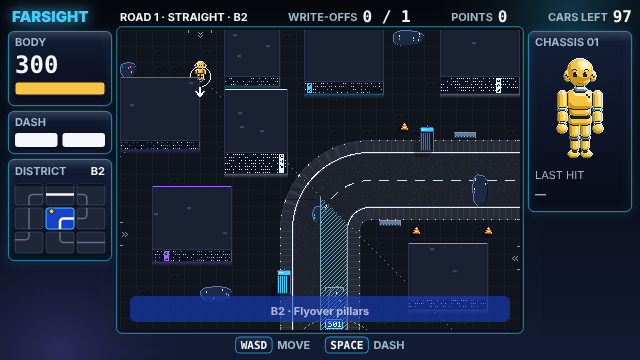

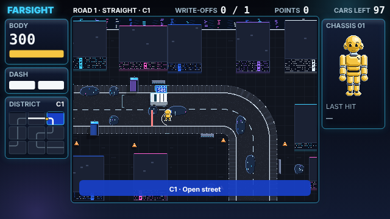

## Surfaces (D18; 20 October)

Layered, per GDD 11.3: one ground per tile, patches on top. `surfaceAt` returns the top patch.

- **Puddles:** `world.puddleShare` 0.02 of `world.tileSize` 32-unit tiles: 10 of 475 per screen. Spots of 1–2 tiles (`world.puddleSpotMax`), alternating road and walkable ground. Never under a static, spawn or cone.
- **Dummy on water:** speed × `world.terrain.puddle.dummySpeed` 0.9; coast × `movement.lowGripStopMultiplier` 2.5; no dash (`world.terrain.puddle.lunge` 0). A denied dash splashes.
- **Cars on water:** braking capped at `world.terrain.puddle.carBraking` 0.5 × `traffic.hardBraking`. A skid throws spray.
- **Look:** irregular blob; sheen on the far lip, dark near lip; vertical reflections of the city lights.

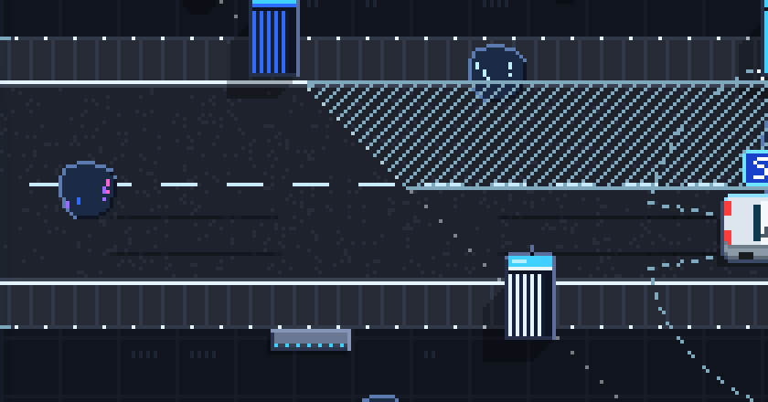

## City v2 (Fix A, `proto.city` = 1; 20 October)

Blocks and jersey barriers are level statics. Start screens: `sim.js` (`LEVELS.<road>.city`), generated by `tools/city_gen.js`. Other screens: generated at load (Districts). Anything that looks solid is solid.

| Road | Blocks | Share of level | Jersey barriers | Share of road edge | All solids |
|---|---:|---:|---:|---:|---:|
| L1 Straight | 8 | 26.8% | 3 | 8.2% | 27.8% |
| L2 Barrier | 8 | 25.6% | 3 | 8.2% | 28.1% |
| L3 Corner | 10 | 25.3% | 3 | 7.0% | 26.4% |

- **Targets** (decision 118): buildings about 25% of the level; barriers about 5–10% of the road edge.

- **Collide** with the dummy and cones. **Cast sensor shadows** (`occluded`). Cars never swerve into them.
- **Blocks:** off the road band (pavement + 16 units); alleys at least `world.pedestrianGap` (40); flush to an edge or 40 clear of it. Largest legal block first, on an 8-unit grid. Height (60–140 units) only sets the drawing.
- **Jersey barriers:** 44 × 8 units, 4 units off the pavement, straight stretches only, spread along the road.
- **Access checked:** every open spot connects to a spawn; the road is reachable.
- **Looks:** eco blocks with roof gardens by day; LED blocks with lit windows, vertical glyph signs and neon spill by night and in cyber.
- **X-ray pass.** An occluded car or dummy shows as a checker of its own pixels (tier 1: never occluded).
- **`proto.city` = 0** restores the P2.2 roads (tuning panel; applies on the next road or restart).
- **Not rebalanced.** Blocks add cover and sensor shadows. Quotas, traffic and pod layout are P2.2 values.
- **Occlusion cap** raised to 0.30 (`world.occludedFractionMax`) to admit the 25% city.
- **Level design** still needs a focused pass: landmarks, sightlines, ambush routes.

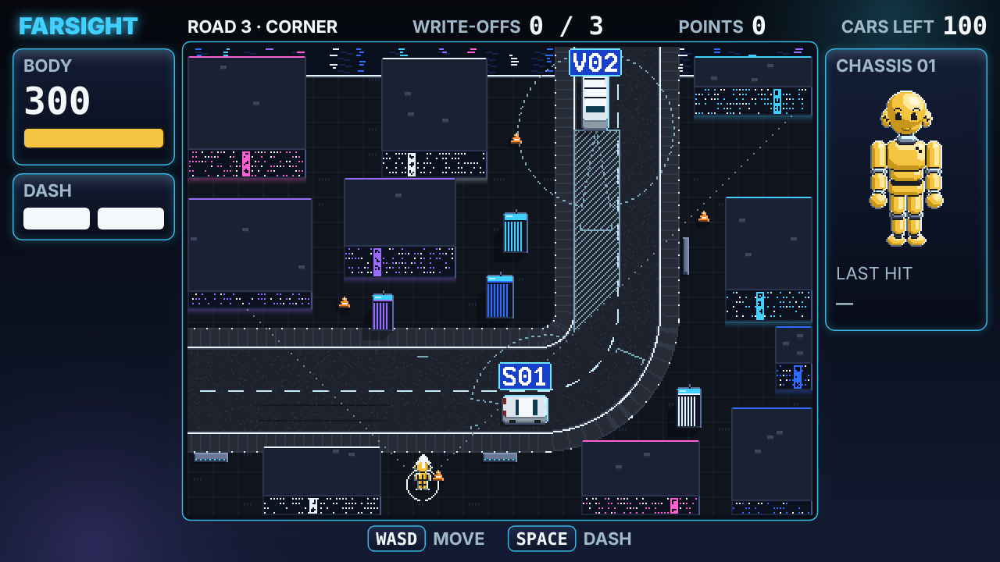

## HUD v3 (20 October)

| Place | Shows |
|---|---|
| Top bar | Road · WRITE-OFFS n / quota · POINTS · CARS LEFT (the shift's clock; no separate timer) |
| Left | BODY: health at 48 px with its bar. DASH: two charge blocks (`battery.capacity` 2) |
| Right | CHASSIS: front-view doll, 64 × 108 art px on the field's grid. Each part shows its own damage; owned modules show. LAST HIT: part and health lost. Cut abilities in `cue.warning` |
| Bottom | Controls that apply now |

- **Locational damage.** Every impact records `part` (head, torso, armL, armR, legL, legR); `body.parts` sums health lost per part.
  - **Height** from the hit's size: below `proto.parts.torsoFrom` (100) the legs; up to `proto.parts.headFrom` (250) the torso, or an arm when the hit comes from the side; above, the head.
  - **Side** from the contact point against the dummy's facing.
  - **Doll levels:** any damage dents the part; `proto.parts.crackedShare` (0.2 of `damage.bodyHealth`) cracks it; `proto.parts.brokenShare` (0.4) turns its outline to the warning ink. The hit part flashes white.
  - **Health stays one pool.** Parts only decide which ability the damage cuts.
- **Modules** show on the doll as components (below).

### Part damage cuts abilities (`proto.parts.effects` = 1)

Share = health lost by the part ÷ `damage.bodyHealth`. Each ability falls linearly to a floor.

| Part | Ability | Rule | Loss | Floor |
|---|---|---|---:|---:|
| Legs (L + R shares) | Ground speed: walk, run, carry | × (1 − loss × share) | `proto.parts.legSpeedLoss` 1 | `proto.parts.legSpeedFloor` 0.5 |
| Torso | Turn rate | × (1 − loss × share) | `proto.parts.torsoTurnLoss` 1.5 | `proto.parts.torsoTurnFloor` 0.5 |
| Head | View cone width (`sensing.coneWidth`) | × (1 − loss × share) | `proto.parts.headConeLoss` 1.5 | `proto.parts.headConeFloor` 0.5 |
| Arms (L + R shares) | Throw distance (`upgrades.throwDistance`) | × (1 − loss × share) | `proto.parts.armThrowLoss` 1 | `proto.parts.armThrowFloor` 0.5 |
| Both arms broken | Pick up a cone | Denied while each arm ≥ `proto.parts.brokenShare` | — | — |

- **Examples (Standard 800):** 200 lost to the legs → speed 75%. 107 lost to the head → cone 72° of 90°. Floors: speed 50%, cone 45°.
- **On screen:** the chassis panel lists each cut ability: SPEED %, TURN %, VIEW °, THROW %, or CONE NO GRIP. The view cone narrows in the field.
- **Dash reach** shrinks with leg damage only: × max(`movement.wearFloor` 0.45, 1 − `proto.parts.legDashLoss` 1.5 × leg share). Torso, arm and head damage leave it alone. With part effects off, total wear shortens it as before (D19).
- **Two charges** (`battery.capacity` 2, decision 112). The battery limit stays.
- **Big battery** (D26): three charges (`upgrades.bigCapacity` 3). Shop, Battery column, 1 credit (`economy.price.battery`).

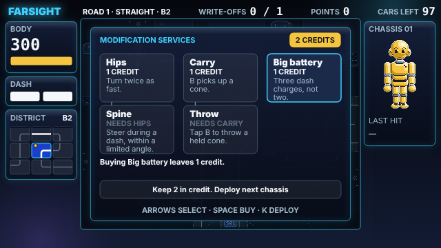
- **New chassis resets every part.**
- **`proto.parts.effects` = 0** restores display-only parts (tuning panel).

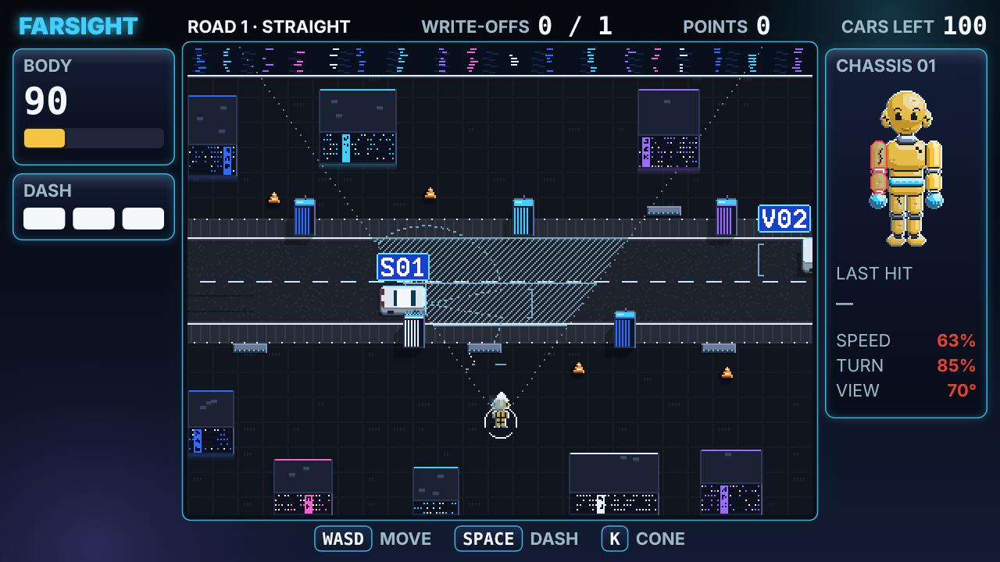

### Chassis doll (20 October)

- **Native resolution.** 64 × 108 art px, drawn at `ui.artScale` on the art grid. Never upscaled.
- **Appeal from the real dummy:** glossy yellow, dot eyes with a glint, arched brows, small smile, ears with quartered decals, black neck, chrome collar, elbows, wrists, knees and ankles.
- **Built from shapes, not painted.** Each shape is a shaded rounded box tagged with a body part. Sun top right: three tones plus one glint.
- **Seams** fall on the shape underneath. The outer edge is the 1-px outline, or the rim on dark ground.
- **Damage per part:** worn tint and dents on any loss, cracks at `proto.parts.crackedShare`, a warning outline and spark at `proto.parts.brokenShare`. The hit part flashes white.

| Branch | Tier 1 | Tier 2 | Tier 2 |
|---|---|---|---|
| Head | Wider view: goggles | Memory: crown cartridge | Ears: dish ears, antennae |
| Torso | Hips: swivel bearing | Spine: ribbed bellows | Neck: gimbal collar |
| Legs | Spring start: ankle coils | Jump: thigh pistons | Grip: tread soles, cleats |
| Arms | Carry: grip gloves | Throw: shoulder pistons | Hold on: forearm clamps |
| Battery | Big battery: five-cell chest pack | Kinetic charge: flank plates | Fast charge: belt port, plugged cable |

- **Components use the brand accent** (`mod` ramp). Each sits on its branch's body part.
- **Cyber ramps:** gunmetal chrome (`#7D8AA3`, `#D6F6FF`, `#353D52`); module LEDs glow magenta `#FF5FD2` (battery cells, cartridge, bolt glyphs). Day LEDs `#E8FAFF`.
- **Tree per V29 D3.2.** Legs is Spring start → Jump, Grip. Strafe was withdrawn on 12 October (R10).
- **Owned nodes show.** P3 sells Hips, Spine, Carry and Throw; the other eleven are designed and drawn.
- **Shop try-on.** The selected node blinks onto the doll before you buy.
- **Preview:** tuning panel, "Preview all 15 modules" (display only; the run is untouched).

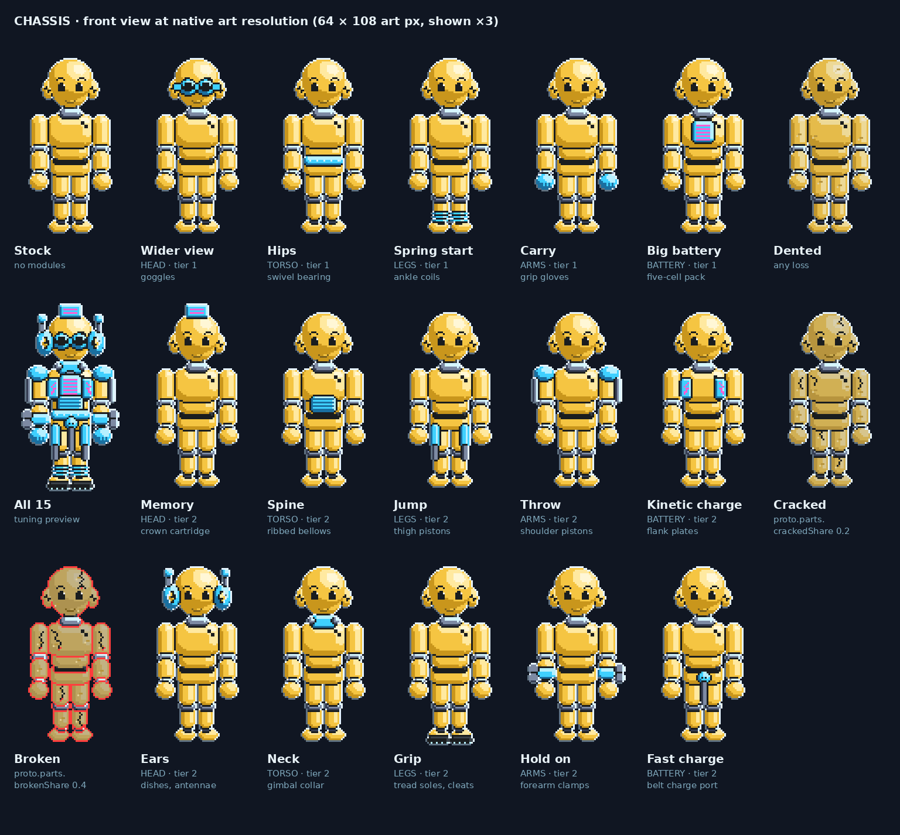

Day version: `docs/p3_chassis_modules.png`.
- **DASH** is the on-screen name for the lunge. Registry IDs keep `movement.lunge*`.

## Type at registry size (GDD §4.2.3)

| Class | Parameter | Cap height | P3 use |
|---|---|---|---|
| Load-bearing | `ui.typeLoadBearing` | 24 units | HUD readouts (B612 Mono 32 px) |
| Field label | `ui.typeFieldLabel` | 12 units | Car tags and bark text: 6-art-px pixel face (half the old tag, decision 120) |
| Secondary | `ui.typeSecondary` | 16 units | Labels, menus, toasts (B612 22 px, cap 16.5) |
| Texture | `ui.typeTexture` | 9 units | Not used. Nothing on screen is below legibility |

## Essentials only (V29 D10.3)

- **Top:** road and screen, WRITE-OFFS, POINTS, CARS LEFT. **Left:** BODY, DASH, DISTRICT map. **Right:** CHASSIS doll, LAST HIT, cut abilities.
- **Credits** show on the report and shop screens only.
- **Bottom:** move and dash keys during play; cone appears after Carry.
- **Field:** three-character tags (`S01`, `V02`, 4.2.2) at half size, seniority as square pips, roof pips, stop line, stop bracket, nose vector, charge ring.
- **Cut from P2.2:** slogan, badges, notice band, micro-type, bezel range marks, FLEET panel, active time, chassis number, ghost car, STOP word, BLIND word, zoom punch.
- **Barks back** (decision 119). Pixel bubbles in the 6-px face, ≤ 48 characters, from `content/db/fleet.json`.
  - Above the car's tag, else below the car. Never over a tag, a car or the dummy.
  - Speech solid edge; shout double edge; mutter dashed; thought dotted with trailing dots.
  - Cars name new modules and broken parts when they notice the dummy. A model that learned says so when it returns.

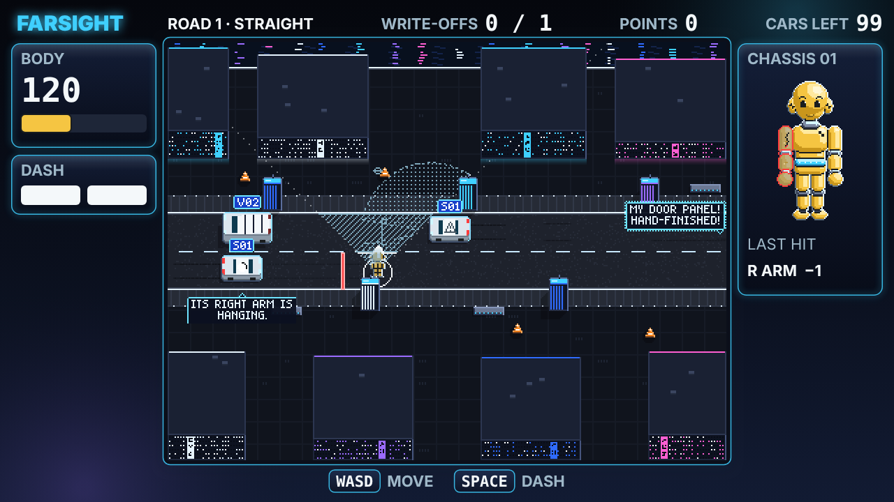

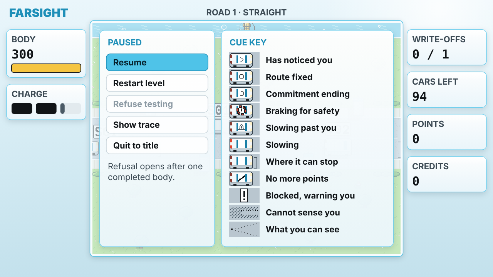

## New parameters

| ID | Value | Status |
|---|---|---|
| `ui.artScale` | 2 | Registry (`edit40-2026-10-20`), in `OVERRIDES` |
| `world.districtColumns`, `world.districtRows` | 3, 3 | Registry (Edit 40, D24) |
| `world.gateWidth`, `world.flipSeconds` | 48 units, 0.4 s | Registry, Proposed |
| `world.tileSize`, `world.puddleShare`, `world.puddleSpotMax` | 32 units, 0.02, 2 tiles | Registry (Edit 40, D18) |
| `world.terrain.puddle.*` | speed 0.9, lunge 0, grip low, car braking 0.5 | Registry terrain row; lunge 1.0 → 0 |
| `world.blockShare`, `world.jerseyShare` | 0.25, 0.08 | Registry. Generator targets (decision 118) |
| `upgrades.bigCapacity`, `economy.price.battery` | 3, 1 | Registry (D26) |
| `proto.district`, `proto.district.seed` | 1, 0 | Registry, prototype group |
| `field.puddle*`, `field.gate` (palette roles) | Edit 40 | Proposed. Cyber and day |
| `damage.bodyHealth` | 800 | Registry (`edit40.1-2026-10-20`); was 1600 (CR-004) |
| `proto.health.fragile`, `.standard`, `.reinforced` | 600, 800, 1000 | Registry, prototype group (Edit 40.1) |
| `world.district.<id>.*` (10 fields × 5 districts) | City districts table above | Registry `districts` table (Edit 41) |
| `world.deckHeight`, `world.deckWidth` | 120, 176 units | Registry, Proposed (`world.deckStack` retired, Edit 42; height 60 → 120, Edit 43) |
| `world.deckPillarSpacing`, `world.deckInterval` | 160 units, 2.4 s | Registry, Proposed |
| `world.towerHeightMin`, `world.towerHeightMax`, `world.roundaboutRadius` | 288, 380, 160 units | Registry, Proposed (min 220 → 288, Edit 44) |
| `damage.plateMultiplier`, `world.terrain.matting.lunge` | 1.5, 1.15 | Registry values, now used |
| `proto.layout` | 0 | Registry, prototype group. Baked layout 1–3; −1 = live |
| `world.deckCrossAngle`, `world.deckColumn` | 5°, 24 units | Registry (Edit 43); `world.deckParallelAngle` retired |
| `world.turnRadiusTight`, `world.turnRadiusWide`, `traffic.cornerAccel` | 64, 224 units; 60 units/s² | Registry, Proposed (Edit 43) |
| `world.buildingSetback`, `world.storeyHeight` | 48, 36 units | Registry, Proposed (Edit 43) |
| `proto.art.beamLength`, `.beamAlpha`, `.brakeLength`, `.brakeAlpha` | 200, 0.22, 48, 0.35 | Registry, prototype group (Edit 43) |
| `world.parapetWidth`, `world.deckLampSpacing` | 8, 128 units | Registry, Proposed (Edit 42) |
| `world.stairLength`, `world.stairWidth`, `world.stairSpeed` | 64, 32 units; 0.7 | Registry, Proposed (Edit 42) |
| `world.dropSeconds`, `damage.dropSpeed` | 0.35 s, 120 units/s | Registry, Proposed (Edit 42) |
| `world.wallThickness` | 16 units | Registry, Proposed (Edit 42); `world.underpassChance` retired (Edit 44) |
| `world.highHeight`, `world.skybridgeMax` | 216, 96 units | Registry, Proposed (Edit 44) |
| `world.skybridgeChance`, `world.platformChain`, `world.skybridgeCount` | 0.75, 3, 4 | Registry, Proposed (Edit 44) |
| `world.district.<id>.highDecks`, `.platformShare` | 0/0/1/1/0; 0.10–0.15 | Registry `districts` table (Edit 44); CBD `decks` 1 → 2 |
| `world.deckTopClear`, `world.deckBottomClear`, `world.edgeOverlap` | 128, 128, 32 units | Registry (Edit 48): top clearance and edge overlap user-directed |
| `world.boomRange`, `world.boomSeconds` | 140 units, 0.5 s | Registry, Proposed (Edit 42) |
| `proto.art.wallHeight` | 40 units | Registry, prototype group (Edit 42) |
| `ui.typeFieldLabel` | 12 units | Registry. Tags and barks |
| `battery.capacity` | 2 | Registry (D19) |
| `proto.parts.legDashLoss` | 1.5 | Registry, prototype group. Dash reach per leg share |
| `ui.playWidth`, `ui.playHeight` | 800, 640 | Registry (`edit42-2026-10-20`), in `REG` as `world.width`, `world.height` |
| `ui.typeLoadBearing`, `ui.typeSecondary`, `ui.typeTexture` | 24, 16, 9 | Registry values, now in `REG` |
| `proto.art.extrusion` | 0.3 | Proposed. Share of height drawn as a screen-up offset |
| `proto.city` | 1 | Proposed. City blocks and jersey barriers are statics; 0 = P2.2 roads |
| `proto.parts.torsoFrom`, `proto.parts.headFrom` | 100, 250 | Proposed. Assessed damage that reaches the torso, then the head |
| `proto.parts.crackedShare`, `proto.parts.brokenShare` | 0.2, 0.4 | Proposed. Share of body health lost by one part to crack, then break it |
| `proto.parts.effects` | 1 | Proposed. Part damage cuts abilities; 0 = display only |
| `proto.parts.legSpeedLoss`, `proto.parts.legSpeedFloor` | 1, 0.5 | Proposed. Ground speed per leg share; lowest multiplier |
| `proto.parts.torsoTurnLoss`, `proto.parts.torsoTurnFloor` | 1.5, 0.5 | Proposed. Turn rate per torso share; lowest multiplier |
| `proto.parts.headConeLoss`, `proto.parts.headConeFloor` | 1.5, 0.5 | Proposed. View cone per head share; lowest multiplier |
| `proto.parts.armThrowLoss`, `proto.parts.armThrowFloor` | 1, 0.5 | Proposed. Throw distance per arm share; lowest multiplier |
| `dummy.rimLight`, `dummy.rimDark` (palette roles) | `#E6F4FF`, `#5E7080` | Proposed. Night and cyber only. Dummy rim on dark ground |
| `fleet.rim*`, `prop.coneRim*`, `structure.jerseyRim*`, `structure.podRim*`, `structure.bldgRim*` (palette roles) | Outline table above | Proposed. Night and cyber only |
| `chassis.chrome*`, `chassis.mod*`, `chassis.modGlow` (palette roles) | Chassis doll above | Proposed. Day and cyber ramps |

## Files

| File | Role |
|---|---|
| `sim.js` | P2.2 simulation plus the presentation IDs above |
| `pixel.js` | Art grid: buffer, primitives, 8 × 12 and 6-px faces, chassis doll, sprite and ground generators |
| `game.js` | Input, events, juice, HUD, screens, tuning. P2.2 logic; new renderer |
| `shell.html` | Integer-scaled stage, full-screen button, tuning drawer |
| `build.py` | Bundles into `dummies_p3.html`, with `content/db/fleet.json` as `window.FLEET_DB` |
| `tools/city_gen.js` | City v2 generator: `node tools/city_gen.js .` prints block and barrier data |
| `test_sim.js` | `node test_sim.js`: 83 checks, incl. 27 for the city districts (shared-edge straddles, flyover clearance, contract on all 15 layouts, square crossings, turn styles, buildings, corner speed, landmarks, deck drivers, stairs, drop, Z levels, platforms, skybridges, link stairs, high highway, walls and booms, plates, matting, smoke runs) |
| `tools/district_bake.js`, `tools/district_check.js` | Bake 3 layouts per district; the district contract and start-screen bot |
| `../../content/districts/districts.json` | The 15 baked layouts at 800 × 640, bundled as `window.DISTRICT_DB` |
| `../../content/db/` | Fleet database and `check_lore.py` (lore consistency) |

## Open

- **Exhibition hardware.** Windows 11 gaming laptop (decision 121). 1080p draws ×3.
- **Animation.** Single frames: no walk, lunge or wreck cycles.
- **Seniority pips** need playtesting against `proto.learningEnabled` = 1.
- **Fonts.** B612 and Nunito load from Google Fonts. The laptop build must embed them.
- **Moods.** Lines exist in the database; the sim does not assign moods yet.
- **D28 exploration reward.** Exploration is optional today.
- **Pacing at 800 health.** A reading bot clears L1 in 31.6 s (was 11.0 s at 300). Quotas 2 and 3 on L2 and L3 need a timed check against CARS LEFT.
- **Junctions.** Generated screens have no T or cross pieces yet.
- **Roof cues.** No traffic cues on a roof. Should ground paths show from Z2, to time a drop?
- **Link stairs** climb only 10 px from a north deck. Playtest whether they read.
- **Drop value.** 76–176 damage from Z1, 136–236 from Z2: a hit, or a getaway? Playtest.
- **Deck tags.** Six tagged deck cars at once may crowd the field.
- **D30.** GDD 7.2's old level types against the districts.
- **Turn-style weights.** Equal thirds per screen. Districts could lean.
- **Pacing.** Corner slowing and forecourt spawns moved first write-offs to 24–54 s on the start screens.
