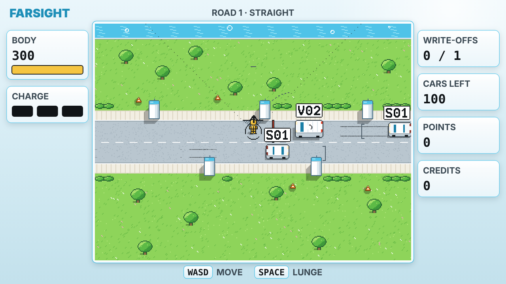

# DUMMIES — P3 Prototype: 16-bit Aero

**P3 · 20 October 2026 · Lawrence Lek**

P2.2's simulation in the GDD Edit 37 art direction: a pixel-art eco-city field inside the FARSIGHT glass frame. Screen 640 × 360 art pixels. Field 400 × 300 at (120, 30). The simulation is unchanged; only presentation moved.

## Play

Open `dummies_p3.html` in a browser. No install, no server. **Full screen** fills the display at the largest whole scale.

| Control | Keys |
|---|---|
| Move | WASD or arrows |
| Lunge | Space or J |
| Cone (after Carry) | K or Shift |
| Pause and cue key | Esc |
| Tuning panel | T |

Campaign, difficulty and quotas match P2.2.

## Display grids

| Grid | Size | Unit |
|---|---|---|
| Simulation | 800 × 600 | world units (`ui.playWidth` × `ui.playHeight`) |
| Art | 400 × 300 field, 640 × 360 screen | 1 art px = 2 world units (`ui.artScale` = 2) |
| Reference | 1280 × 720 | HUD and screens; 1 reference unit = 1 world unit |
| Device | 640 × 360 × k | k = whole number: 720p ×2, 1080p ×3, 1440p ×4, 4K ×6 |

- **Integer only.** The canvas is always a whole multiple of 640 × 360. Spare space shows sky.
- **Verified.** At 1080p every art pixel is a clean 3 × 3 block (120,000 of 120,000 cells).
- **Colliders unchanged.** `body.radius` 13 = dummy sprite 13 px wide. Sedan 28 × 14, van 34 × 16 art px.

## Pixel rules (Edit 37 §4.1.3)

- **No anti-aliasing.** Every mark is a whole art pixel. Translucency is colour math on whole pixels.
- **Generated, not painted.** `pixel.js` builds every sprite and ground at load. No image files.
- **Cars:** footprint extruded by `vehicles.<cls>.height` × `proto.art.extrusion` ÷ `ui.artScale`. 32 headings (11.25°). South face, 1-px outline, white roof, blue glass. Tail lights brighten when braking.
- **Pods:** 9-px towers, depth-sorted with cars and the dummy.
- **Dummy:** 13 × 19, four facings, six wear tints, dents and a cracked head. The nose vector gives the exact facing.
- **Ground:** road, kerbs, dashes and paving from each level's centre line. Canal, lawns, flowers, hedges, trees. Hard shadows down-left (`proto.art.shadowScale`).

## Palettes

| Switch | Field | Frame | Cues |
|---|---|---|---|
| Default | Edit 37 eco-city: lawns, canal, white pods | FARSIGHT light glass | Dark on light |
| `?palette=night` | Chongqing night: dark lawns, lime-lit trees, LED-striped towers, river reflections, light strings | Dark glass, cyan LED edges | Light on dark. Blue LED model tags. Red STOP line with a pink halo |
| `?palette=cyber` | Night colours, city scenery: deck plates instead of lawns and trees | As night | As night |

- **Exclusive hues hold in both.** Yellow is the dummy alone. Red is the warning alone.
- **Night contrast (on road):** `cue.primary` 14.9:1 · `cue.secondary` 6.2:1 · `cue.warning` 4.5:1 (halo 9.2:1) · `dummy.body` 9.8:1.
- **Palettes never change play.** The city below is the same in all three.
- **X-ray pass (all palettes).** An occluded car or dummy shows as a checker of its own pixels.
- **Options, not decided.** Decision 88 still names the eco-city field.

## City (Fix A, `proto.city` = 1)

Blocks and jersey barriers are level statics in `sim.js` (`LEVELS.<road>.city`). Anything that looks solid is solid.

| Road | Blocks | Jersey barriers |
|---|---|---|
| L1 Straight | 8 | 5 |
| L2 Barrier | 7 | 2 |
| L3 Corner | 7 | 3 |

- **Collide** with the dummy and cones. **Cast sensor shadows** (`occluded`). Cars never swerve into them.
- **Blocks:** off the road band (pavement + 30 units), ≥ 44 units apart, flush to an edge or ≥ 44 clear of it. Height per block (60–140 units) only sets the drawing.
- **Jersey barriers:** 44 × 8 units, 4 units off the pavement, straight stretches only, ≥ 60 units apart.
- **Access checked:** every open spot connects to a spawn; the road is reachable.
- **Looks:** eco blocks with roof gardens by day; LED blocks with lit windows, vertical glyph signs and neon spill by night and in cyber.
- **X-ray pass.** An occluded car or dummy shows as a checker of its own pixels (tier 1: never occluded).
- **`proto.city` = 0** restores the P2.2 roads (tuning panel; applies on the next road or restart).
- **Not rebalanced.** Blocks add cover and sensor shadows. Quotas, traffic and pod layout are P2.2 values.

## HUD v3 (20 October)

| Place | Shows |
|---|---|
| Top bar | Road · WRITE-OFFS n / quota · POINTS · CARS LEFT (the shift's clock; no separate timer) |
| Left | BODY: health at 48 px with its bar. DASH: charge blocks |
| Right | CHASSIS: front-view doll at ×9. Each part shows its own damage. LAST HIT: part and health lost |
| Bottom | Controls that apply now |

- **Locational damage.** Every impact records `part` (head, torso, armL, armR, legL, legR); `body.parts` sums health lost per part.
  - **Height** from the hit's size: below `proto.parts.torsoFrom` (100) the legs; up to `proto.parts.headFrom` (250) the torso, or an arm when the hit comes from the side; above, the head.
  - **Side** from the contact point against the dummy's facing.
  - **Doll levels:** any damage dents the part; `proto.parts.crackedShare` (0.2 of `damage.bodyHealth`) cracks it; `proto.parts.brokenShare` (0.4) turns its outline to the warning ink. The hit part flashes white.
  - **Display and reports only.** Health stays one pool; parts change no ability.
- **Modules** glow aqua on the doll. The full list lives in the shop and pause screens.
- **DASH** is the on-screen name for the lunge. Registry IDs keep `movement.lunge*`.

## Type at registry size (GDD §4.2.3)

| Class | Parameter | Cap height | P3 use |
|---|---|---|---|
| Load-bearing | `ui.typeLoadBearing` | 24 units | HUD readouts (B612 Mono 32 px). Car tags: 8 × 12 pixel face, 12-art-px caps |
| Secondary | `ui.typeSecondary` | 16 units | Labels, menus, toasts (B612 22 px, cap 16.5) |
| Texture | `ui.typeTexture` | 9 units | Not used. Nothing on screen is below legibility |

## Essentials only (V29 D10.3)

- **Left:** BODY (health and bar), CHARGE (three blocks).
- **Right:** WRITE-OFFS, CARS LEFT, POINTS, CREDITS.
- **Top:** FARSIGHT, road name. **Bottom:** move and lunge keys during play; cone appears after Carry.
- **Field:** three-character tags (`S01`, `V02`, 4.2.2), seniority as square pips, roof pips, stop line, stop bracket, nose vector, charge ring.
- **Cut from P2.2:** slogan, badges, notice band, micro-type, bezel range marks, FLEET panel, active time, chassis number, ghost car, STOP word, BLIND word, zoom punch.
- **Barks off.** A bubble at `ui.typeSecondary` would cover the field. Events still log.

## New parameters

| ID | Value | Status |
|---|---|---|
| `ui.artScale` | 2 (registry 3, Edit 37) | P3 override, in `OVERRIDES` |
| `ui.playWidth`, `ui.playHeight` | 800, 600 | Registry values, now in `REG` |
| `ui.typeLoadBearing`, `ui.typeSecondary`, `ui.typeTexture` | 24, 16, 9 | Registry values, now in `REG` |
| `proto.art.extrusion` | 0.3 | Proposed. Share of height drawn as a screen-up offset |
| `proto.city` | 1 | Proposed. City blocks and jersey barriers are statics; 0 = P2.2 roads |
| `proto.parts.torsoFrom`, `proto.parts.headFrom` | 100, 250 | Proposed. Assessed damage that reaches the torso, then the head |
| `proto.parts.crackedShare`, `proto.parts.brokenShare` | 0.2, 0.4 | Proposed. Share of body health lost by one part to crack, then break it |

## Files

| File | Role |
|---|---|
| `sim.js` | P2.2 simulation plus the presentation IDs above |
| `pixel.js` | Art grid: buffer, primitives, 8 × 12 face, sprite and ground generators |
| `game.js` | Input, events, juice, HUD, screens, tuning. P2.2 logic; new renderer |
| `shell.html` | Integer-scaled stage, full-screen button, tuning drawer |
| `build.py` | Bundles into `dummies_p3.html` |
| `test_sim.js` | `node test_sim.js`: 44 checks: 8 for the city, 2 for body parts |

## Open

- **Exhibition display.** Confirm the panel. 16:10 and ultrawide get sky bands.
- **Animation.** Single frames: no walk, lunge or wreck cycles.
- **Seniority pips** need playtesting against `proto.learningEnabled` = 1.
- **Barks** need a legible form: report screen or audio.
- **Fonts.** B612 and Nunito load from Google Fonts. Offline exhibition builds should embed them.
