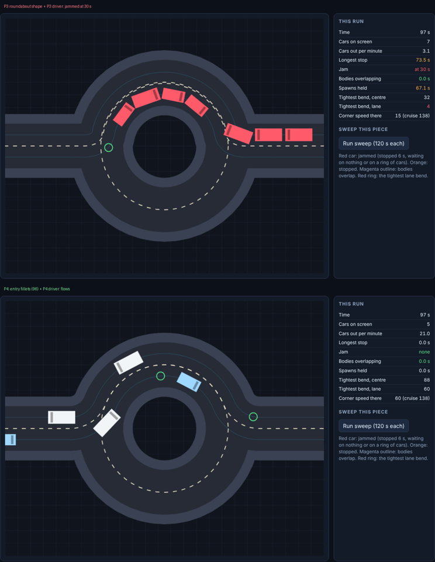
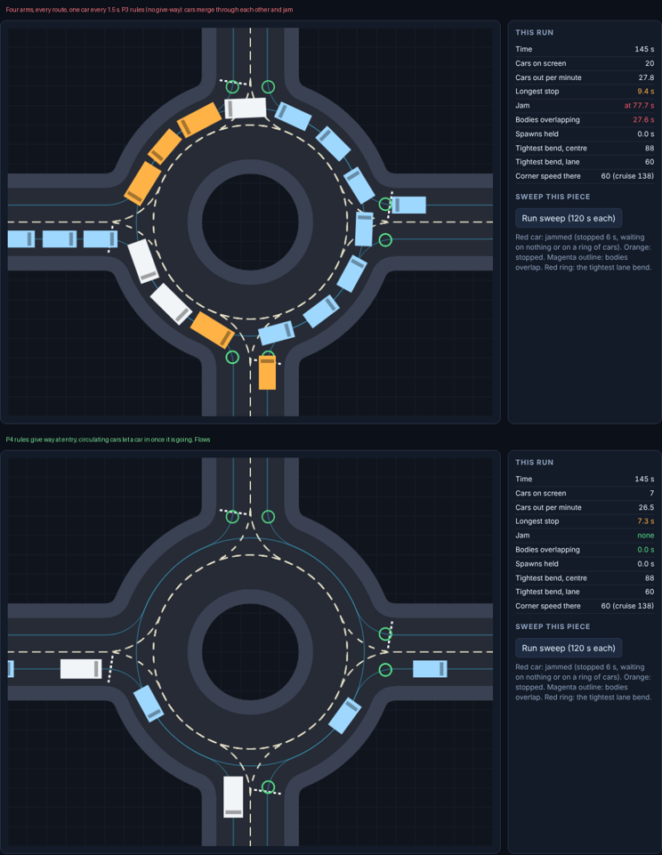
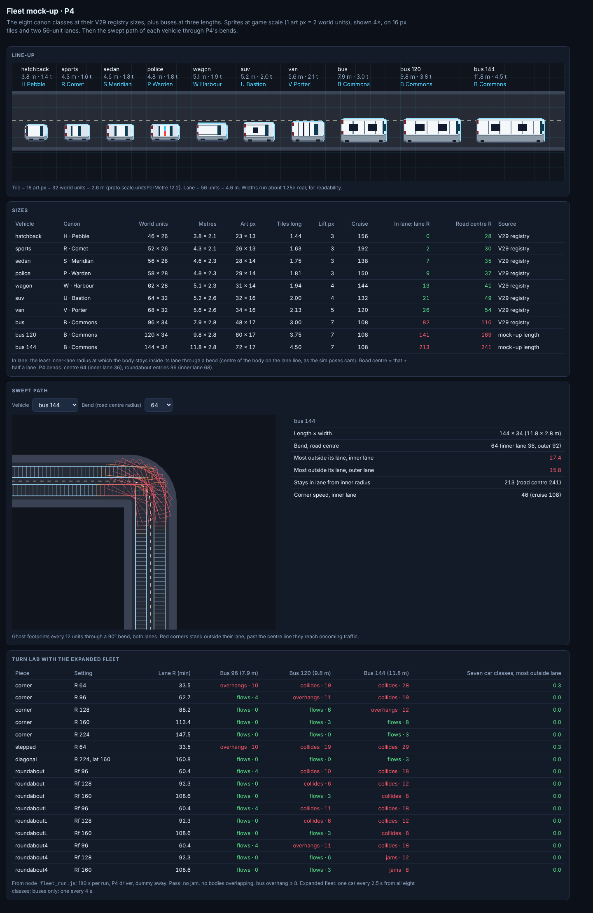
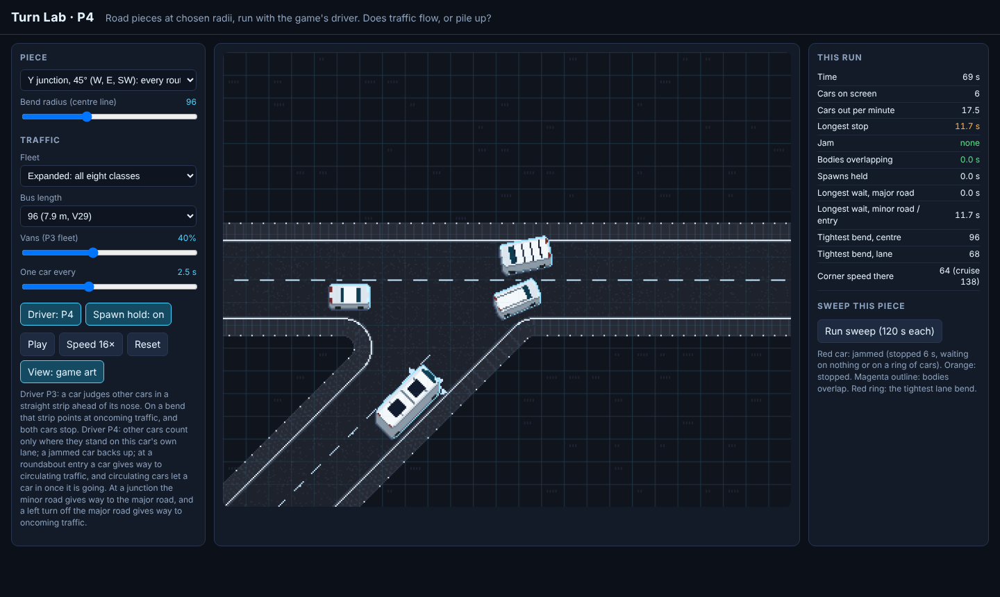
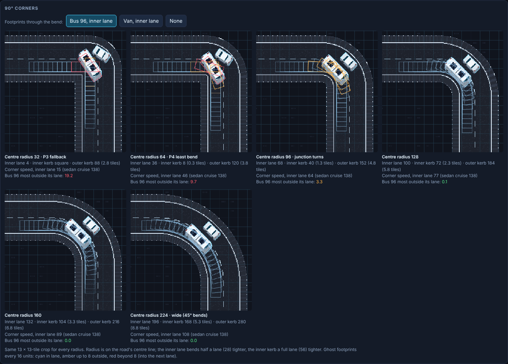
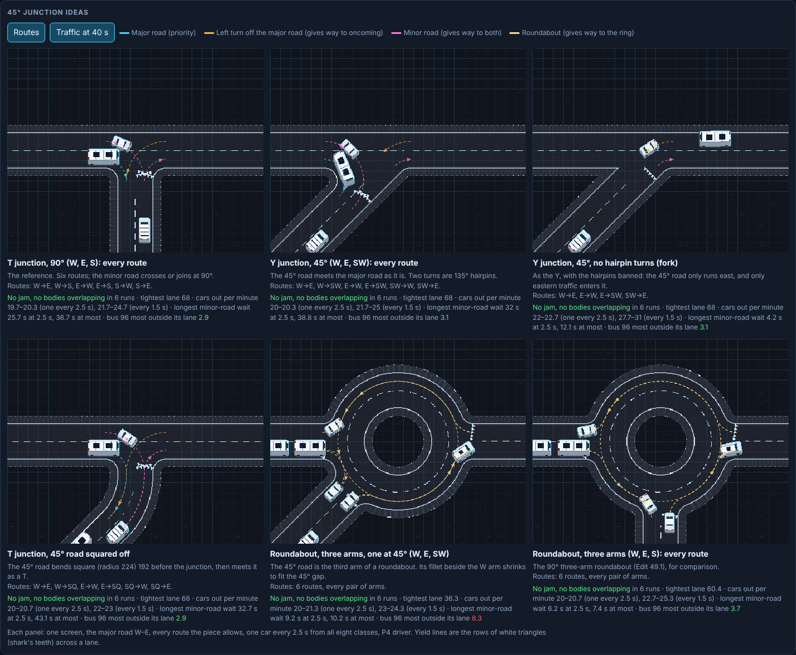
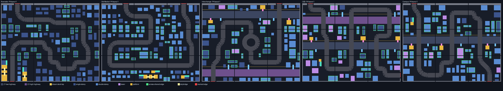
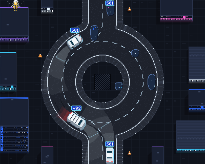
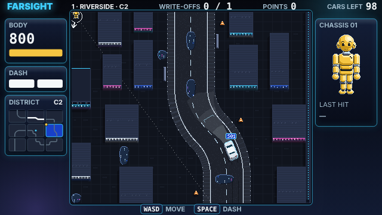

# DUMMIES — P4 test prototype: turn radii and 45° roads

**P4.3 · 21 October 2026 · Lawrence Lek** · Spec: GDD Edits 49–49.3 (proposed). P3 (P3.4) is unchanged.

P4 is P3.4 with the road and traffic rules under test. Four builds:

- **`turn_lab.html` (Turn Lab):** one road piece at a time, at any radius, with the game's driver, in game art. Does traffic flow or pile up?
- **`road_mockup.html` (Road mock-up):** 90° corners at radius 32–224; five 45° junction ideas with routes, yield lines and traffic.
- **`fleet_mockup.html` (Fleet mock-up):** every canon class and three bus lengths at game scale; swept paths; Turn Lab fleet runs.
- **`dummies_p4.html` (P4.3):** the game on 15 P4 layouts: 45° roads, roundabout fillets, the new driver and the spawn hold.

## Why

- **O3.60:** Interchange piles up. Cars cannot reverse out of it.
- **O3.61:** roads zigzag through a screen with tight left-right corners.
- **O3.62:** would a three- or four-way interchange still work?
- **O3.63:** what about the expanded fleet, with buses? Mock up lengths and sizes.
- **O3.64:** keep the 96 bus. Mock up the Turn Lab, the 90° radii and the 45° road junction idea.

## What the Interchange pile-up was

- Two causes, both measured.
- **Driver:** a P3 car judges other cars in a straight strip ahead of its nose. On a bend the strip points into the oncoming lane. Two opposing cars on a reverse bend each see the other head-on and stop. Neither reverses.
- **Geometry:** the radial road met the ring at a rounded 90° corner. Offset by half a lane, the inner lane bends at radius 4. Cars there swing through each other.
- **Repro (P3.4):** Interchange B2, all 3 layouts. A car had stood 10 s by 19–20 s; no car left the screen in 180 s.

## Rules under test (P4 only)

| Rule | Parameter | Value |
|---|---|---|
| Cars judge other cars along their own lane | `traffic.followRoad` | 1 |
| No new cars while traffic is jammed | `traffic.gridlockSeconds` | 6 s |
| A jammed car backs up to clear the jam | `traffic.jamReverse` | 1 |
| Give way at a roundabout entry: gap to circulating traffic | `traffic.giveWayGap` | 2.5 s |
| Give way: speed at the line | `traffic.giveWaySpeed` | 40 |
| Least bend on any road (centre line) | `world.turnRadiusTight` | 64 (inner lane 36) |
| Junction turns (centre line) | `world.junctionTurnRadius` | 96 (inner lane 68) |
| 45° road squared off: square run before a T | `world.junctionApproach` | 192 |
| Ring left between close arms' fillets | `world.roundaboutArmGap` | 10° |
| Roundabout entry fillet | `world.roundaboutEntryRadius` | 96 |
| Screens with 45° roads | `world.diagonalShare` | 0.25 |

- **Jammed:** a car stopped 6 s whose wait leads, car by car, to a cycle or to nothing. A queue behind the dummy or a cone is play: spawns continue.
- **Jam reverse:** a jammed car on the wrong side of the road backs up 140; a stopped car behind it backs up first to make room; of two cars facing each other, the later one backs up.
- **Entry room:** a car enters only with room to stop from cruise behind the last car in.
- **Z jog:** two 90° corners need an offset ≥ 128. A smaller offset takes one 45° segment.
- **45° style:** a through-screen's jog becomes one 45° segment; a corner screen's L is cut at 45° (96–192 per leg). Never under a flyover.

## Turn Lab



- **Pieces:** L corner, P3 Z jog, P3 stepped L, 45° diagonal jog, 45° chamfered L, roundabout (half round, three quarters round), roundabout with three arms, with four arms.
- **Controls:** radius, offset, corner cut, entry fillet (0 = P3 shape), van share, interval, driver P3/P4, spawn hold, speed.
- **Live:** cars out per minute, longest stop, jam time, seconds with bodies overlapping, seconds spawns held, tightest bend.
- **Sweep:** runs the piece over its radius range on both drivers.
- **Headless:** `node lab_run.js` → `docs/turn_lab_results.md` (330 runs, 180 s each).

P3 driver = P3.4: straight strip, no jam reverse. 282 runs, 180 s each, three vehicle mixes, the dummy away.

| Piece | P4 driver | P3 driver |
|---|---|---|
| L corner (90°) | Flows from centre 32. At 32 the inner lane bends at 3.6: 15 at the bend, 18–21 cars/min. At 64: 45 at the bend, 22–23 cars/min | Vans jam at centre 48–64 |
| Z jog, two 90° corners | Offset 48 jams. Offset 84: bodies overlap. Offset ≥ 128 flows | Jams at every offset |
| Stepped L | Flows. Full rate from centre 48 | Jams at every radius |
| 45° diagonal jog | Flows at every radius (64–224) and offset (84–240) | Jams on most short offsets |
| 45° chamfered L | Flows | Flows |
| Roundabout, half round | Flows even on the P3 shape: 15 at the entry, 18–19 cars/min. Fillet 96: 60 at the entry, 22/min | Jams at every fillet |
| Roundabout, three quarters | P3 shape fails (8–12 cars/min). Fillet ≥ 32 flows | Jams in most runs at every fillet |

- **Reading:** the driver causes the jams. Tight bends cost speed and throughput, and the shortest Z jogs fail on either driver.
- **P4 margin:** 64 for every bend (45 at the bend, full rate); 96 for roundabout entries.
- **Spawn hold, P3 roundabout on the P3 driver:** spawns held 145–150 s of 180; the queue stops growing.
- **Dummy in a lane for 30 s, then gone (P4):** jams clear within 27 s on every piece tested.

## Three- and four-arm roundabouts (P4.1, Edit 49.1)



- **Turn Lab pieces:** three arms (W, E, S) and four arms; one route per pair of arms; traffic keeps right and circulates anticlockwise on screen.
- **Give way:** a car slows to stop at its entry line (40 there) and waits while a circulating car would reach its join within 2.5 s.
- **Let in:** circulating cars slow for a car that has crossed its line and is going. A joining car does not follow circulating cars behind its join.

| Rules | Three arms | Four arms |
|---|---|---|
| P3 (straight strip, no give-way) | Light traffic: cars clip. One car every 1.5 s: jams in every run | Same |
| P4 without give-way | No jams. Cars merge through each other: 6–38 s per 180 s | 11–62 s per 180 s |
| P4 with give-way, fillet 96 | No jam, no overlap. 21–22 cars/min light; 25–27 dense | No jam, no overlap. 21–22 light; 24–26 dense |
| P4 with give-way, fillet 64 | No jam, no overlap | No jam, no overlap (corrected in P4.3) |

- **Districts:** still one road through each screen. A three- or four-arm Interchange needs branching roads in the planner.

## Fleet mock-up (P4.2, Edit 49.2)



- **Sizes:** the V29 registry `vehicles.<class>.length` and `.width`. Buses at 120 and 144 are mock-up lengths only.
- **In lane:** the least inner-lane radius at which a body stays in its lane. P4 bends give 36 (corners) and 68 (roundabout entries).

| Vehicle | Units (L × W) | Metres | Tiles long | In lane from |
|---|---|---|---|---|
| Hatchback | 46 × 26 | 3.8 × 2.1 | 1.4 | 0 |
| Sports | 52 × 26 | 4.3 × 2.1 | 1.6 | 2 |
| Sedan | 56 × 28 | 4.6 × 2.3 | 1.8 | 7 |
| Police | 58 × 28 | 4.8 × 2.3 | 1.8 | 9 |
| Wagon | 62 × 28 | 5.1 × 2.3 | 1.9 | 13 |
| SUV | 64 × 32 | 5.2 × 2.6 | 2.0 | 21 |
| Van | 68 × 32 | 5.6 × 2.6 | 2.1 | 26 |
| Bus (V29) | 96 × 34 | 7.9 × 2.8 | 3.0 | 82 |
| Bus 120 | 120 × 34 | 9.8 × 2.8 | 3.8 | 141 |
| Bus 144 | 144 × 34 | 11.8 × 2.8 | 4.5 | 213 |

- **Fleet matrix:** `node fleet_run.js 180` → `docs/fleet_results.md` (96 runs). Pass: no jam, no overlap, bus at most 8 outside its lane.

| Piece (road centre) | Bus 96 | Bus 120 | Bus 144 |
|---|---|---|---|
| Corner 64 | Swings 10 | Collides | Collides |
| Corner 96 | Flows | Swings 11 | Collides |
| Corner 128 | Flows | Flows | Swings 12 |
| Corner 160 | Flows | Flows | Flows |
| Two-arm roundabout, fillet 96 / 128 / 160 | Flows | Collides / collides / flows | Collides |
| Four-arm roundabout, fillet 96 / 128 / 160 | Flows | Swings 11 / flows / flows | Collides / swings 12 / flows (corrected in P4.3) |

- **Seven car classes:** at most 0.3 outside their lane on every piece.
- **Turn Lab:** fleet select (P3, expanded, buses only) and bus length (96, 120, 144).
- **Decided:** keep the bus at 96 (decision 200). A longer bus would need bus routes with bends ≥ 128–160.

## Turn Lab in game art, 90° corners, 45° junctions (P4.3, Edit 49.3)



- **Turn Lab:** game art by default (the game's ground and sprites, 16 px tiles). `View` toggles the diagram.
- **Junction pieces:** T (90°), Y (45°), fork (45°, no hairpins), squared-off T (45° road bent square), roundabout with a 45° arm.



| Centre radius | Inner lane | Inner kerb (tiles) | Corner speed, inner lane | Bus 96 outside lane |
|---|---|---|---|---|
| 32 (P3 fallback) | 4 | square | 15 | 19.2 |
| 64 (P4 least bend) | 36 | 8 (0.3) | 46 | 9.7 |
| 96 (junction turns) | 68 | 40 (1.3) | 64 | 3.3 |
| 128 | 100 | 72 (2.3) | 77 | 0.1 |
| 160 | 132 | 104 (3.3) | 89 | 0 |
| 224 (wide, 45° bends) | 196 | 168 (5.3) | 108 | 0 |



- **Give way by rank:** 0 major road; 1 left turn off it (gives way to oncoming); 2 minor road (gives way to both).
- **Yield line:** `traffic.minimumGap` before the first span shared with a higher rank. One per minor arm. US triangles.
- **Gap:** `traffic.giveWayGap`, or the time to clear from a standstill plus `perception.reactionDelay`. Priority cars let a going car in.
- **Junction matrix:** `node junction_run.js 180` → `docs/junction_results.md` (66 runs). No jam, no overlap on any piece.

| Piece (radius 96) | Routes | Cars out/min, every 2.5 s / 1.5 s | Longest minor wait, 2.5 s / any | Bus 96 outside lane, radius 64 / 96 |
|---|---|---|---|---|
| T, 90° | 6 | 19.7–20.3 / 21.7–24.7 | 25.7 / 36.7 s | 8.9 / 2.9 |
| Y, 45° | 6 | 20–20.3 / 21.7–25 | 32 / 38.8 s | 9 / 3.1 |
| Fork, 45° | 4 | 22–22.7 / 27.7–31 | 4.2 / 12.1 s | 8.8 / 3.1 |
| Squared-off T, 45° | 6 | 20–20.7 / 22–23 | 32.7 / 43.1 s | 8.9 / 2.9 |
| Roundabout, 45° arm | 6 | 20–21.3 / 23–24.3 | 9.2 / 10.2 s | 9.6 / 8.3 (fillet 64 / 96) |
| Roundabout, 90° three arms | 6 | 20–20.7 / 22.7–25.3 | 6.2 / 7.4 s | — / 3.7 |

- **Recommendation (decision 204):** a 45° road joins as a roundabout arm where a ring fits; else a fork; a squared-off T where a T is wanted.
- **Jam-test fix (decision 205):** a car at its yield line is giving way. Turn Lab: 1 of 330 verdicts changed. Fleet: 2 of 48 cells.

## P4 layouts







- **Bake:** 15 kept of 61 candidates (`content/districts/districts_p4.json`, `p4-edit49-2026-10-21`). No candidate failed on a bend or a jam.
- **Every lane:** tightest bend 33.5 (36 nominal) on all 15 layouts.
- **Traffic soak (contract clause 26):** every screen, 60 s, no jam.

| District | 45° screens, layouts 1–3 | First bot write-off, layouts 1–3 |
|---|---|---|
| Riverside | 1, 1, 3 | 35.8, 29.5, 48.3 s |
| Old Market | 3, 3, 3 | 31.6, 30.2, 76.9 s |
| Interchange | 0, 2, 1 | 20.9, 43.6, 39.4 s |
| CBD | 1, 1, 2 | 32.0, 55.3, 37.7 s |
| Campus | 3, 2, 0 | 36.6, 32.5, 36.1 s |

- Z jogs too short for two corners also take a 45° segment, whatever the screen's style.
- **Browser:** Interchange B2, 60 s of traffic: 17 cars out, longest stop 0, no jam. A 45° screen toured. No page errors.

## Run

```
python3 build.py            # dummies_p4.html, turn_lab.html, fleet_mockup.html, road_mockup.html
node test_sim.js            # P3.4 checks plus P4 checks (91)
node lab_run.js 180         # Turn Lab matrix
node fleet_run.js 180       # Fleet matrix
node junction_run.js 180    # Junction matrix
node tools/district_bake.js 60   # P4 layouts → content/districts/districts_p4.json
```

## Files

| File | Role |
|---|---|
| `sim.js` | P3.4 sim plus Edit 49: `filletAny`, the `diagonal` style, roundabout fillets, `leadGap` along the lane, `jammed`, `jamCause`, `needsRoom`; Edit 49.1: `giveWayHold`, `mergingPast`; Edit 49.3: `junctionHold`, `junctionLetIn`, `junctionPast`, ring arms at any angle |
| `lab.js`, `lab_view.js`, `lab_shell.html` | Turn Lab: pieces (Edit 49.3: junctions, shared spans, ranks), runner, metrics, viewer in game art or diagram |
| `lab_run.js` | Headless matrix |
| `fleet_run.js`, `fleet_view.js`, `fleet_shell.html` | Fleet mock-up: matrix, page |
| `junction_run.js`, `road_view.js`, `road_shell.html` | Road mock-up: junction matrix, page |
| `tools/district_check.js` | Contract plus clauses 25 (bends) and 26 (60 s traffic soak) |
| `tools/district_bake.js` | Bakes P4 layouts to `content/districts/districts_p4.json` |
| `game.js`, `pixel.js`, `shell.html` | P3.4 renderer. Screen toasts show the theme and `45° road`. `pixel.js` draws each canon class (Edit 49.2); junction roads and yield lines (Edit 49.3) |

## Open

- **Junction choice:** roundabout arm, fork or squared-off T for a 45° road (decision 204)?
- **Planner:** branching roads. Districts still run one road per screen.
- **Minor-road waits:** 26–43 s at priority junctions in heavy traffic. Play, or force a gap?

- **Bus pose:** bodies centre on the lane line. A two-axle pose would cut the inside like a real bus.
- **Bus behaviour:** canon buses only brake. The P4 driver still lets them swerve.

- **Adopt into P3?** The driver and spawn hold carry over without a rebake. Bends and 45° roads need one.
- **Diagonal art:** 45° segments draw with the curve renderer. Playtest how they read.
- **Passing clips:** a car passing a dummy can still clip an oncoming car before the jam clears. P3 does the same.
- **Frontage:** buildings stay axis-aligned beside a diagonal, leaving wedge forecourts.
