# DUMMIES — P5 prototype: five models, bus roads, faster highways, one traffic per district

**P5.3 · 25 October 2026 · Lawrence Lek** · Spec: GDD Edits 50–50.2, 51–51.3, 52 and 53 (proposed). P3 (P3.4) and P4 (P4.3) are unchanged.

P5 is the game with P4's road and traffic learnings, plus the fleet, highway and points rules of Edits 50 and 50.1.

- **`dummies_p5.html`:** the game (P5.3).
- **`highway_mockup.html`:** highway width at 176, 160 and 128 over the same road, in game art with live traffic.
- **`cityscape_mockup.html`:** the three proposed districts (Edits 51.3 and 52): the three centres live at the top, then each district as 3 × 3 screens in game art with live traffic. Tap a screen to see it at 2×. Not in the game yet.

## Why

- **O3.72:** vehicles continuous across the whole map. Cars come from the start, not tile by tile; a car followed to the next tile keeps its speed. A final decision; check how before building.
- **O3.65:** buses only on roads with centre radius 160, and on the elevated highways.
- **O3.65:** highway traffic faster, with fewer vehicles, and better to go there.
- **O3.65:** 45° roads and highways in; all new learnings into P5. Five car models: hatchback, sedan, police, van, small bus.
- **O3.66:** the highway pays through speed, not a bonus. Walking into a car's front scores too much. What about diagonal highways?
- **O3.67:** highways as wide as the road and walkway below; lamps 8–10 per screen width; round columns; angles only on ground roads. Three cityscapes instead of five.
- **O3.71:** an adversarial level-design critic; one mechanic and landmark per tile; flow to the centre; crossings at 90° or 45°; roundabouts with three or more arms; cars orbit the inner ring lane until their exit is free. Highways may run across, down or at 45°.
- **O3.70:** Parkland's roundabout higher in the screen; more interesting paving and planting. Circus buildings more monumental and brutalist cyberpunk.
- **O3.69:** Parkland's B2 road runs top to bottom. Two escalators per highway screen, opposite sides, opposite ends. Monument: a road in the middle; walkways must read as raised to meet roofs. Brutalist planters, not flowers.
- **O3.68:** Parkland keeps the Z1 ring over the lake. Circus as is. Sculptures, not trees. Monument: 90° and 45° only; roofs lead up to the walkway; no rounded walkway ends. Mock up the three as 3 × 3 layouts.

## From P4

| Learning | Parameter | Value |
|---|---|---|
| Cars judge other cars along their own lane | `traffic.followRoad` | 1 |
| No new cars while traffic is jammed | `traffic.gridlockSeconds` | 6 s |
| A jammed car backs up to clear the jam | `traffic.jamReverse` | 1 |
| Least bend on any road (centre line) | `world.turnRadiusTight` | 64 |
| Roundabout entry fillet | `world.roundaboutEntryRadius` | 96 |
| Screens with 45° roads | `world.diagonalShare` | 0.25 |
| Give way at ring entries and junctions; a car at its line is not jammed | `traffic.giveWayGap` | 2.5 s |

- **Junction pieces** (Edit 49.3) are in the driver, not the planner. Districts still run one road per screen.

## New in P5 (Edit 50)

| Rule | Parameter | Value |
|---|---|---|
| Five models: vans by district, then hatchback, police, bus; sedans the rest | `traffic.share.hatchback` / `.police` / `.bus` | 0.22 / 0.08 / 0.10 |
| A bus runs a ground road only if every bend keeps this radius (no ring) | `vehicles.bus.minRadius` | 160 |
| Highways (straight) always carry buses | — | — |
| A bus only brakes; it never swerves | `vehicles.bus.swerve` | 0 |
| Highway cars cruise faster | `traffic.deckSpeedScale` | 1.4× |
| Highway cars come further apart | `traffic.deckGapScale` | 1.5× `world.deckInterval` |
| Highway width: lanes 112, a 16 walkway each side, parapets 8, as the road below with its pavements (Edit 50.2) | `world.deckWidth` | 160 (was 176) |
| Highway lamps in pairs, one per parapet (Edit 50.2) | `world.deckLampSpacing` | 88 (about 9 a side per screen) |
| Highways run square only; 45° angles stay on ground roads (Edit 50.2) | `world.deckCrossAngle` | 5° |
| Highway hits pay through speed alone (Edit 50.1; was 1.5×) | `damage.deckMultiplier` | 1 |
| Walking or running into a car adds this share of the dummy's speed; a dash adds all of it, up to `proto.dummyStrikeSpeed` (Edit 50.1) | `damage.walkShare` | 0.25 |

- **Bus slot on an unfit road:** runs as a sedan.
- **Bend measure:** arc length over turn, across four vertices; 10% polyline tolerance (as contract clause 25).
- **Sight:** a bus hides the dummy from cars like a van, and casts a sensor shadow.
- **Popup:** a highway hit shows `HIGHWAY X…` under its points when `damage.deckMultiplier` > 1 (off in P5.1).
- **Out:** sports, wagon and SUV. Their sizes stay in the registry.

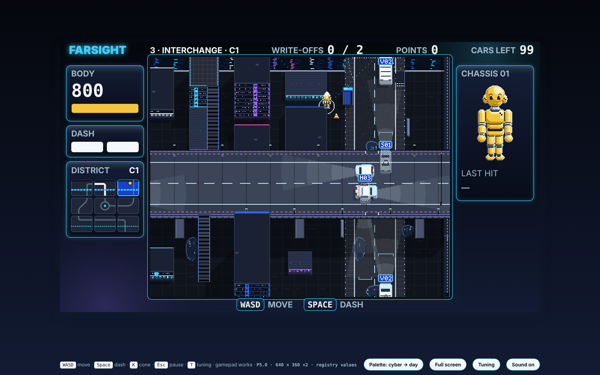

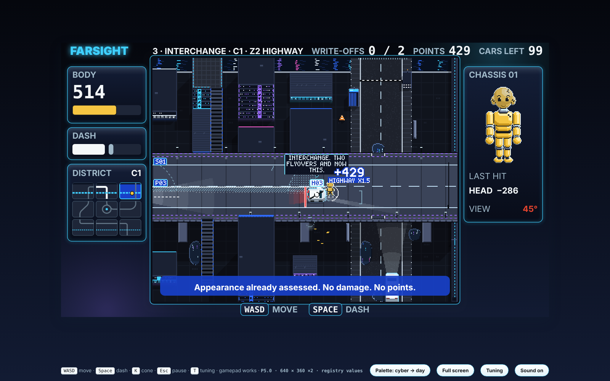

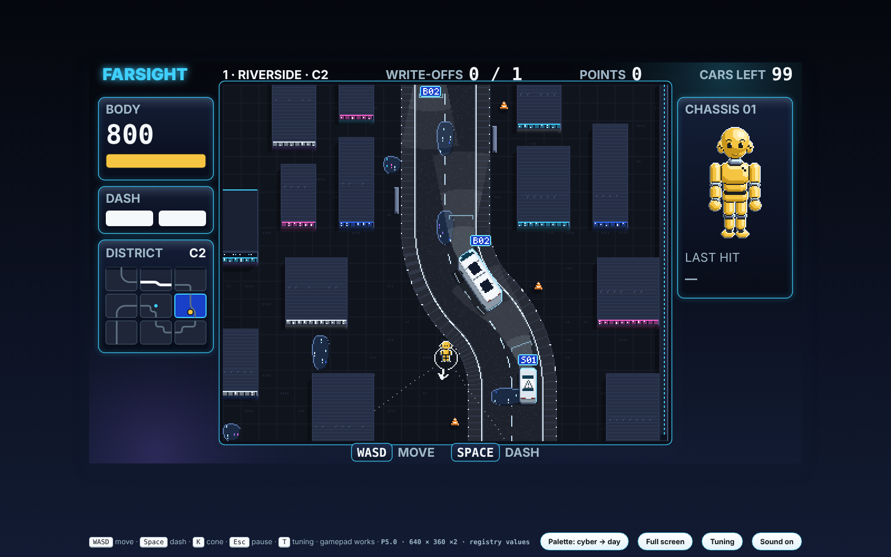

## Points rebalance (P5.1, Edit 50.1)

| Front contact with a sedan (points = damage) | Parked | Caution (82) | Cruise (138) | Highway (193) |
|---|---|---|---|---|
| Standing | 0 | 35 | 100 | 196 |
| Walking in (81): P5.0 → P5.1 | 34 → 2 | 140 → 55 | 252 → 132 | 394 → 239 |
| Running in (162): P5.0 → P5.1 | 53 → 9 | 174 → 79 | 297 → 167 | 451 → 286 |
| Dashing in | 53 | 174 | 297 | 451 |

- **Points report** (`docs/points_report.md`, every start screen, 150 s):

| Model | Style | Layouts with a write-off | Write-offs | Mean points per hit | Median first write-off |
|---|---|---|---|---|---|
| P5.0 | Walks into cars | 13 of 15 | 22 | 54 | 57 s |
| P5.0 | Dashes | 15 of 15 | 34 | 77 | 35 s |
| P5.1 | Walks into cars | 0 of 15 | 0 | 15 | — |
| P5.1 | Dashes | 14 of 15 | 27 | 60 | 49 s |

- **Bake bot:** all 15 layouts still give a first write-off by 90 s (18–87 s). No rebake.

## Highways (P5.2, Edit 50.2)

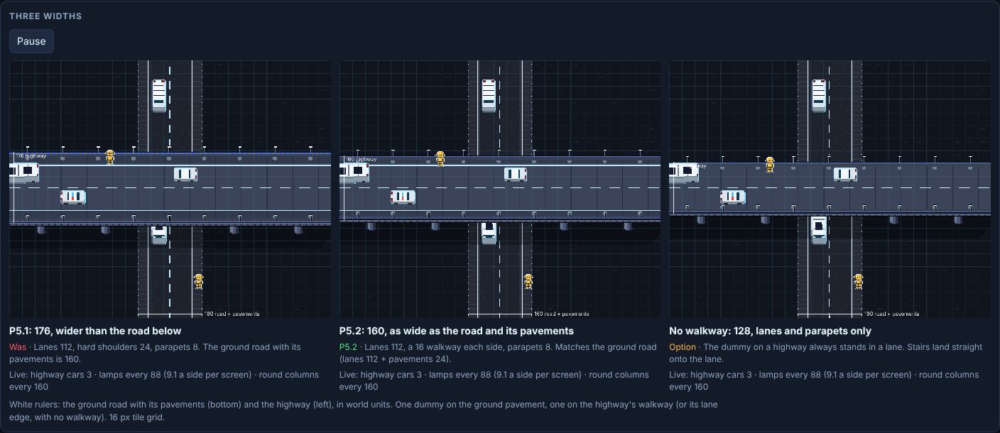

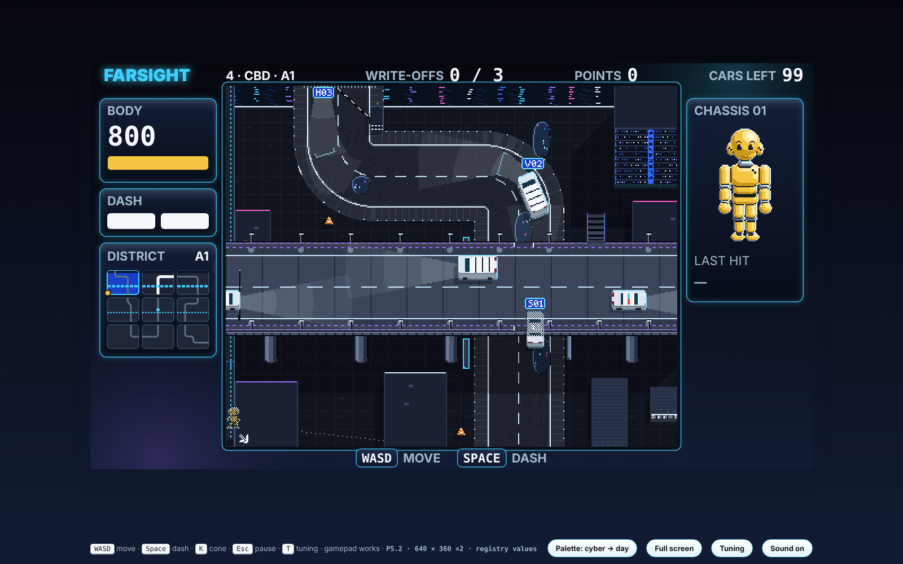

- **Diagonal highways (P5.1 mock-up):** rejected. Highways run square; 45° angles stay on ground roads (decision 224).

## Three districts (mock-up, Edits 51–52)

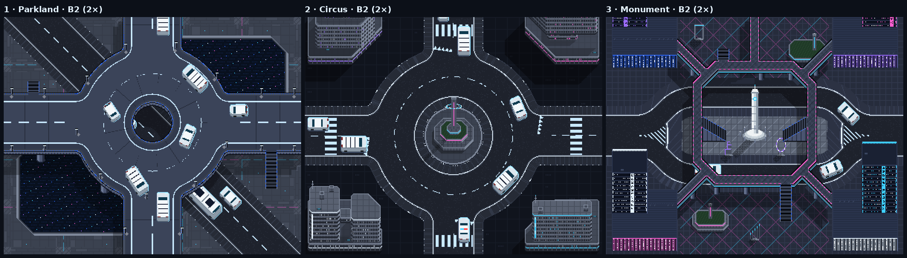

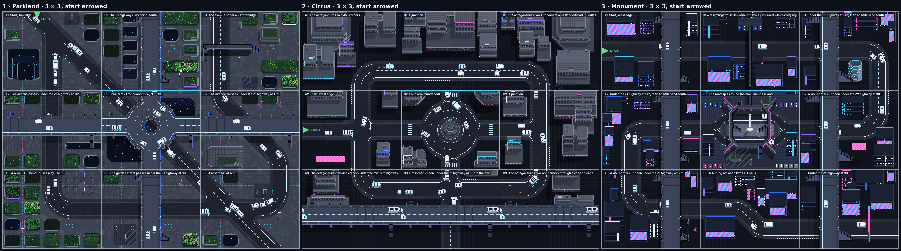

| District | Start | Centre (B2) | The rest |
|---|---|---|---|
| 1 Parkland | A1, top edge | Four-arm Z1 ring; the 45° boulevard passes beneath | Z1 highways across row 2 and down column B; T and crossroads at 45°; footbridge; R160 bends |
| 2 Circus | A2, west edge | Four-arm roundabout; orbit lane | Octagon street with 45° corners; crossroads and T junctions; roadworks, flooded corner, a coned lane (C3, Edit 53) |
| 3 Monument | A1, west edge | Split road under the walkway ring | Z1 and Z2 highways down columns A and C; skybridge; bends, corner cuts, a 45° jog |

- **Level design (Edit 52):** each tile reveals one mechanic and one landmark; the table under the grid lists them. Critique: `docs/level_design_critique.md`.
- **Roundabouts (Edit 52):** three or more arms; cars orbit on the inner lane when their exit is blocked (`traffic.ringOrbit`). Evidence: `docs/orbit_report.md`.
- **Escalators (rule):** two per highway screen, opposite sides, opposite ends.

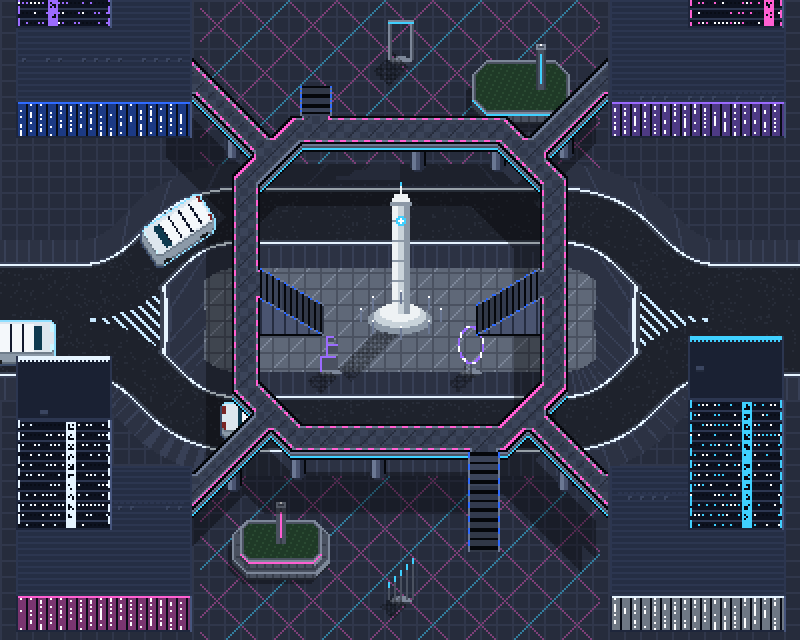

## District traffic (P5.3, Edit 53)

| Rule | Parameter | Value |
|---|---|---|
| Every screen of a district runs its traffic every tick | `traffic.continuous` | 1 |
| A car crossing a shared edge goes on next door: same id, model, speed, offset and plan | — | — |
| Cars this near a seam are seen and drawn next door; the dummy is seen across the edge | `world.spawnLeadIn` | 200 |
| Cars enter only where a road or highway crosses the district boundary | — | — |
| At the start every lane runs at its steady headway; a car on each start-screen lane | district interval × 2 | — |
| A bus enters only if its whole route keeps the bus radius (no game district does) | `vehicles.bus.minRadius` | 160 |
| Junction waits that would close a circle are broken (after this long) | `traffic.gridlockSeconds` | 6 s |
| Mock-up: each entry admits one car per 2 × interval | `world.district.<id>.interval` | 4.5 / 3.2 / 2.4 s |
| Mock-up: after this many seams a car takes the way out | `traffic.exitAfterSeams` | 9 |
| Mock-up: a district runs this long before it is shown | `traffic.warmSeconds` | 30 s |

- **CARS LEFT:** the shift's cars not yet entered, plus those still in the district.
- **Off:** `traffic.continuous` 0 restores P5.2, one screen at a time.

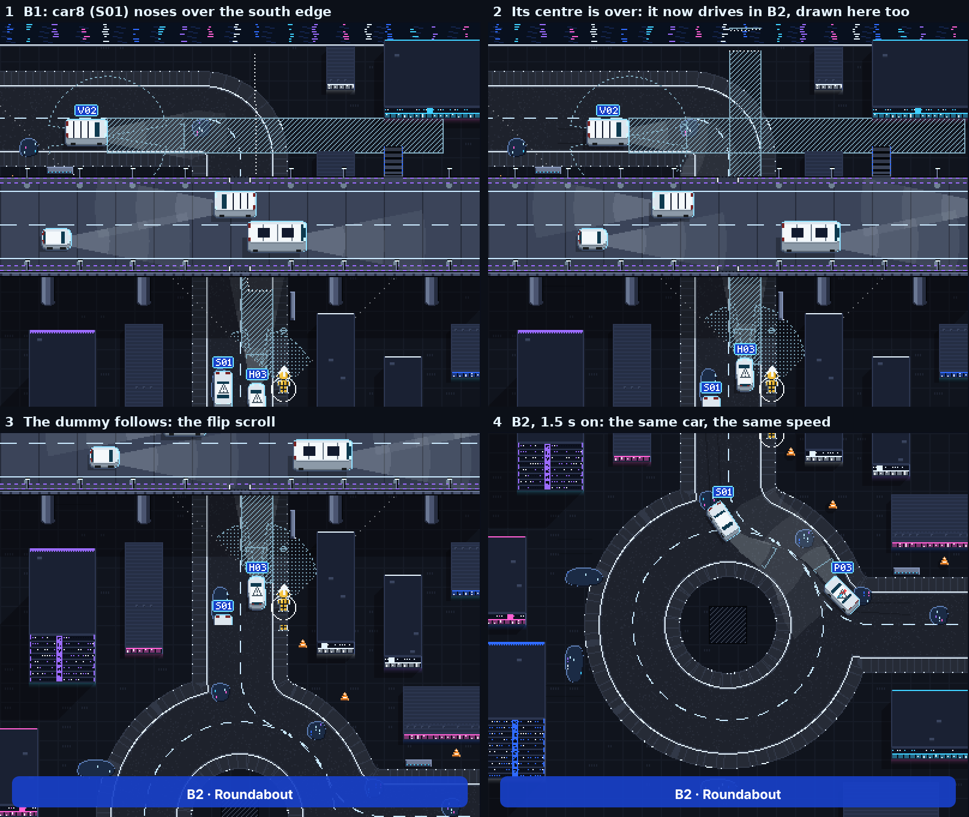

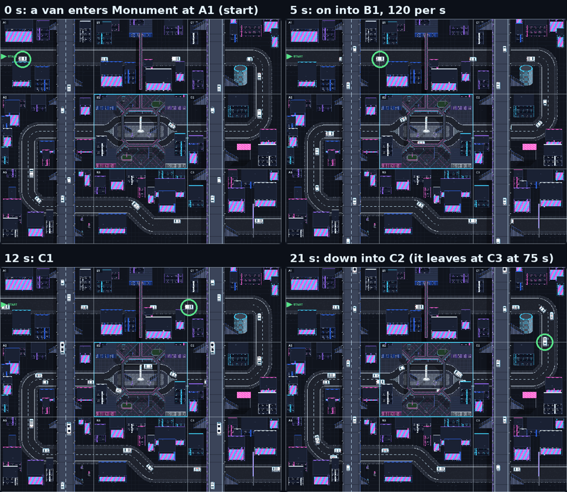

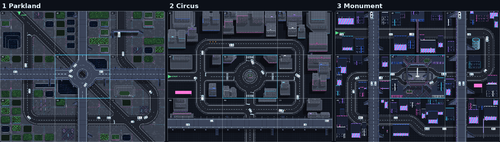

## Evidence

- `node test_sim.js` → 101/101: P3.4 and P4 checks, plus P5 fleet, buses, highways, points and district traffic.
- `node tools/continuity_report.js` → `docs/continuity_report.md`: 15 layouts, 120 s each. No jump, no car lost or doubled, no seam overlap, exits only at the district edge.
- **Rebake (P5.2):** 15 layouts of 32 candidates at the 160 deck; bot first write-off 18–87 s.
- **Bake:** 15 layouts kept of 30 candidates (`content/districts/districts_p5.json`, `p5-edit50-2026-10-21`). Contract clauses 25–26 hold with the P5 fleet.
  - 11 of 15 match P4's layouts. Interchange 1–3 and CBD 3 differ.
- **Report:** `node tools/p5_report.js 120` → `docs/p5_report.md`.

| Measure | P5 | P4 highway settings |
|---|---|---|
| Highway cars per lane on screen | 1.81 | 4.31 |
| Mean highway speed | 182 | 113 |
| Buses among highway cars | 11% | 10% |

- **Bus roads (P5.2):** 53 of 135 screens (39%) on the P5.2 layouts may carry a bus on the ground (54 on P5.0's). Every highway carries buses.
  - Per district, layouts 1–3: Riverside 4, 7, 4 · Old Market 4, 3, 4 · Interchange 4, 2, 3 · CBD 1, 3, 3 · Campus 6, 4, 1 (of 9).
- **Ground buses:** 27 of 693 ground cars on the 15 highway screens of layout 1 (120 s each, P5.2). P5.3: none, as no whole district route keeps the bus radius.
- **Bot, start screen:** first write-off 23–53 s on every layout.

## Run

```
python3 build.py                 # dummies_p5.html
node test_sim.js                 # P3.4, P4 and P5 checks (94)
node tools/district_bake.js 60   # P5 layouts → content/districts/districts_p5.json
node tools/p5_report.js 120      # bus roads, highway traffic
node tools/points_report.js 150  # walk-in against dash play, before and after damage.walkShare
node tools/orbit_report.js        # the inner-lane orbit, free flow and a blocked exit
node tools/continuity_report.js   # district-wide traffic: seams, start, queues, one car followed
```

## Files

| File | Role |
|---|---|
| `sim.js` | P4.3 sim plus Edit 50: `fleetClass`, `minBend`, `busRoad`, deck speed and spacing, highway points, bus without swerve. Edit 53: `netBuild`, `netBegin`/`netEnd` (district traffic), `laneEnds`, ghosts, junction lock breakers |
| `game.js`, `pixel.js`, `shell.html` | P4.3 renderer. Highway popup; bus sensor shadow; P5 tuning rows |
| `lab.js` | Test helper only (road pieces for `test_sim.js`). The Turn Lab stays in P4 |
| `tools/district_bake.js`, `tools/district_check.js` | Bake and contract, as P4 |
| `tools/p5_report.js` | Bus roads and highway traffic on the baked layouts |
| `tools/points_report.js` | Walk-in and dash play on every start screen, P5.0 and P5.1 points |
| `highway_view.js`, `highway_shell.html` | Highway width mock-up (P5.1's diagonal mock-up retired) |
| `cityscape_view.js`, `cityscape_shell.html` | Three districts mock-up: centres, then 3 × 3 screens with a mechanic and landmark per tile (Edit 52); screens linked into one traffic (Edit 53) |
| `tools/orbit_report.js` | Inner-lane orbit evidence (Edit 52) |
| `tools/continuity_report.js` | District-wide traffic evidence (Edit 53) |

## Open

- **Ring capacity (Edit 53):** Parkland's Z1 ring takes all four highway entries. At one car per 6 s per entry it locks within minutes; the mock-up runs one per 9 s.
- **Ground buses (Edit 53):** none until the planner builds whole bus routes.
- **Districts (decisions 225–255):** approve the three layouts, then P6 rebuilds the planner: a curved deck, split roads, walkways on columns, podium roofs, two escalators per highway screen.
- **No-walkway highway (decision 223):** 128 wide, lanes and parapets only. Mocked up, not adopted.
- **Walk share:** 0.25 stops walk-in write-offs; dashing play slows (first write-off 35 → 49 s).

- **Bus routes:** 40% of screens fit a bus. Should the planner make wide-bend bus routes?
- **Junctions:** the 45° junction choice (decision 204) and branching roads in the planner.
- **Police:** canon says it tracks your approach, then commits. P5 drives it like a sedan.
- **Hatchback:** canon says one signalled recommitment. Not built.
