# DUMMIES — P5 prototype: five models, bus roads, faster highways, one traffic per district

**P5.3 · 26 October 2026 · Lawrence Lek** · Spec: GDD Edits 50–50.2, 51–51.3, 52, 53, 53.1, 54, 55–55.2, 56–59 (proposed). P3 (P3.4) and P4 (P4.3) are unchanged.

P5 is the game with P4's road and traffic learnings, plus the fleet, highway and points rules of Edits 50 and 50.1.

- **`dummies_p5.html`:** the game (P5.3).
- **`highway_mockup.html`:** highway width at 176, 160 and 128 over the same road, in game art with live traffic.
- **`cityscape_mockup.html`:** the three proposed districts (Edits 51.3 and 52): the three centres live at the top, then each district as 3 × 3 screens in game art with live traffic. Tap a screen to see it at 2×. Not in the game yet.

## Why

- **O3.73:** P6 builds whole bus routes. Parkland: widen the ring so highways can carry more.
- **O3.72:** vehicles continuous across the whole map. Cars come from the start, not tile by tile; a car followed to the next tile keeps its speed. A final decision; check how before building.
- **O3.65:** buses only on roads with centre radius 160, and on the elevated highways.
- **O3.65:** highway traffic faster, with fewer vehicles, and better to go there.
- **O3.65:** 45° roads and highways in; all new learnings into P5. Five car models: hatchback, sedan, police, van, small bus.
- **O3.66:** the highway pays through speed, not a bonus. Walking into a car's front scores too much. What about diagonal highways?
- **O3.67:** highways as wide as the road and walkway below; lamps 8–10 per screen width; round columns; angles only on ground roads. Three cityscapes instead of five.
- **O3.71:** an adversarial level-design critic; one mechanic and landmark per tile; flow to the centre; crossings at 90° or 45°; roundabouts with three or more arms; cars orbit the inner ring lane until their exit is free. Highways may run across, down or at 45°.
- **O3.70:** Parkland's roundabout higher in the screen; more interesting paving and planting. Circus buildings more monumental and brutalist cyberpunk.
- **O3.69:** Parkland's B2 road runs top to bottom. Two escalators per highway screen, opposite sides, opposite ends. Monument: a road in the middle; walkways must read as raised to meet roofs. Brutalist planters, not flowers.
- **O3.68:** Parkland keeps the Z1 ring over the lake. Circus as is. Sculptures, not trees. Monument: 90° and 45° only; roofs lead up to the walkway; no rounded walkway ends. Mock up the three as 3 × 3 layouts.

## From P4

| Learning | Parameter | Value |
|---|---|---|
| Cars judge other cars along their own lane | `traffic.followRoad` | 1 |
| No new cars while traffic is jammed | `traffic.gridlockSeconds` | 6 s |
| A jammed car backs up to clear the jam | `traffic.jamReverse` | 1 |
| Least bend on any road (centre line) | `world.turnRadiusTight` | 64 |
| Roundabout entry fillet | `world.roundaboutEntryRadius` | 96 |
| Screens with 45° roads | `world.diagonalShare` | 0.25 |
| Give way at ring entries and junctions; a car at its line is not jammed | `traffic.giveWayGap` | 2.5 s |

- **Junction pieces** (Edit 49.3) are in the driver, not the planner. Districts still run one road per screen.

## New in P5 (Edit 50)

| Rule | Parameter | Value |
|---|---|---|
| Five models: vans by district, then hatchback, police, bus; sedans the rest | `traffic.share.hatchback` / `.police` / `.bus` | 0.22 / 0.08 / 0.10 |
| A bus runs a ground road only if every bend keeps this radius (no ring) | `vehicles.bus.minRadius` | 160 |
| Highways (straight) always carry buses | — | — |
| A bus only brakes; it never swerves | `vehicles.bus.swerve` | 0 |
| Highway cars cruise faster | `traffic.deckSpeedScale` | 1.4× |
| Highway cars come further apart | `traffic.deckGapScale` | 1.5× `world.deckInterval` |
| Highway width: lanes 112, a 16 walkway each side, parapets 8, as the road below with its pavements (Edit 50.2) | `world.deckWidth` | 160 (was 176) |
| Highway lamps in pairs, one per parapet (Edit 50.2) | `world.deckLampSpacing` | 88 (about 9 a side per screen) |
| Highways run square only; 45° angles stay on ground roads (Edit 50.2) | `world.deckCrossAngle` | 5° |
| Highway hits pay through speed alone (Edit 50.1; was 1.5×) | `damage.deckMultiplier` | 1 |
| Walking or running into a car adds this share of the dummy's speed; a dash adds all of it, up to `proto.dummyStrikeSpeed` (Edit 50.1) | `damage.walkShare` | 0.25 |

- **Bus slot on an unfit road:** runs as a sedan.
- **Bend measure:** arc length over turn, across four vertices; 10% polyline tolerance (as contract clause 25).
- **Sight:** a bus hides the dummy from cars like a van, and casts a sensor shadow.
- **Popup:** a highway hit shows `HIGHWAY X…` under its points when `damage.deckMultiplier` > 1 (off in P5.1).
- **Out:** sports, wagon and SUV. Their sizes stay in the registry.


## Points rebalance (P5.1, Edit 50.1)

| Front contact with a sedan (points = damage) | Parked | Caution (82) | Cruise (138) | Highway (193) |
|---|---|---|---|---|
| Standing | 0 | 35 | 100 | 196 |
| Walking in (81): P5.0 → P5.1 | 34 → 2 | 140 → 55 | 252 → 132 | 394 → 239 |
| Running in (162): P5.0 → P5.1 | 53 → 9 | 174 → 79 | 297 → 167 | 451 → 286 |
| Dashing in | 53 | 174 | 297 | 451 |

- **Points report** (`docs/points_report.md`, every start screen, 150 s):

| Model | Style | Layouts with a write-off | Write-offs | Mean points per hit | Median first write-off |
|---|---|---|---|---|---|
| P5.0 | Walks into cars | 13 of 15 | 22 | 54 | 57 s |
| P5.0 | Dashes | 15 of 15 | 34 | 77 | 35 s |
| P5.1 | Walks into cars | 0 of 15 | 0 | 15 | — |
| P5.1 | Dashes | 14 of 15 | 27 | 60 | 49 s |

- **Bake bot:** all 15 layouts still give a first write-off by 90 s (18–87 s). No rebake.

## Highways (P5.2, Edit 50.2)


- **Diagonal highways (P5.1 mock-up):** rejected. Highways run square; 45° angles stay on ground roads (decision 224).

## Three districts (mock-up, Edits 51–52)


| District | Start | Centre (B2) | The rest |
|---|---|---|---|
| 1 Parkland | A1, top edge | Four-arm Z1 ring; the 45° boulevard passes beneath | Z1 highways across row 2 and down column B; a 90° T at A1; a street ring at C3 (Edit 56); footbridge to the highway; R160 bends |
| 2 Circus | A2, west edge | Four-arm street ring; orbit lane | Octagon street with 45° corners; street rings at A2 and C2, T junctions at B1 and B3 (Edit 56); exit east; roadworks, flooded corner, a coned lane (C3, Edit 53) |
| 3 Monument | A1, west edge | Split road under the walkway ring | Z1 and Z2 highways down columns A and C; skybridge; bends, corner cuts, a 45° jog |

- **Level design (Edit 52):** each tile reveals one mechanic and one landmark; the table under the grid lists them. Critique: `docs/level_design_critique.md`.
- **Roundabouts (Edit 52):** three or more arms; cars orbit on the inner lane when their exit is blocked (`traffic.ringOrbit`). Evidence: `docs/orbit_report.md`.
- **Escalators (rule):** two per highway screen, opposite sides, opposite ends. Monument C2: the west one drops from the roof plaza (Edit 54).
- **Set piece (Edit 54):** every tile shows scenography, a change of level, or both. The plan table names it; the page warns on a tile without one.
- **Portal and roof link (Edit 54):** Monument C2's Z2 highway runs through a 12-storey tower (opening `world.portalClearance`, 72). A roof plaza at Z2 opens off its west parapet.
- **Redrawn (Edit 54):** Parkland A3 belvedere; Monument A3 stacked LED cubes, B3 skybridge across the jog.
- **Nothing below ground (Edit 55):** Z0 is the lowest level. Parkland C3's court is at grade. Exception (Edit 59): a river's surface below its seawall; water, not a floor.
- **No street zebras (Edit 59):** removed from Circus B2. Parapet zebras stay where the dummy steps onto a highway.
- **Planting in three sizes (Edit 55):** a great lawn over the largest free block (`world.gardenLargeCells`), beds only where they frame it or the set piece (`world.gardenBedTypes` types), planters `world.gardenPlanter` across in the open squares.
- **Sculpture in three sizes (Edit 55):** courts with one large piece (`world.sculptureScaleLarge`), two medium, `world.courtSmallCount` lit bollards. Parkland B3 and C3.

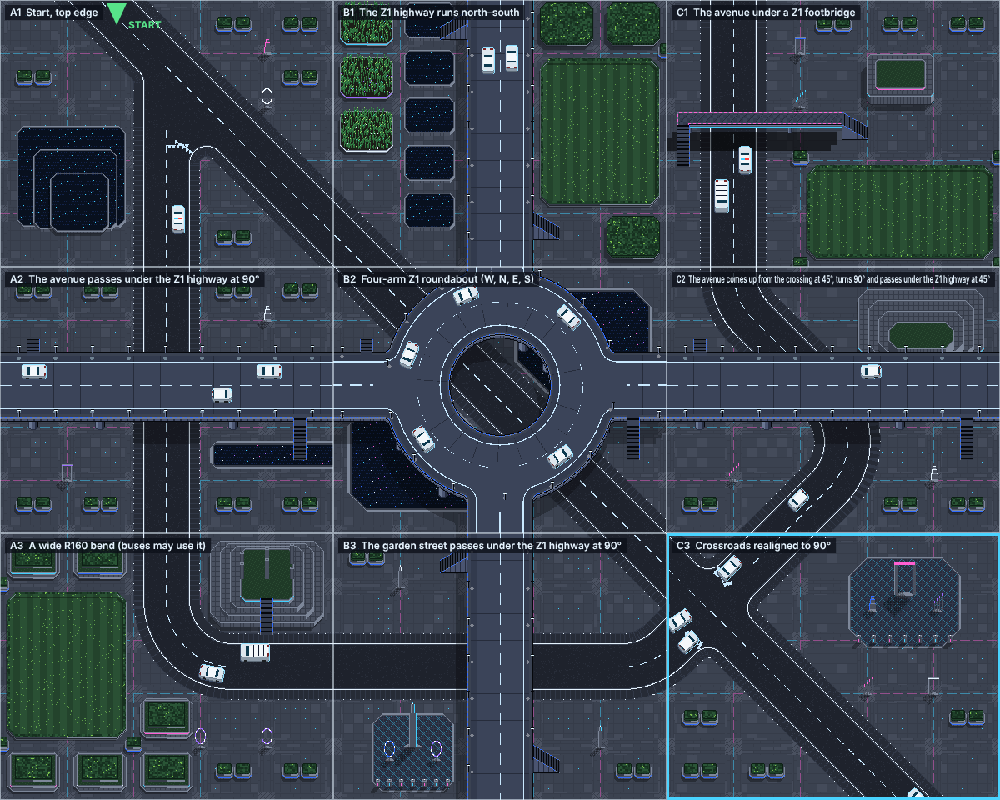

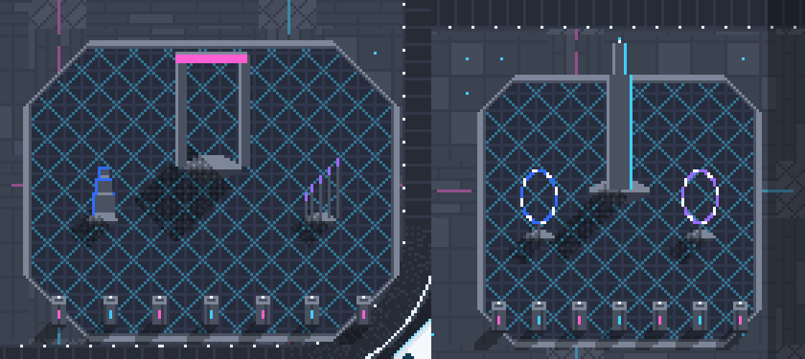

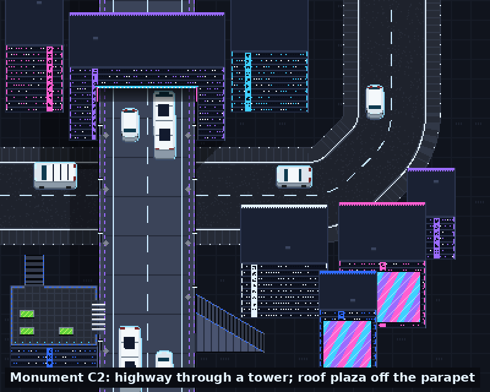

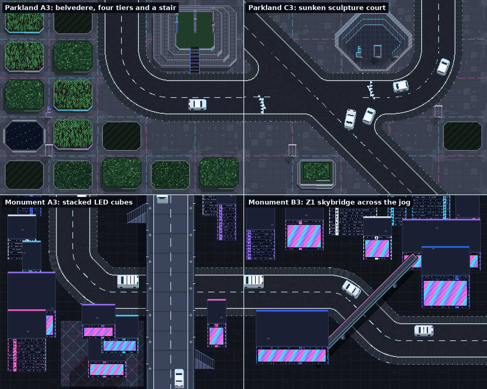


## A 45° crossroads: four options (example, Edit 55)

`crossing_options.html`: today's 45° four-way crossing and four treatments from road design practice, one screen each with live traffic.

- **Decided (Edit 55.1):** A is the rule. C only in a district's centre tile (B2). D only where a level design names it. B is not used.
- **Edit 55.2:** every junction's arms meet at 90°, three-way included, and every junction sits in its tile's central `world.junctionZone` (75%). The mock-up warns otherwise.
- **Edit 56 (supersedes 55.1 for four-ways):** every four-way takes a roundabout (C); three-way joins use A's 90° bend.
- **Parkland:** A1's avenue curves to join the boulevard square. Row 3's road moves to local y 448, so C3's crossing sits mid-tile. The B2 ring is drawn centred, radius 160 (`world.deckRingRadius`), straight arm runs visible at every edge. The C1 footbridge runs west across B1, meets the Z1 highway at both parapets, and lands in A1 by escalator.

| Option | Conflict points | Cars out /min at 1.8 s | Longest wait on the 45° road |
|---|---:|---:|---:|
| Today | 32 | 21–22 | 24–40 s |
| A · Realigned to 90° | 32, all at 90° | 21–22 | 29–33 s |
| B · Staggered T junctions (`world.junctionStagger` 256) | 22 | 21–24 | 28–42 s |
| C · Roundabout, skew kept | 8 | 22–27 | 6–10 s |
| D · Flyover | 0 | 32–33 | none |

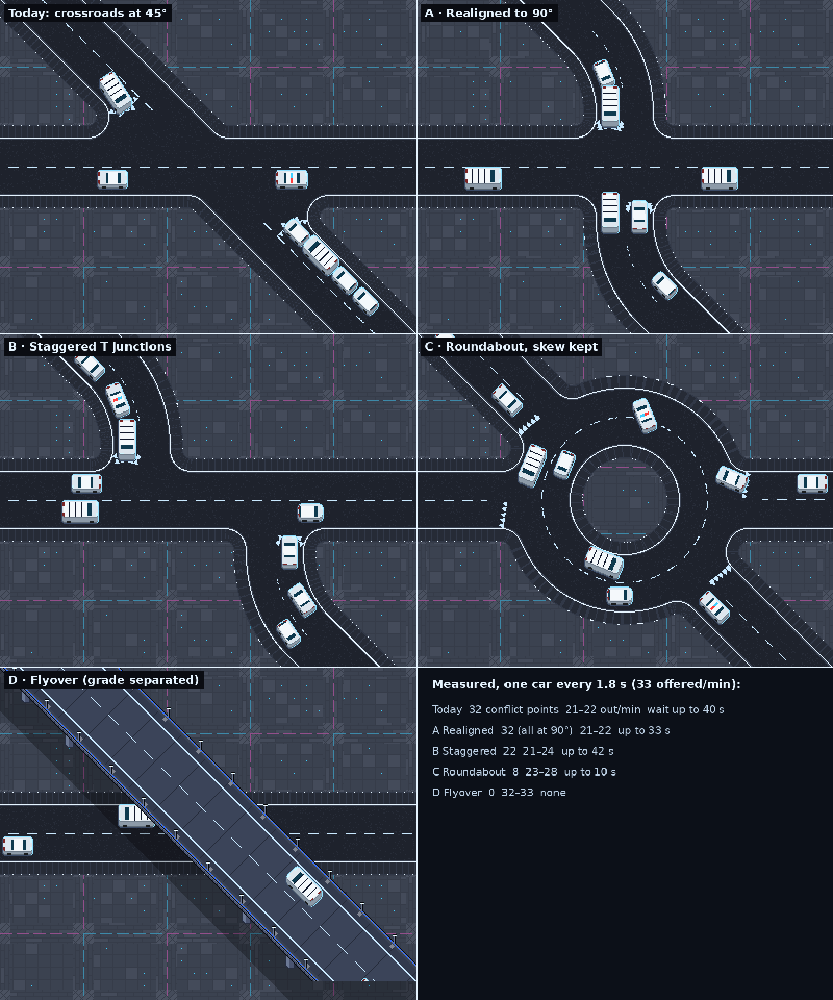

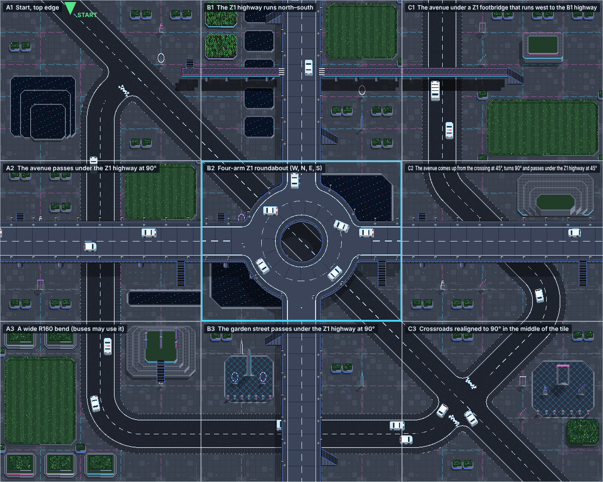

## Four-way roundabouts; US junction markings (Edit 56)

- **Four-way:** always a roundabout, arms 90° apart, wholly inside its tile, centre in `world.junctionZone`.
  - Street rings `world.roundaboutRadiusStreet` (112): outer lane 140, inner 84. Highway rings `world.deckRingRadius` (160).
  - A 45° road reaches its arm through a bend outside the ring.
- **Three-way:** arms meet at 90° after a transition bend (Parkland A1).
- **Markings (MUTCD):** yield line of white triangles at every give-way and ring entry (3B.16, 3C.04).
  - Edit 57: three identical teeth at equal steps, square to the approach lane's last straight, each pointing back up it. The line sits at the straight's end; ring stop lines moved back 8–9.
  - Teeth `world.markYieldBase` 14, `world.markYieldHeight` 21, `world.markYieldGap` 4 (7 × 10.5 art px).
  - Centre lines stop at the junction (3B.08). Rings: a dashed lane line only (3C.02). All white: yellow is the dummy's.
- **Parkland C3:** a street ring at (206, 286); the street's SW arm turns west outside it.
- **Circus:** street rings at A2, B2 and C2. The east road runs to the district edge: the exit moves from south to east. B3 is a T.
- **Orbit cap:** a car whose exit is blocked waits at the yield line once `traffic.ringOrbitMax` (2) cars orbit. Without it Circus locked at 13 min.
- **The mock-up warns** on a four-way without a ring, arms under 90°, a ring over its tile edge or outside the zone.

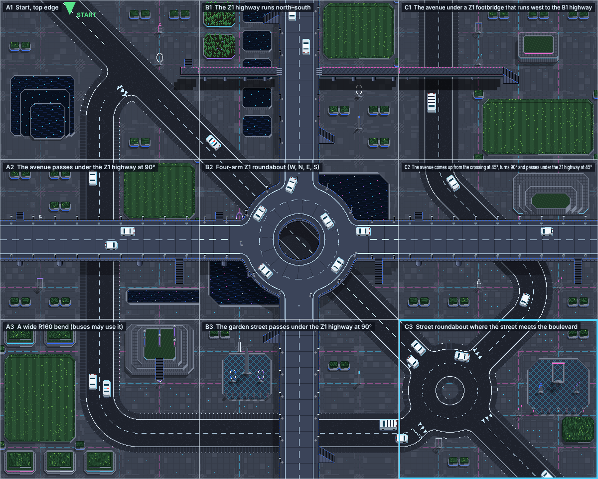

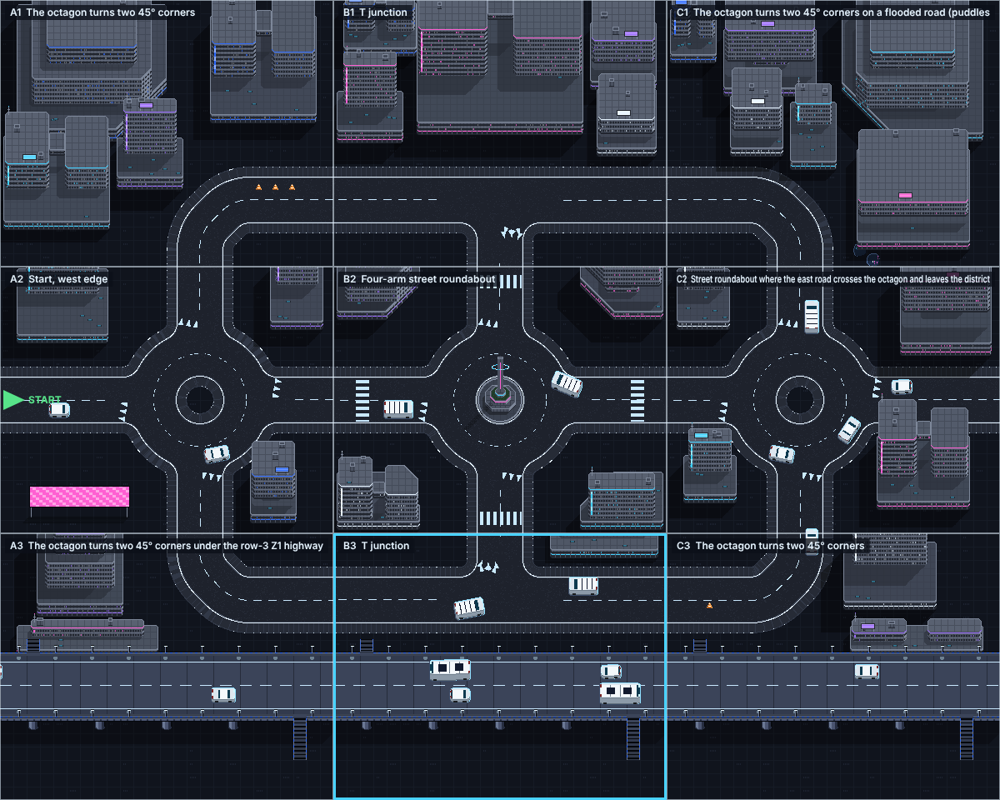

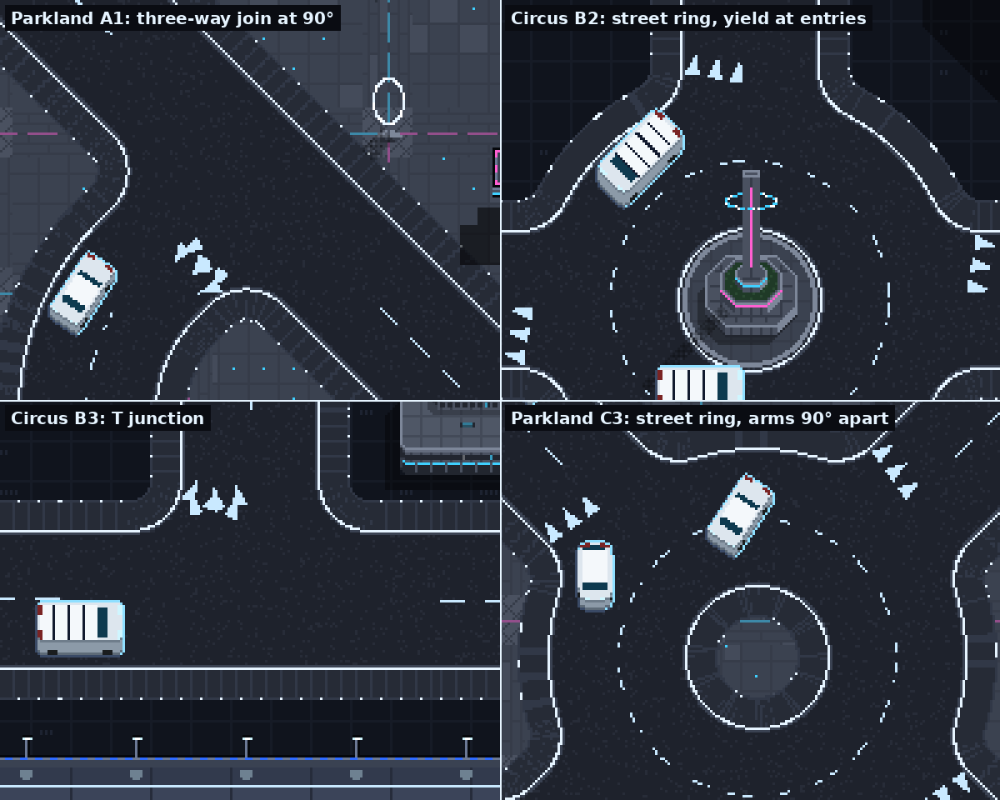

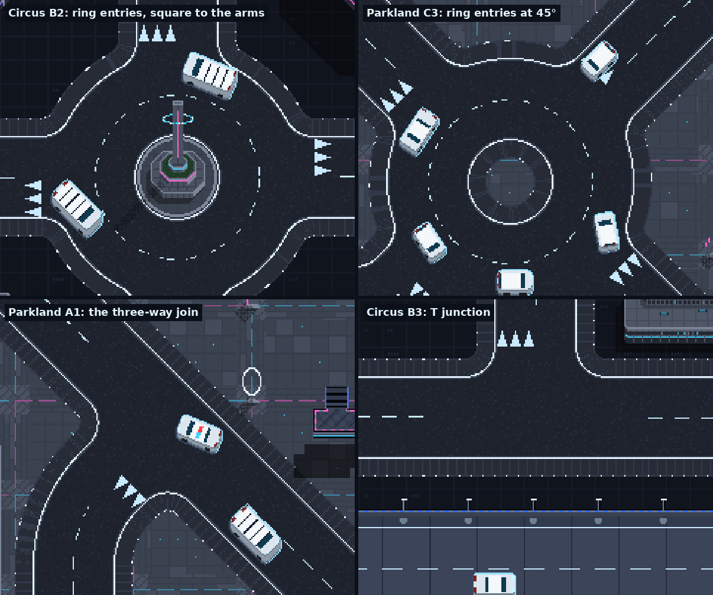

## Circus: three layouts (Edit 57, plans)

`circus_options.html`: today's Circus and three options round the kept central roundabout, as plans in district units. The page checks each plan's level rules live. The chosen one (D32) is built in game art next.

| | Today | A · Diamond | B · Crown | C · Twin rings |
|---|---|---|---|---|
| Highways | Z1 along row 3 | Z1 and Z2 45° chevrons crossing at A2, C2 | Z1 crown (45° shoulders), Z2 bar on row 3 | Z1 roundabouts at A1, C3; a loop with 45° corners |
| Drop points / stacks | 0 / 0 | 10 / 2 | 6 / 2 | 4 / 0 |
| Screens with a street / highway | 9 / 3 | 9 / 9 | 9 / 8 | 5 / 8 |

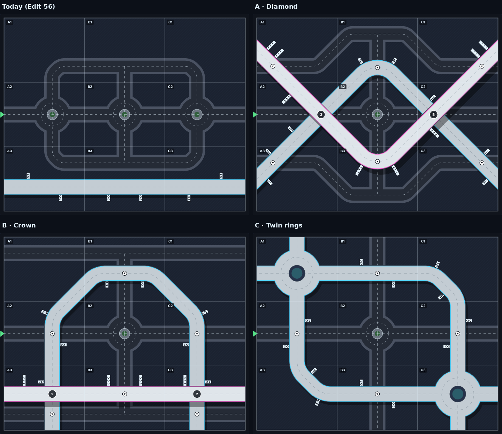

## Circus as a valley city (Edit 58, plans)

`circus_valley.html`: A, B and C are set aside (decision 302). Terrain now sets the levels: hills (rows 1, 3) are Z1 ground, the valley floor (row 2) Z0. Roads keep their level: a Z1 road is a street on a hill and stands on columns only over the valley.

- **Valley Avenue (Z0):** along the valley floor, through the circus.
- **Ridge roads (Z1):** along both hilltops. **Bridges (Z1):** hill to hill, on columns over the valley only.
- **Climbs:** the circus's north and south arms ramp up coves (27%) to the ridge roads. The circus is the valley's one way uphill.
- **The page checks** the transport logic (no dead ends, levels meet only at the circus, columns only over the valley) and the level rules. All hold.

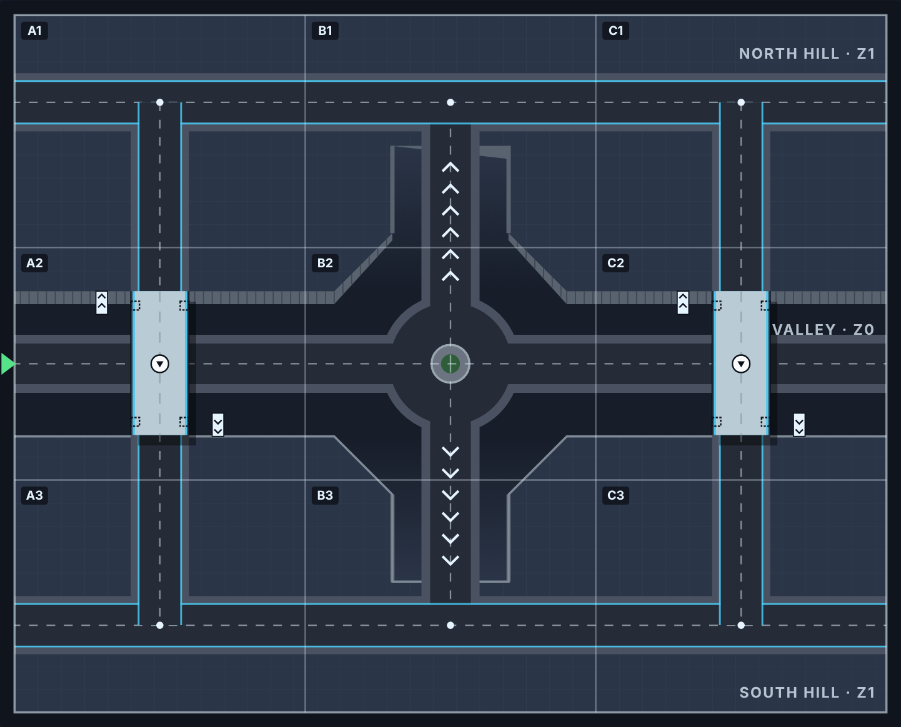

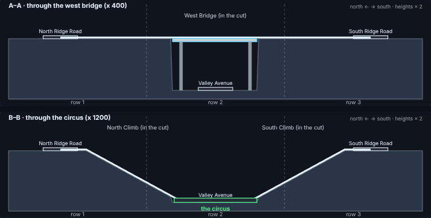

- **Edit 59, the riverbank:** row 2 runs cliff, avenue, beach. The bridges run straight south over a Z0 coastal drive (horizontal, 45°, horizontal on the seawall) and the river, with no Z1 link south of the hill. The circus's south arm is the beach road to the drive.

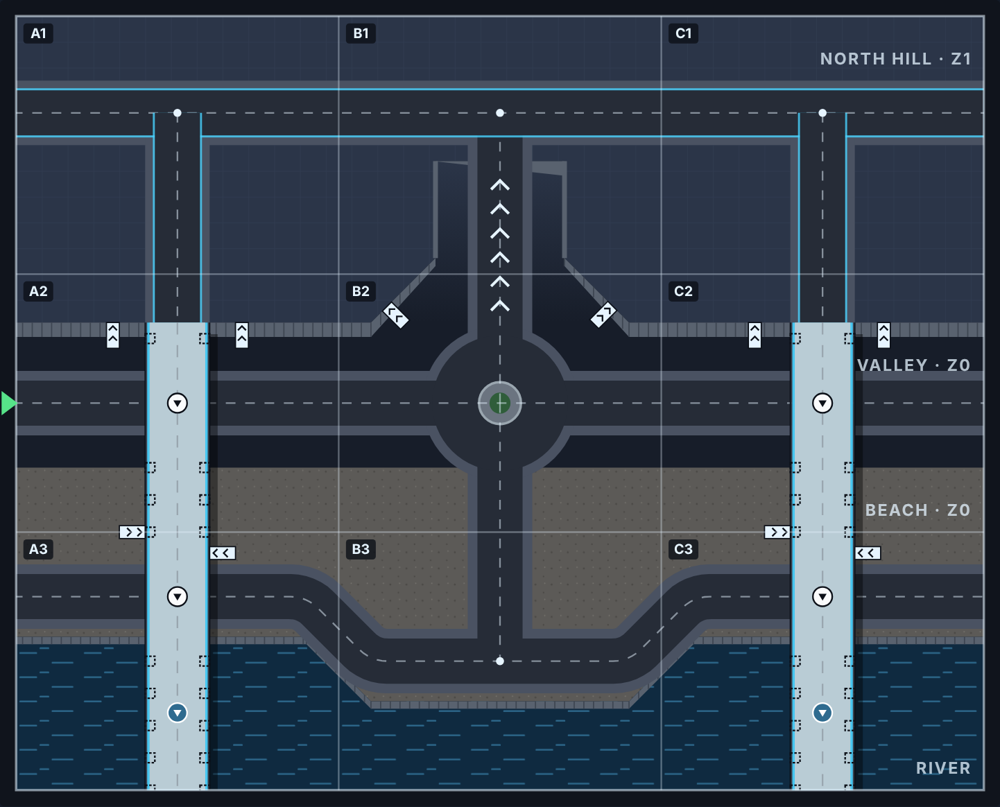

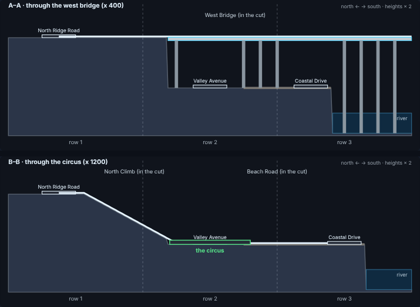

## Shadows: four options (Edit 59, not built)

`tools/shadow_options.py` renders one test scene five ways (hill, cove ramp, valley, Z1 bridge on columns, tower, cars). Today stamps every shadow on one ground buffer, so a bridge at grade shadows its own hill. Options: 1 noon sun; 2 oblique sun, a mask per level (recommended); 3 height-field sweep; 4 occlusion and height tint. Moving objects take a noon blob in all four (D36).

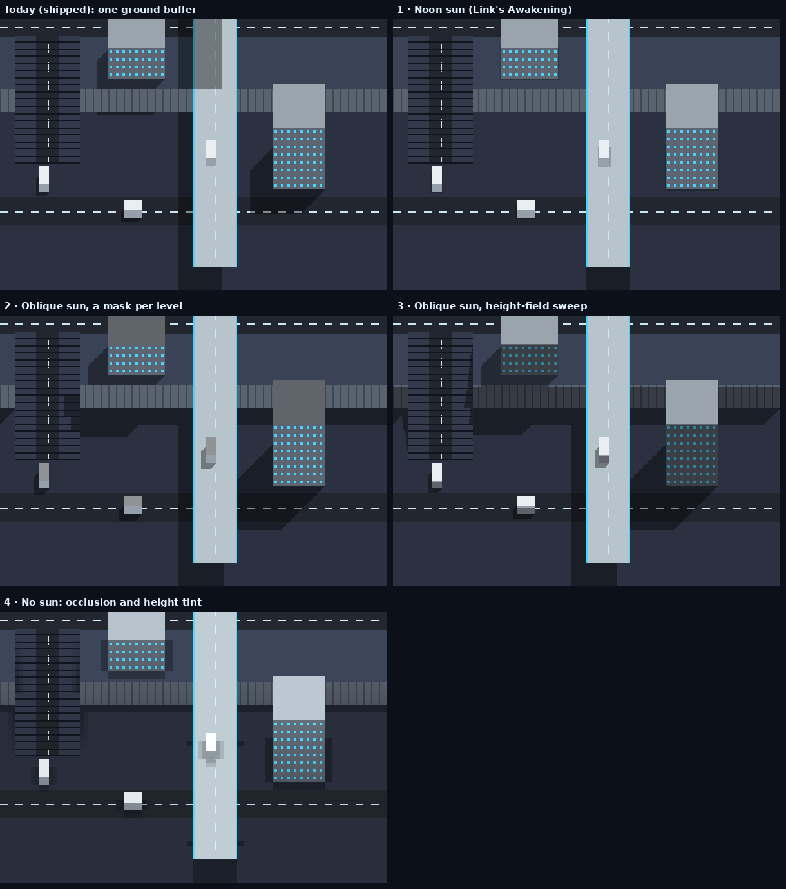

## District traffic (P5.3, Edit 53)

| Rule | Parameter | Value |
|---|---|---|
| Every screen of a district runs its traffic every tick | `traffic.continuous` | 1 |
| A car crossing a shared edge goes on next door: same id, model, speed, offset and plan | — | — |
| Cars this near a seam are seen and drawn next door; the dummy is seen across the edge | `world.spawnLeadIn` | 200 |
| Cars enter only where a road or highway crosses the district boundary | — | — |
| At the start every lane runs at its steady headway; a car on each start-screen lane | district interval × 2 | — |
| A bus enters only if its whole route keeps the bus radius (no game district does) | `vehicles.bus.minRadius` | 160 |
| Junction waits that would close a circle are broken (after this long) | `traffic.gridlockSeconds` | 6 s |
| Mock-up: each road entry admits one car per 2 × interval; highways run the game's rate (Edit 53.1) | `world.district.<id>.interval` | 4.5 / 3.2 / 2.4 s |
| Mock-up: after this many seams a car takes the way out | `traffic.exitAfterSeams` | 9 |
| Mock-up: a district runs this long before it is shown | `traffic.warmSeconds` | 30 s |
| Cars see across a seam within the fastest highway car's stopping distance (Edit 53.1) | `traffic.hardBraking`, `world.spawnLeadIn` | 398 in the game |
| Highway (Z1) ring radius (Edit 53.1: 132 → 200; Edit 55.2: 160) | `world.deckRingRadius` | 160 |
| Every ring: only a car leaving at this exit or later (third: 270°) uses the inner lane; a blocked exit may go round on it (Edit 54) | `traffic.ringInnerExit` | 3 |
| Mock-up: each Parkland highway end admits one car per (Edit 54) | `world.district.parkland.deckInterval` | 8 s |
| Parkland Z1 ring: entry metered at this share of the outer lane | `world.deckRingFill` | 0.5 |
| Every ring: an inner-lane car orbits until it can leave (no last-lap wait) | `traffic.ringMaxLaps` | 3 lap paths, then repeat |
| Every ring: a car whose exit is blocked waits at the line once this many orbit (Edit 56) | `traffic.ringOrbitMax` | 2 |
| P6: whole bus routes per district | `world.busRoutesPerDistrict` | 1 |

- **CARS LEFT:** the shift's cars not yet entered, plus those still in the district.
- **Off:** `traffic.continuous` 0 restores P5.2, one screen at a time.


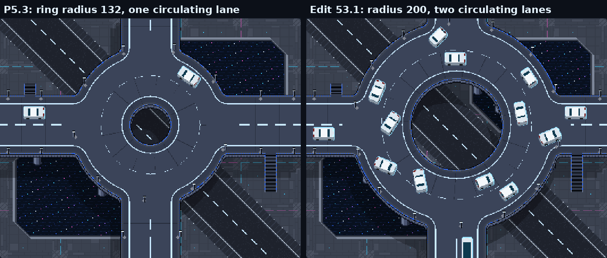

## Evidence

- `node test_sim.js` → 104/104: P3.4 and P4 checks, plus P5 fleet, buses, highways, points, district traffic, ring lanes by exit and the crossing options.
- **District mock-up, Edit 56, 40 min at design flow:** no lock. Longest stop: Circus 22 s, Parkland 10 s, Monument 0 s. At one Circus car per 2.6 s (+23%) Circus locks at 5 min (Edit 55.2: 19 min).
- `node tools/crossing_report.js` → `docs/crossing_report.md`: the four crossing options on the P5 driver.
- **Highway density (Edit 54):** game 1.24–1.29 cars per lane per screen (unchanged). Mock-up Parkland 3.02 → 0.53; Circus 1.22; Monument 0.96. 30 min per district: no car stopped over 20 s.
- **Parkland ring (Edit 53.1), 30 min at the game's highway rate:** no lock; 36–40 cars/min through the ring (P5.3 fed it 27).
- `node tools/continuity_report.js` → `docs/continuity_report.md`: 15 layouts, 120 s each. No jump, no car lost or doubled, no seam overlap, exits only at the district edge.
- **Rebake (P5.2):** 15 layouts of 32 candidates at the 160 deck; bot first write-off 18–87 s.
- **Bake:** 15 layouts kept of 30 candidates (`content/districts/districts_p5.json`, `p5-edit50-2026-10-21`). Contract clauses 25–26 hold with the P5 fleet.
  - 11 of 15 match P4's layouts. Interchange 1–3 and CBD 3 differ.
- **Report:** `node tools/p5_report.js 120` → `docs/p5_report.md`.

| Measure | P5 | P4 highway settings |
|---|---|---|
| Highway cars per lane on screen | 1.81 | 4.31 |
| Mean highway speed | 182 | 113 |
| Buses among highway cars | 11% | 10% |

- **Bus roads (P5.2):** 53 of 135 screens (39%) on the P5.2 layouts may carry a bus on the ground (54 on P5.0's). Every highway carries buses.
  - Per district, layouts 1–3: Riverside 4, 7, 4 · Old Market 4, 3, 4 · Interchange 4, 2, 3 · CBD 1, 3, 3 · Campus 6, 4, 1 (of 9).
- **Ground buses:** 27 of 693 ground cars on the 15 highway screens of layout 1 (120 s each, P5.2). P5.3: none, as no whole district route keeps the bus radius.
- **Bot, start screen:** first write-off 23–53 s on every layout.

## Run

```
python3 build.py                 # dummies_p5.html
node test_sim.js                 # P3.4, P4 and P5 checks (104)
node tools/district_bake.js 60   # P5 layouts → content/districts/districts_p5.json
node tools/p5_report.js 120      # bus roads, highway traffic
node tools/points_report.js 150  # walk-in against dash play, before and after damage.walkShare
node tools/orbit_report.js        # the inner-lane orbit, free flow and a blocked exit
node tools/continuity_report.js   # district-wide traffic: seams, start, queues, one car followed
node -e "const C=require('./circus_plans.js'); for (const p of C.PLANS) console.log(p.name, C.check(p).rows.filter((q) => !q.ok).length)"  # Circus options: rule breaks per plan
```

## Files

| File | Role |
|---|---|
| `sim.js` | P4.3 sim plus Edit 50: `fleetClass`, `minBend`, `busRoad`, deck speed and spacing, highway points, bus without swerve. Edit 53: `netBuild`, `netBegin`/`netEnd` (district traffic), `laneEnds`, ghosts, junction lock breakers |
| `game.js`, `pixel.js`, `shell.html` | P4.3 renderer. Highway popup; bus sensor shadow; P5 tuning rows |
| `lab.js` | Test helper only (road pieces for `test_sim.js`). The Turn Lab stays in P4. Edit 55: the 45° crossing options |
| `tools/district_bake.js`, `tools/district_check.js` | Bake and contract, as P4 |
| `tools/p5_report.js` | Bus roads and highway traffic on the baked layouts |
| `tools/points_report.js` | Walk-in and dash play on every start screen, P5.0 and P5.1 points |
| `highway_view.js`, `highway_shell.html` | Highway width mock-up (P5.1's diagonal mock-up retired) |
| `cityscape_view.js`, `cityscape_shell.html` | Three districts mock-up: centres, then 3 × 3 screens with a mechanic and landmark per tile (Edit 52); screens linked into one traffic (Edit 53); a set piece per tile, the Chongqing portal (Edit 54) |
| `tools/orbit_report.js` | Inner-lane orbit evidence (Edit 52) |
| `tools/continuity_report.js` | District-wide traffic evidence (Edit 53) |
| `crossing_shell.html` → `crossing_options.html` | The 45° crossing options example (Edit 55), built from the mock-up kit |
| `tools/crossing_report.js` | Crossing options evidence (Edit 55) |
| `circus_plans.js`, `circus_shell.html` → `circus_options.html` | Circus layout options as plans, with the level rules checked (Edit 57; set aside) |
| `circus_valley.js`, `circus_valley_shell.html` → `circus_valley.html` | Circus as a valley city by the river: terrain, plan, sections, transport checks (Edits 58–59) |
| `tools/shadow_options.py` | Five shadow treatments of one test scene (Edit 59; offline, not P5) |

## Open

- **Circus · Valley (D35, Edit 58):** cars climbing the cove, or stairs only.
- **Shadows (D36, Edit 59):** pick one of four; not in P5 yet.
- **River (D37, Edit 59):** a dummy that falls in.
- **Circus overload (Edit 56):** at +23% flow a car passing C3's cone meets an oncoming car head-on; queues close the loop. No pass while its own lane queues ahead, or move the cone.
- **Circus exit (Edit 56):** east instead of south. Confirm.
- **Parkland C3 (Edit 56):** the ring sits left of centre; B3's south-end escalator caps row 3's road at local 456.

- **Ring capacity (Edit 53.1):** the widened ring passes about 37 cars/min. Edit 54 feeds Parkland's highways one car per 8 s per end, so nothing waits.
- **Portals and roof links (Edit 54):** mock-up only. P6: towers may straddle a deck band as portals; a bridge floor joins roof and deck.
- **Bus routes (decision 264):** P6 builds them; until then no ground buses.
- **Districts (decisions 225–255):** approve the three layouts, then P6 rebuilds the planner: a curved deck, split roads, walkways on columns, podium roofs, two escalators per highway screen.
- **No-walkway highway (decision 223):** 128 wide, lanes and parapets only. Mocked up, not adopted.
- **Walk share:** 0.25 stops walk-in write-offs; dashing play slows (first write-off 35 → 49 s).

- **Bus routes:** 40% of screens fit a bus. Should the planner make wide-bend bus routes?
- **Junctions:** the 45° junction choice (decision 204) and branching roads in the planner.
- **Police:** canon says it tracks your approach, then commits. P5 drives it like a sedan.
- **Hatchback:** canon says one signalled recommitment. Not built.
