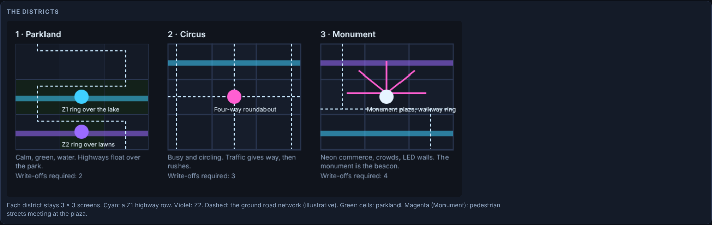
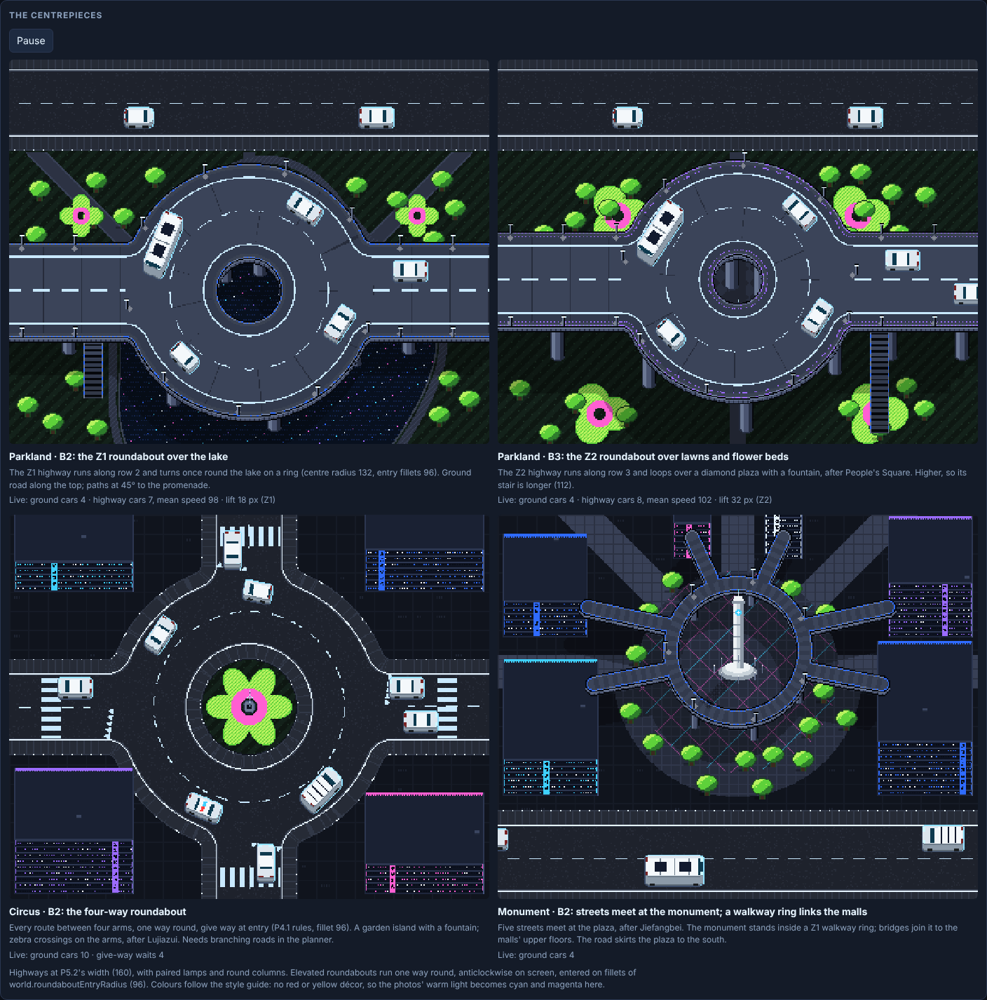

# DUMMIES — P5 prototype: five models, bus roads, faster highways

**P5.2 · 22 October 2026 · Lawrence Lek** · Spec: GDD Edits 50–50.2 and 51 (proposed). P3 (P3.4) and P4 (P4.3) are unchanged.

P5 is the game with P4's road and traffic learnings, plus the fleet, highway and points rules of Edits 50 and 50.1.

- **`dummies_p5.html`:** the game (P5.2).
- **`highway_mockup.html`:** highway width at 176, 160 and 128 over the same road, in game art with live traffic.
- **`cityscape_mockup.html`:** the three proposed cityscapes' cores (Edit 51), in game art with live traffic. Not in the districts yet.

## Why

- **O3.65:** buses only on roads with centre radius 160, and on the elevated highways.
- **O3.65:** highway traffic faster, with fewer vehicles, and better to go there.
- **O3.65:** 45° roads and highways in; all new learnings into P5. Five car models: hatchback, sedan, police, van, small bus.
- **O3.66:** the highway pays through speed, not a bonus. Walking into a car's front scores too much. What about diagonal highways?
- **O3.67:** highways as wide as the road and walkway below; lamps 8–10 per screen width; round columns; angles only on ground roads. Three cityscapes instead of five.

## From P4

| Learning | Parameter | Value |
|---|---|---|
| Cars judge other cars along their own lane | `traffic.followRoad` | 1 |
| No new cars while traffic is jammed | `traffic.gridlockSeconds` | 6 s |
| A jammed car backs up to clear the jam | `traffic.jamReverse` | 1 |
| Least bend on any road (centre line) | `world.turnRadiusTight` | 64 |
| Roundabout entry fillet | `world.roundaboutEntryRadius` | 96 |
| Screens with 45° roads | `world.diagonalShare` | 0.25 |
| Give way at ring entries and junctions; a car at its line is not jammed | `traffic.giveWayGap` | 2.5 s |

- **Junction pieces** (Edit 49.3) are in the driver, not the planner. Districts still run one road per screen.

## New in P5 (Edit 50)

| Rule | Parameter | Value |
|---|---|---|
| Five models: vans by district, then hatchback, police, bus; sedans the rest | `traffic.share.hatchback` / `.police` / `.bus` | 0.22 / 0.08 / 0.10 |
| A bus runs a ground road only if every bend keeps this radius (no ring) | `vehicles.bus.minRadius` | 160 |
| Highways (straight) always carry buses | — | — |
| A bus only brakes; it never swerves | `vehicles.bus.swerve` | 0 |
| Highway cars cruise faster | `traffic.deckSpeedScale` | 1.4× |
| Highway cars come further apart | `traffic.deckGapScale` | 1.5× `world.deckInterval` |
| Highway width: lanes 112, a 16 walkway each side, parapets 8, as the road below with its pavements (Edit 50.2) | `world.deckWidth` | 160 (was 176) |
| Highway lamps in pairs, one per parapet (Edit 50.2) | `world.deckLampSpacing` | 88 (about 9 a side per screen) |
| Highways run square only; 45° angles stay on ground roads (Edit 50.2) | `world.deckCrossAngle` | 5° |
| Highway hits pay through speed alone (Edit 50.1; was 1.5×) | `damage.deckMultiplier` | 1 |
| Walking or running into a car adds this share of the dummy's speed; a dash adds all of it, up to `proto.dummyStrikeSpeed` (Edit 50.1) | `damage.walkShare` | 0.25 |

- **Bus slot on an unfit road:** runs as a sedan.
- **Bend measure:** arc length over turn, across four vertices; 10% polyline tolerance (as contract clause 25).
- **Sight:** a bus hides the dummy from cars like a van, and casts a sensor shadow.
- **Popup:** a highway hit shows `HIGHWAY X…` under its points when `damage.deckMultiplier` > 1 (off in P5.1).
- **Out:** sports, wagon and SUV. Their sizes stay in the registry.


## Points rebalance (P5.1, Edit 50.1)

| Front contact with a sedan (points = damage) | Parked | Caution (82) | Cruise (138) | Highway (193) |
|---|---|---|---|---|
| Standing | 0 | 35 | 100 | 196 |
| Walking in (81): P5.0 → P5.1 | 34 → 2 | 140 → 55 | 252 → 132 | 394 → 239 |
| Running in (162): P5.0 → P5.1 | 53 → 9 | 174 → 79 | 297 → 167 | 451 → 286 |
| Dashing in | 53 | 174 | 297 | 451 |

- **Points report** (`docs/points_report.md`, every start screen, 150 s):

| Model | Style | Layouts with a write-off | Write-offs | Mean points per hit | Median first write-off |
|---|---|---|---|---|---|
| P5.0 | Walks into cars | 13 of 15 | 22 | 54 | 57 s |
| P5.0 | Dashes | 15 of 15 | 34 | 77 | 35 s |
| P5.1 | Walks into cars | 0 of 15 | 0 | 15 | — |
| P5.1 | Dashes | 14 of 15 | 27 | 60 | 49 s |

- **Bake bot:** all 15 layouts still give a first write-off by 90 s (18–87 s). No rebake.

## Highways (P5.2, Edit 50.2)


- **Diagonal highways (P5.1 mock-up):** rejected. Highways run square; 45° angles stay on ground roads (decision 224).

## Three cityscapes (mock-up, Edit 51)





| District | Core | Mood | Quota |
|---|---|---|---|
| 1 Parkland | Z1 ring over a lake (B2); Z2 ring over lawns (B3) | Calm, green, water | 2 |
| 2 Circus | Four-way roundabout, give way at entry | Busy and circling | 3 |
| 3 Monument | Five streets meet at a plaza; a walkway ring links the malls | Neon commerce, LED walls | 4 |

## Evidence

- `node test_sim.js` → 94/94: P3.4 and P4 checks, plus P5 fleet, buses, highways and points.
- **Rebake (P5.2):** 15 layouts of 32 candidates at the 160 deck; bot first write-off 18–87 s.
- **Bake:** 15 layouts kept of 30 candidates (`content/districts/districts_p5.json`, `p5-edit50-2026-10-21`). Contract clauses 25–26 hold with the P5 fleet.
  - 11 of 15 match P4's layouts. Interchange 1–3 and CBD 3 differ.
- **Report:** `node tools/p5_report.js 120` → `docs/p5_report.md`.

| Measure | P5 | P4 highway settings |
|---|---|---|
| Highway cars per lane on screen | 1.81 | 4.31 |
| Mean highway speed | 182 | 113 |
| Buses among highway cars | 11% | 10% |

- **Bus roads:** 53 of 135 screens (39%) on the P5.2 layouts may carry a bus on the ground (54 on P5.0's). Every highway carries buses.
  - Per district, layouts 1–3: Riverside 4, 7, 4 · Old Market 4, 3, 4 · Interchange 4, 2, 3 · CBD 1, 3, 3 · Campus 6, 4, 1 (of 9).
- **Ground buses:** 27 of 693 ground cars on the 15 highway screens of layout 1 (120 s each).
- **Bot, start screen:** first write-off 23–53 s on every layout.

## Run

```
python3 build.py                 # dummies_p5.html
node test_sim.js                 # P3.4, P4 and P5 checks (94)
node tools/district_bake.js 60   # P5 layouts → content/districts/districts_p5.json
node tools/p5_report.js 120      # bus roads, highway traffic
node tools/points_report.js 150  # walk-in against dash play, before and after damage.walkShare
```

## Files

| File | Role |
|---|---|
| `sim.js` | P4.3 sim plus Edit 50: `fleetClass`, `minBend`, `busRoad`, deck speed and spacing, highway points, bus without swerve |
| `game.js`, `pixel.js`, `shell.html` | P4.3 renderer. Highway popup; bus sensor shadow; P5 tuning rows |
| `lab.js` | Test helper only (road pieces for `test_sim.js`). The Turn Lab stays in P4 |
| `tools/district_bake.js`, `tools/district_check.js` | Bake and contract, as P4 |
| `tools/p5_report.js` | Bus roads and highway traffic on the baked layouts |
| `tools/points_report.js` | Walk-in and dash play on every start screen, P5.0 and P5.1 points |
| `highway_view.js`, `highway_shell.html` | Highway width mock-up (P5.1's diagonal mock-up retired) |
| `cityscape_view.js`, `cityscape_shell.html` | Three cityscapes mock-up (Edit 51) |

## Open

- **Cityscapes (decisions 225–229):** approve the three cores, then P6 rebuilds the planner: curved decks, branching roads, walkways.
- **No-walkway highway (decision 223):** 128 wide, lanes and parapets only. Mocked up, not adopted.
- **Walk share:** 0.25 stops walk-in write-offs; dashing play slows (first write-off 35 → 49 s).

- **Bus routes:** 40% of screens fit a bus. Should the planner make wide-bend bus routes?
- **Junctions:** the 45° junction choice (decision 204) and branching roads in the planner.
- **Police:** canon says it tracks your approach, then commits. P5 drives it like a sedan.
- **Hatchback:** canon says one signalled recommitment. Not built.
