# DUMMIES — Prototype 6.3: three districts, managed traffic, driving that reads

**Prototype 6.3 · 27 October 2026 · Lawrence Lek** · Spec: GDD Edits 62–71 (proposed), built on Edits 51–61. P3, P4 and P5 are unchanged.

Prototype 6.3 follows 6.2 (Edit 70) with the driving playtest of 27 October (Edit 71): smooth turns, turn signals, ring entry, the cone drone, taller cones.

- **`dummies_p6_3.html`:** the game. Parkland → Waterfront → Monument. Open in a browser; no server.
- **`dummies_p6_2.html`:** Prototype 6.2 (Edit 70). Frozen.
- **`dummies_p6_1.html`:** Prototype 6.1 (Edit 69). Frozen.
- **`dummies_p6.html`:** P6 as released (Edit 62). Frozen.
- **`world6.js`:** the world. Art, edges, traffic, play data and the player sim (`Sim6`) per district.
- **`circus_valley.js`:** the Waterfront plan (Edits 58–61). One source for its layout.
- **`test_p6.js`:** headless checks, the release tests included. `node test_p6.js [minutes]`.
- **`tools/p6_traffic.js`:** the traffic soak. `node tools/p6_traffic.js [seconds per screen] [district]`. `P6OV=key=value,…` overrides registry values.
- **`tools/p6_rings.js`:** roundabout entries: waits at the line, signals. `node tools/p6_rings.js [seconds per screen] [district|all] [key=value …]`.
- **`tools/p6_walk.js`:** the walking test. `node tools/p6_walk.js [district]`.
- **`tools/p6_nav.js`:** the navigation checks: dead space, garden paths, flight forecourts, one ground. `node tools/p6_nav.js [district]`.
- **`tools/p6_audit.js`:** the playtest audit on all 27 screens. `node tools/p6_audit.js [district]`.

## Districts

| # | District | Quota | Interval | Levels |
|---|---|---|---|---|
| 1 | Parkland | `world.district.parkland.quota` 2 | `world.district.parkland.interval` 3.2 | Z0 streets; Z1 highways meet at the B2 ring; Z1 walkways |
| 2 | Waterfront | `world.district.waterfront.quota` 3 | `world.district.waterfront.interval` 3.2 | Z1 hill and ridge road; Z0 valley, tunnel, beach, drive; Z1 bridges; the river |
| 3 | Monument | `world.district.monument.quota` 4 | `world.district.monument.interval` 2.4 | Z0 snake road; Z1 and Z2 highways; Z1 walkway ring and skybridges; Z2 roof plaza |

- **Start:** every district in B2. Off the lanes, below the intro banner.

## How it plays

- **Floors:** a test on the dummy's centre at its level.
  - Deck and ring: inside the parapets, less `body.radius`. Open at stair heads, links and broken parapets.
  - Walkway: holds, except one opening per road below.
    - One `world.tileSize` module, on one side of the road's centre line. Ends cyan on the magenta rail.
    - A straight drop lands on the centre line. Steer a little to land in a lane.
  - Hill, terrace, roof: every edge drops. The Parkland A3 belvedere's lawn holds.
  - **6.2:** the Parkland ring's hole stands open over the boulevard. Its inner parapet opens one `world.tileSize` module over each road centre line; step off onto the traffic below.
- **Edges:** another floor at the level, then a stair, then the next screen, then a drop. Else the parapet holds.
- **Screen edges:** no invisible walls. Where an edge holds, a barrier shows on this side.
  - Between screens: a low planter (`world.wallThickness`). Never in a lane.
  - The district's edge: the perimeter wall; a booth and boom on a road; a boom on a highway or hill street; a parapet on the hill.
  - A walkway running into the next screen: chevrons.
  - **6.1:** a crossing needs standing room on arrival: within `body.radius` along the edge, or `world.edgeArrivalDepth` in.
  - **6.1:** an edge that holds holds all along. No sliver narrower than the body stays open.
- **Ground (6.1):** none out of reach. Unreachable ground is planted: a low planter, a hedge top.
- **Dead space (6.2):** none. Open ground the body cannot touch (a gap narrower than the body) is planted the same way.
- **Flights:**
  - A clear apron beyond every foot: `world.stairApron` (40), the flight's width plus 8 each side.
  - A flight as drawn, and its apron, stay `world.stairEdgeMargin` (16) inside the screen.
  - No building stands in an apron or draws over a flight. Every drawn flight walks.
  - **6.2:** a forecourt `world.stairForecourt` (44) beyond the apron: no block, bed, pool or column.
- **Buildings:** every plan is solid at its level, to 4 units. Terraces and landings too.
- **Walkway joints:** the slab stops at the floor it joins. Square at 90°; mitred at 45°.
- **Raised layers at the screen's edge:** drawn to the edge, past the lift. At a level, a north–south crossing happens at the edge as drawn.
- **Wayfinding:** every apron a lit mat, chevrons into its flight. Monument B2: square paving; guide strips to the ring escalators.
- **Parkland: an Expo site on one garden grid (6.2).** Cells `world.gardenCellWidth` × `world.gardenCellHeight`; paths `world.gardenPath` on the grid lines.
  - A seam path runs whole inside each screen; at the district's bound inside the wall. Grass verges (`world.gardenVerge`) frame every path.
  - Every piece sits in cells; nothing in one cell stands on a path. Set pieces span cells and absorb their inner paths.
  - Pavilions: dome, shell hall, LED box, canopy, observation tower. S a kiosk, M a hall, L the whole cell.
  - Parterres, fountains, sculpture courts; sculptures on grass squares, never on a crossing.
  - Great lawns: a paved cross-walk (the hedge opens at it), a reflecting rill with jets.
  - B1 cascade: one pool a cell. B2: the two pools, four cells each. A1 reservoir: stepped up to the back.
  - Along a 45° road: the shoulder, a verge, a footpath, then the grid.
  - Flights: the axis on a path at their own end of the deck (five kept in place by roads). Columns between paths.
- **Tunnel (Waterfront B1):** the dummy walks in. It stops at the top edge of B1, not the mouth.
- **River:** sink `proto.rescueSinkSeconds` (2 s). A drone flies in at `proto.droneSpeed`, lifts the dummy (`proto.droneLiftSeconds`) and sets it on the nearest land.
- **Cues:** only for cars on the dummy's level.

## Traffic (managed)

- **One traffic per district.** Lanes link at seams by elevation. Cars in seam sight show next door.
- **Spacing:** one car per lane every 2 × `world.district.<id>.interval` at `vehicles.sedan.cruiseSpeed`. Highways at their feed.
- **Out of view only:** spawns at inlets with room; a car stopped `traffic.offscreenCullSeconds` (12) is removed.
- **In view:** nothing appears or vanishes. A followed car keeps its speed.
- **Rings (6.1):**
  - A car checks circulating traffic from `traffic.giveWayWindow` out, across a seam too.
  - A fast car starts slowing a stopping distance out, plus `traffic.giveWayLookahead`.
  - Cars on different laps of one route follow each other.
- **The shift:** `run.appearances.road` (100) Z0 cars, counted as each first appears in view.

## Driving (6.3)

- **Heading:** continuous under the hood. Within `proto.headingBlend` (12) of a path vertex the tangent blends to the next segment's. Capped at `proto.carYawRate`.
- **Sprite:** the nearest of 32 headings (11.25°), separately.
- **Turn signals:** from `traffic.signalDistance` (140) before a turn.
  - Ring approach: right for the first exit; left past 12 o'clock or a U-turn; none straight on. On the ring: toward the exit.
  - Junction: toward the turn. Lane shifts first. Honking: both sides. Deck traffic: none.
  - Amber, front and rear, 2 × `proto.art.signalLength` (4) art px, 1.5 Hz.
- **Ring entry:** wait while a circulating car would reach the join within `traffic.ringEntryGap` (2.0). Junctions keep `traffic.giveWayGap` (2.5).
  - A circulating car signalling to leave before the join is passed over: outer lane, not changing lanes, its exit clear.
- **Ring lane change:** over `traffic.ringLaneChange` (150): a 30° arc.
- **Cones:** 8 art px (`proto.art.coneHeight` 16). A free cone in a lane `proto.droneConeSeconds` (5) fetches a drone; it sets the cone at a home.

## Release tests (Edit 69; rerun on 6.3)

| 13.5 min per district, view touring all nine screens | Parkland | Waterfront | Monument |
|---|---|---|---|
| Pop-ins in view | 0 | 0 | 0 |
| Overlaps (P6.6 build → 6.1) | 4 → 0 | 8 → 0 | 0 → 0 |
| Longest stop (6.2 → 6.3) | 14.2 → 12.6 s | 12.4 → 11.9 s | 0 s |
| Emptiest street tile | 12% | 3% | 0% |

| Walking | Parkland | Waterfront | Monument |
|---|---|---|---|
| Reach from the B2 spawn | 18/18 | 30/30 | 27/27 |
| Tour: screen-levels; crossings; flights | 9; 16; 13 | 15; 27; 16 | 9; 16; 18 |
| Building faces hold | 30/30 | 10/10 | 140/140 |
| Wander, 22 × 5 min: traps | 0 | 0 | 0 |

| Roundabout entries, 18 min (6.2 rules → 6.3) | Parkland | Waterfront |
|---|---|---|
| Entries | 941 → 954 | 569 → 594 |
| Wait at the line, mean | 2.29 → 1.09 s | 4.51 → 2.75 s |
| Wait, 90th percentile | 4.88 → 2.87 s | 9.32 → 6.03 s |
| Went on a leaving car's signal | 420 | 283 |

| Navigation (6.2) | Parkland | Waterfront | Monument |
|---|---|---|---|
| Dead space | 0 (18 before) | 0 | 0 (25 planted) |
| Garden paths blocked | 0 | — | — |
| Flight forecourts blocked | 0 | 0 | 0 |
| Walk round the B2 ring at ground | yes | — | — |

## HUD (6.2)

- **Controls:** a panel in the right column under the chassis, one key a row, while play is live.
- **Messages:** toasts and car barks in the strip under the field, never over it. A bark leads with its car's tag. Type `ui.typeSecondary` down to `ui.typeFieldLabel`.
- **District map:** from the world's lanes. Z0 white solid; Z1 blue dashed over it; Z2 magenta dashed. One line weight; the screen in play outlined.

## Drawing

- **One projection** (decision 320): height z draws at y − z × `proto.art.extrusion`.
- **Layers:** decks, the ring, walkways and the hill draw surface, props and actors, then lift as one.
- **X-ray:** cars and the dummy under the hill, a deck or a portal show as a checker.
- **Shadows:** option 2 (decision 309). One shadow per slab.

## Evidence

- `node test_p6.js 3` → 71/71. The audit, walking, navigation, soak and driving checks run in it.
- `node tools/p6_rings.js 120 all` → the roundabout table above.
- `node tools/p6_audit.js` → 198/198: 47 flights, 128 building plans, 23 walkway ends.
- `node test_sim.js` → 104/104 (this copy and P5).
- Browser: no page errors over scripted play in all three districts.

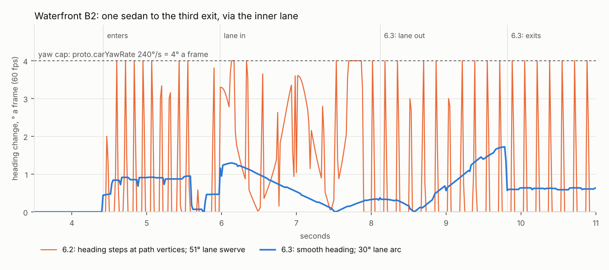

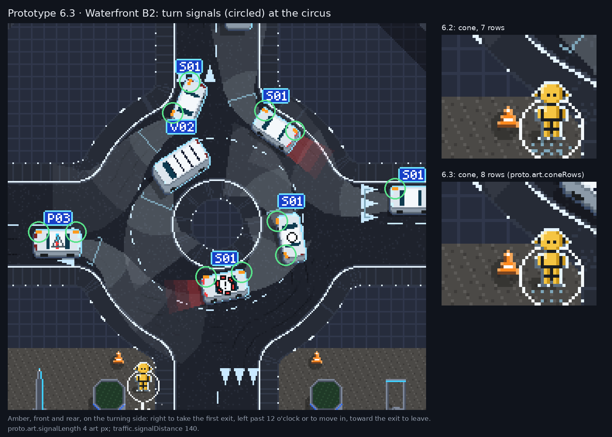

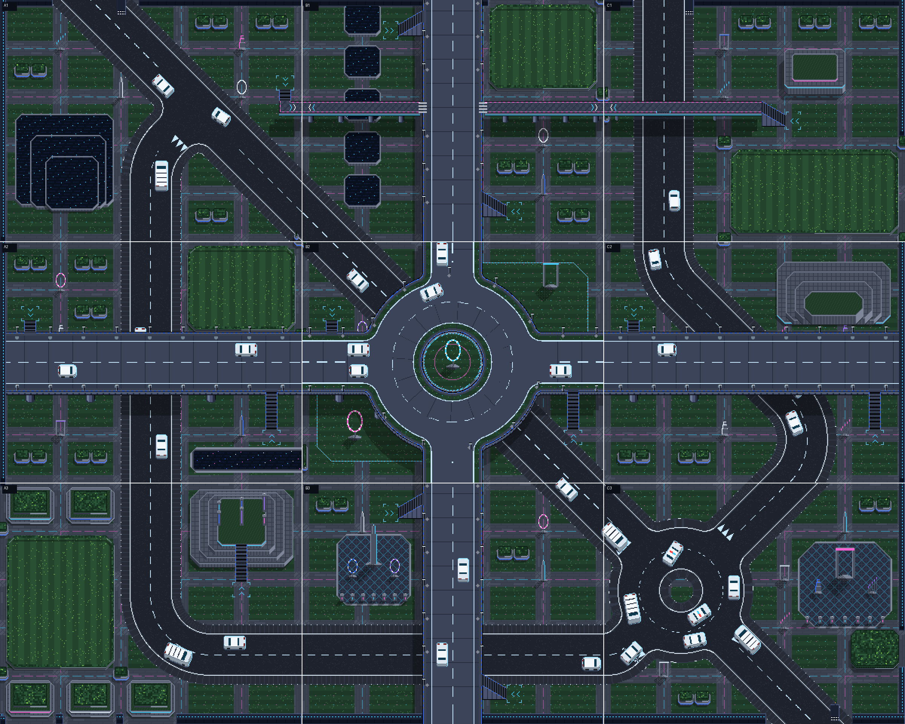

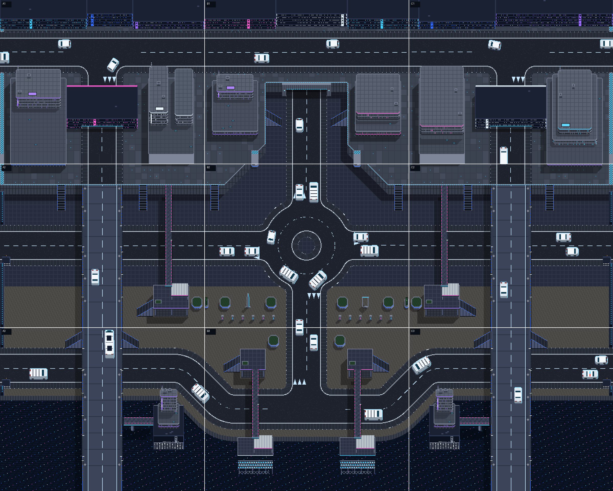

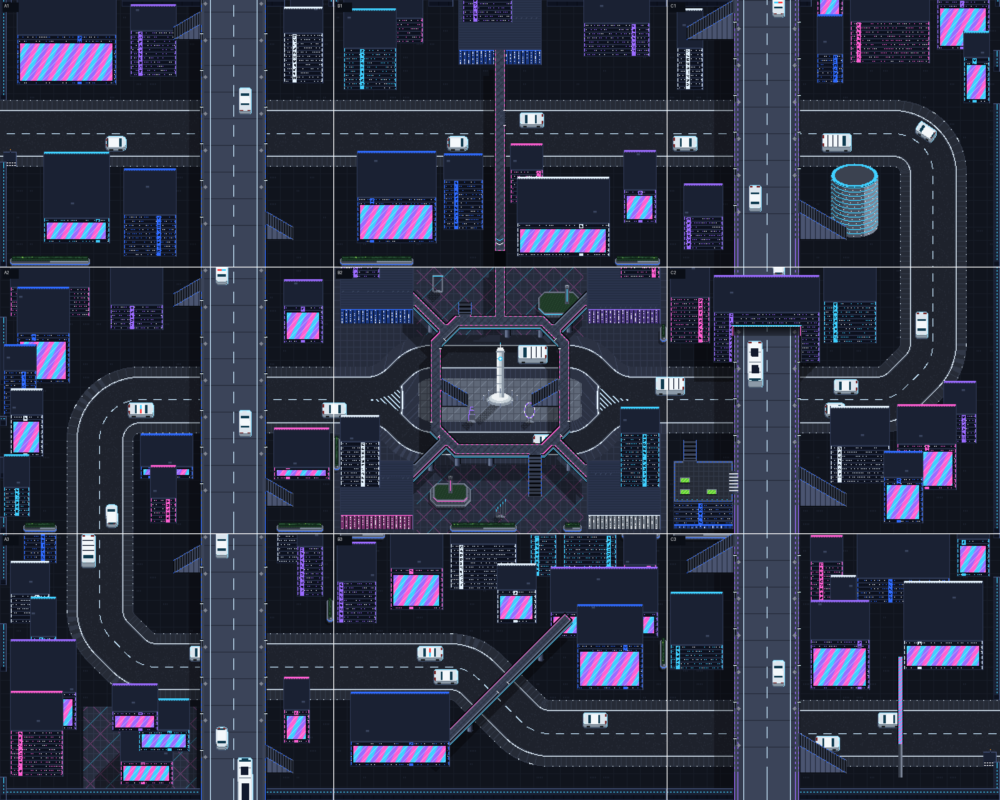

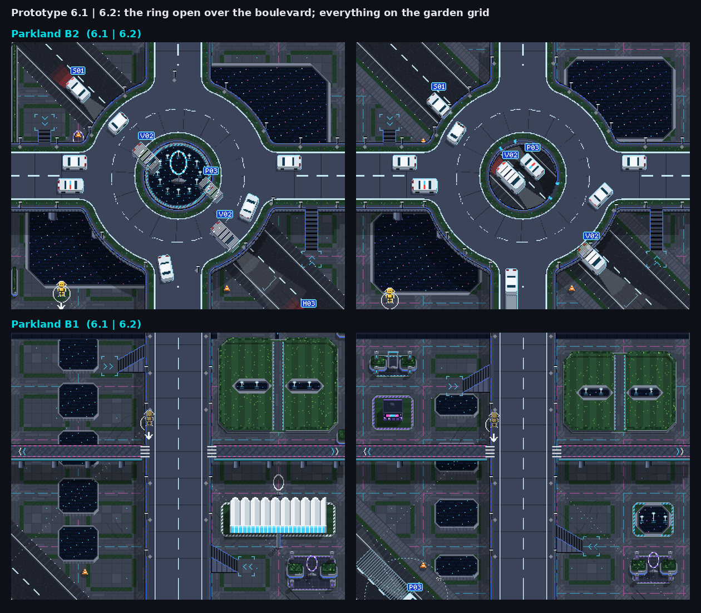

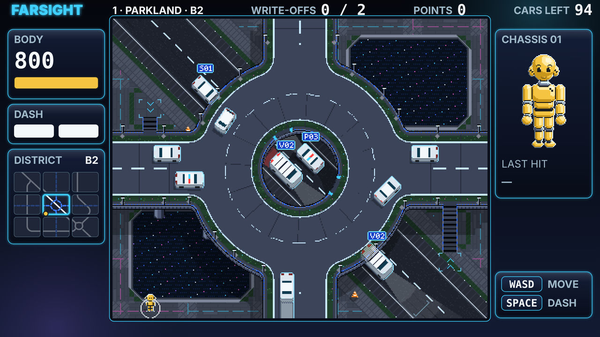

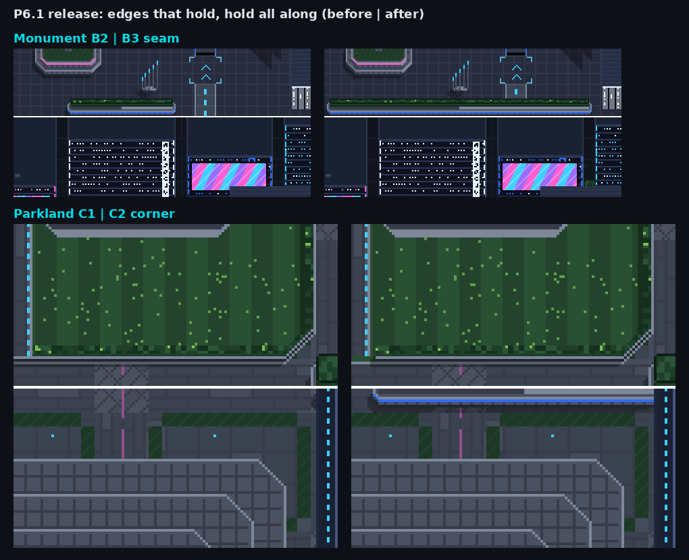

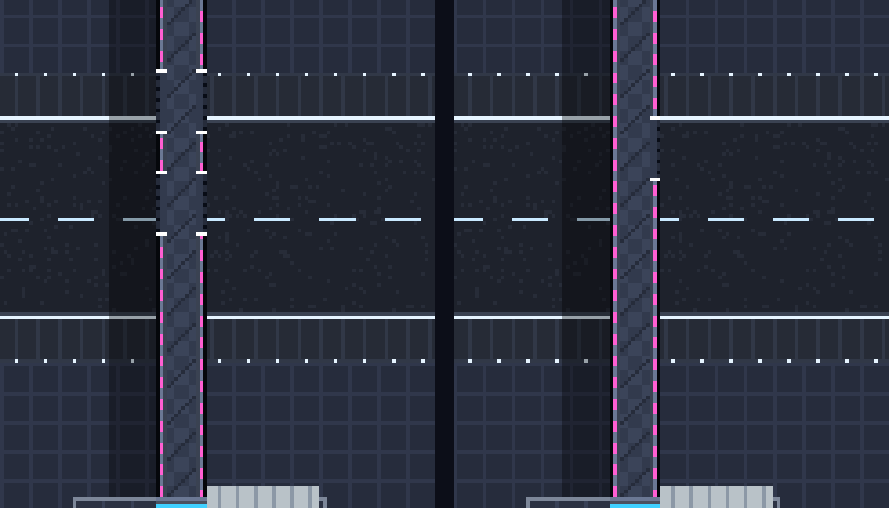

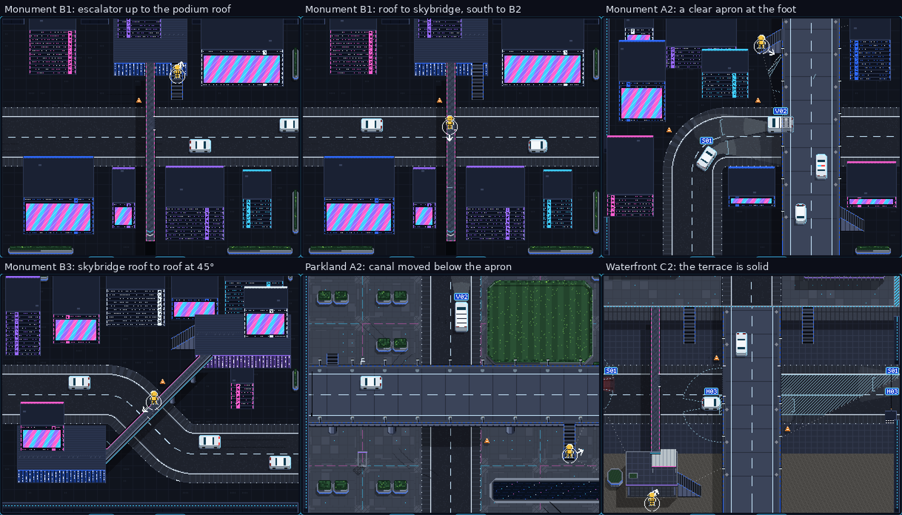

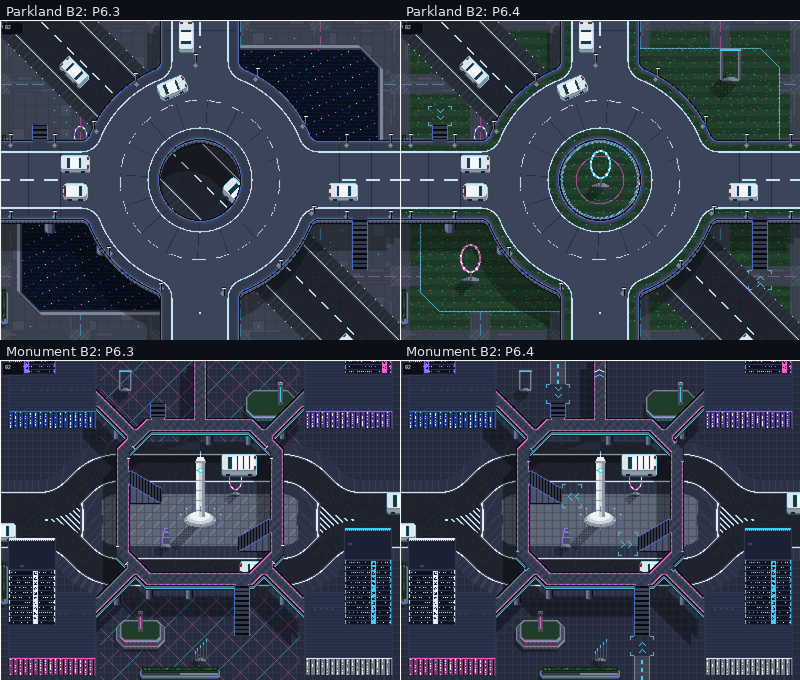

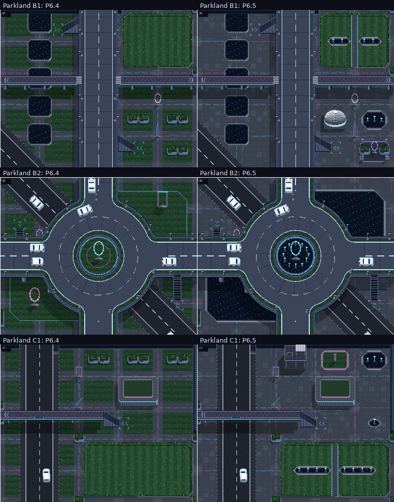

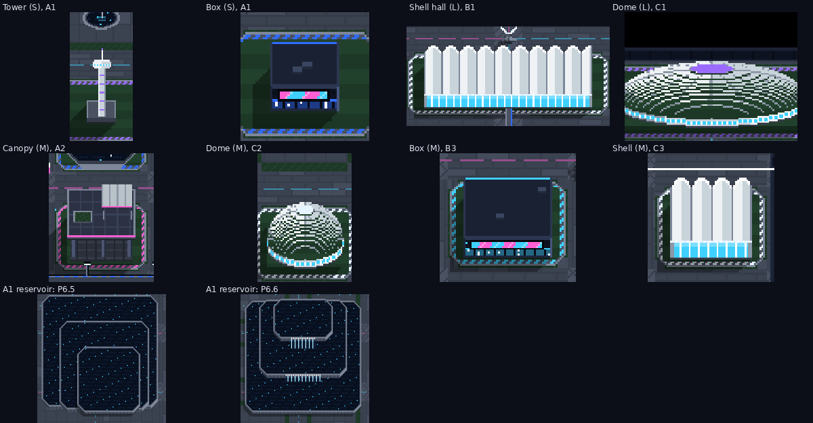

## Known gaps

- Cues still crowd at a busy junction on the dummy's level (D40).
- Tile names: column-row in the game, row-column in playtest notes (D41).
- Five Parkland flights keep their place beside the boulevard or a street (B2, C2, B3).
- Copy for the new toasts is literal in `game.js`. Not yet in the content pipeline.
- Left turns at a two-lane ring join the outer lane, then change lanes (D43).

## Build

`python3 build.py` → `dummies_p6_3.html`. `node tools/p6_shots.js docs && python3 tools/p6_shots.py docs` → the 3 × 3 images.
