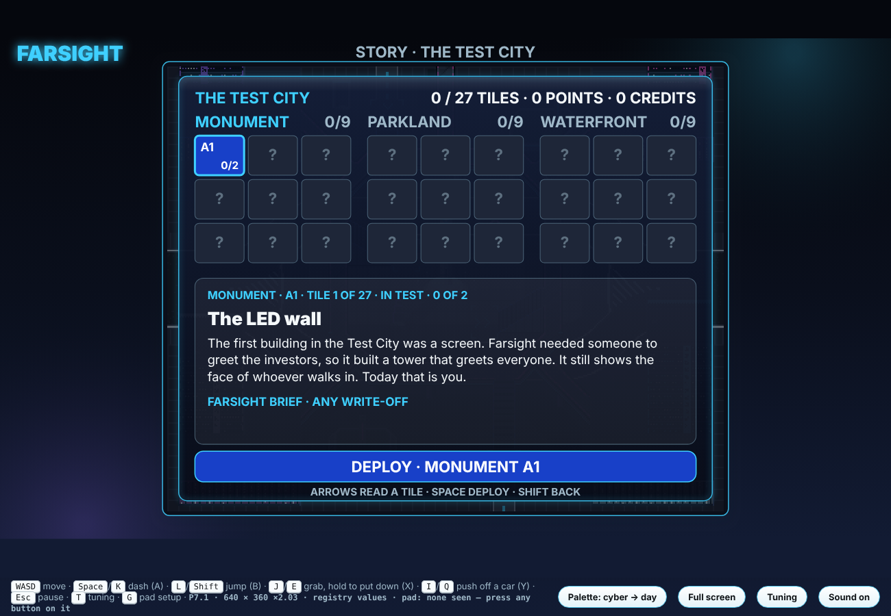
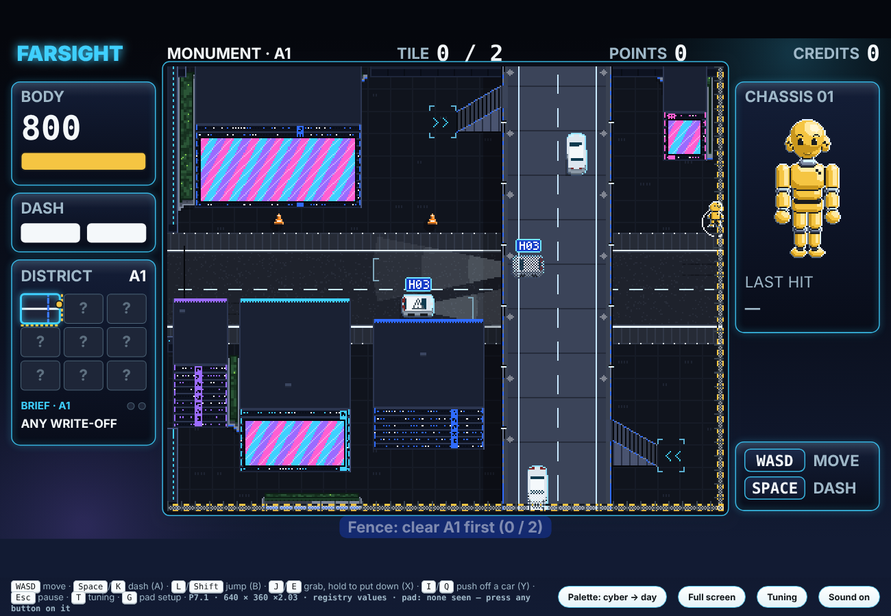
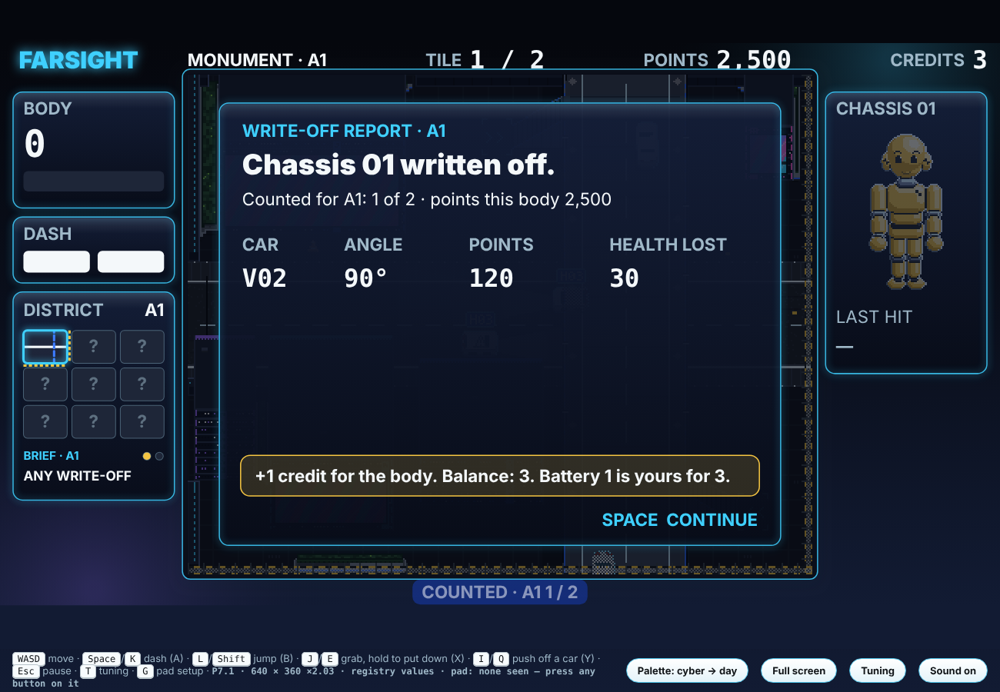
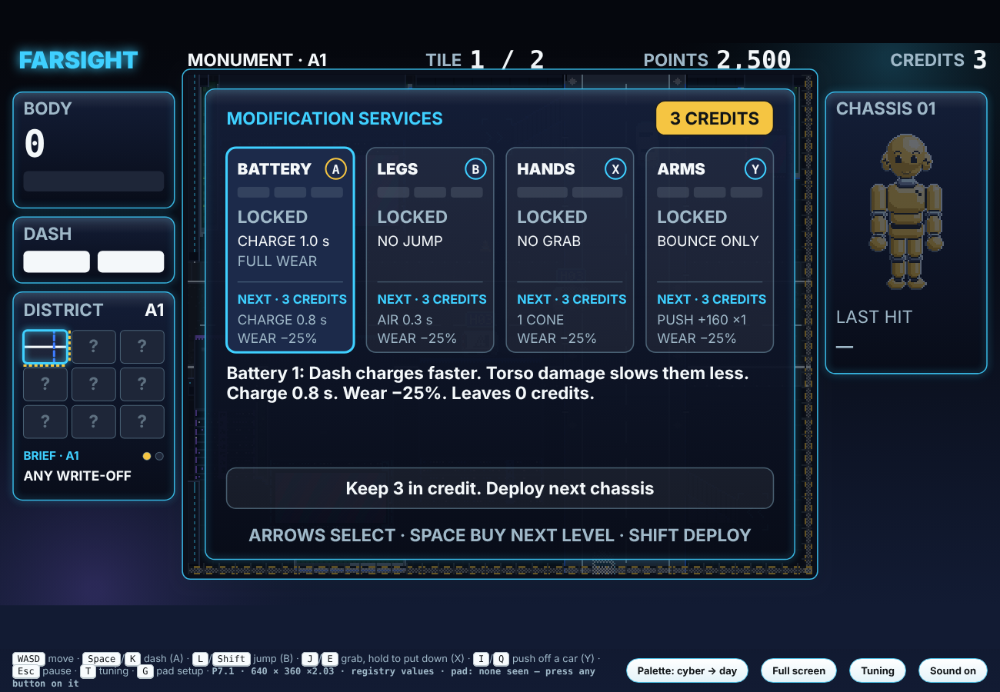
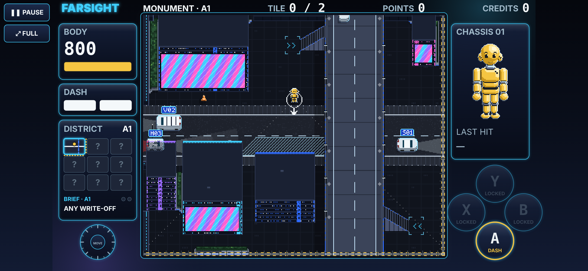

# DUMMIES — Prototype 7.1: Arcade and Story

**Prototype 7.1 · 28 October 2026 · Lawrence Lek** · Spec: GDD Edits 81–82 (proposed), on Prototype 6.10 (Edit 80). The final P7. Prototype 7 stays frozen as `dummies_p7.html`; 6.4–6.10 in `../p6/`.

Prototype 7.1 settles Prototype 7's open questions (D63–D66).
- **Credits:** one credit a body destroyed, in both modes (`economy.creditsPerWriteOff`).
- **Story prices:** level 1 costs 3, level 2 costs 4, level 3 costs 5. Arcade keeps 1, 2, 3.
- **Write-offs per tile:** each tile has its own count, 1 to 3: 62 bodies in all (P7: 81).
- **Arcade:** one district a run. **Briefs:** only the last hit counts.

The title has two modes.
- **ARCADE:** the 6.10 game. Pick Parkland, Waterfront or Monument; each district is a whole run.
- **STORY:** the Test City, tile by tile. Monument, then Parkland, then Waterfront: 27 tiles.
  - Each tile has a short tale of how it came to be, and a brief from Farsight.
  - A tile is fenced until it is cleared. Cleared tiles stay open. The map opens as you go.

## Files

- **`dummies_p7_1.html`:** the game. Open in a browser; no server.
- **Live (GitHub Pages):** https://lawrencelek.github.io/ELVTR-Multiagent-Submission-5/ (game), `/jump/`, `/controls/`, `/p7/` (Prototype 7), `/p6-10/` (Prototype 6.10).
- **`p7_1_page.html`:** the same page for Claude's hosted preview (touch and keys; no gamepads).
- **`dummies_p7.html`:** Prototype 7 (Edit 81). Frozen.
- **`story.js`:** Story mode. `StorySim` extends the P6 player sim (`../p6/world6.js`): start tile, fences, the brief, clears, credits, prices. Runs headless in Node.
- **`../../content/story/story.json`:** the story's content: the order of tiles, 27 tales, Farsight's briefs and gifts. Numbers are registry IDs.
- **`../p6/game.js`, `../p6/world6.js`, `../p6/sim.js`:** the shared game code: the title, the story map, the tile card, fences, the story's HUD.
- **`build.py`:** `python3 build.py` → both pages. `../p6/build.py` refuses: 6.10 is frozen.
- **`test_p71.js`:** `node test_p71.js [screenshot folder]` → the checks; screenshots into the folder.

## Title

| | Keys | Gamepad | Touch |
|---|---|---|---|
| Choose a mode | arrows | stick or d-pad | stick |
| Select | SPACE | A | A |
| Back | SHIFT | B | B |

- **ARCADE** → the district list and difficulty. A cleared district ends the run: Licensed.
- **STORY** → the story map. **NEW STORY** appears once a story has begun; press it twice to erase.

## Story

- **Order** (user-decided). Tile names are column-row: A1 is top left.
  - Monument: A1, B1, C1, C2, B2, A2, A3, B3, C3. The snake road.
  - Parkland: C1, C2, C3, B3, A3, A2, A1, B1, B2. With the highways, ending on the ring.
  - Waterfront: A1, B1, C1, C2, C3, B3, A3, A2, B2. Round the valley, ending at the circus.
- **A tile:** `story.writeOffs.<district>.<tile>` counted write-offs clear it (table below).
  - A write-off counts when its last hit meets the brief. Otherwise it scores and counts for nothing.
- **Fences:** a tile in test is fenced on every side. Fences hold walking, dashes, jumps and throws.
  - Clearing a tile drops its fences; the next tile opens. Entering it closes the fences behind.
  - Cleared tiles stay open. Walk back through them; write-offs there score only.
  - Drawn at the screen's edge: hazard rails, mesh, posts. On the district map: yellow dashes.
- **Credits:** `economy.creditsPerWriteOff` (1) for every body written off, counted or not. A clear pays nothing extra.
  - Prices: `story.price.ability.level1` 3, `level2` 4, `level3` 5. A level-1 power-up is three bodies.
  - A track costs 12; Hands (two levels) 7. Arcade keeps `economy.price.ability.level1`–`level3` (1, 2, 3).
  - Gifts on arrival: Legs 1, Hands 1, Arms 1, Battery 1 in Monument; `story.giftCredits` (3) at Parkland C1 and Waterfront A1.
  - Nothing affordable: the report goes straight to the next chassis.
- **No clock:** a district's traffic runs `story.shiftCars` (5,000) cars. No Failed test.
- **The map:** cleared tiles and the tile in test show. The rest read "?". The cursor reads any revealed tile's tale.
- **Saved** in this browser after every count, clear, gift and purchase. A reload resumes the tile in test.
- **The end:** clearing Waterfront B2 certifies the Test City.

### The 27 tiles

| # | District | Tile | Title | Brief: the last hit | Write-offs | Gift on arrival |
|---|---|---|---|---|---|---|
| 1 | Monument | A1 | The LED wall | ANY WRITE-OFF | 2 | — |
| 2 | Monument | B1 | The podium bridge | DROP ONTO A CAR | 2 | — |
| 3 | Monument | C1 | The LED drum | JUMP INTO A CAR | 2 | Legs 1 (jump) |
| 4 | Monument | C2 | The portal tower | ON A RAISED ROAD | 2 | — |
| 5 | Monument | B2 | The monument | CONE-BAITED CAR | 1 | Hands 1 (cones) |
| 6 | Monument | A2 | The neon arcade | PUSH OFF A CAR | 2 | Arms 1 (push) |
| 7 | Monument | A3 | The stacked cubes | COMBO ×2 | 2 | — |
| 8 | Monument | B3 | The LED canyon | STRUCK, NOT DASHING | 2 | Battery 1 |
| 9 | Monument | C3 | The LED gateway | COMBO ×3 | 2 | — |
| 10 | Parkland | C1 | The lantern pavilion | DROP ONTO A CAR | 2 | +3 credits (`story.giftCredits`) |
| 11 | Parkland | C2 | The amphitheatre | A VAN | 3 | — |
| 12 | Parkland | C3 | The arch and the roundabout | THROWN INTO A CAR | 2 | — |
| 13 | Parkland | B3 | The obelisk court | A POLICE CAR | 2 | — |
| 14 | Parkland | A3 | The belvedere | JUMP INTO A CAR | 3 | — |
| 15 | Parkland | A2 | The canal | ON A RAISED ROAD | 3 | — |
| 16 | Parkland | A1 | The reservoir terraces | PUSH OFF A CAR | 3 | — |
| 17 | Parkland | B1 | The cascade | CONE-BAITED CAR | 2 | — |
| 18 | Parkland | B2 | The ring over the pools | COMBO ×3 | 2 | — |
| 19 | Waterfront | A1 | The west portal | A BUS | 1 | +3 credits (`story.giftCredits`) |
| 20 | Waterfront | B1 | The tunnel portal | JUMP INTO A CAR | 3 | — |
| 21 | Waterfront | C1 | The east portal | A POLICE CAR | 2 | — |
| 22 | Waterfront | C2 | The east beach terrace | DROP ONTO A CAR | 3 | — |
| 23 | Waterfront | C3 | The east pier tower | THROWN INTO A CAR | 3 | — |
| 24 | Waterfront | B3 | The stilt houses | PUSH OFF A CAR | 3 | — |
| 25 | Waterfront | A3 | The west pier tower | ON A RAISED ROAD | 3 | — |
| 26 | Waterfront | A2 | The west beach terrace | CONE-BAITED CAR | 2 | — |
| 27 | Waterfront | B2 | The circus | COMBO ×3 | 3 | — |
- **Write-offs** (D65): 1 for a rare brief (the monument's cone, Waterfront's bus); 2 to learn a verb; 3 as the story goes on. Monument 17, Parkland 22, Waterfront 23.
- **Every brief is possible where it is set.** Checked from 90 s of traffic per district: the class runs there; raised traffic for "on a raised road"; a raised floor over traffic for a drop; cones for a cone brief.
- **Every brief's ability is gifted by its tile:** Legs 1 at Monument C1, Hands 1 at B2, Arms 1 at A2.

## HUD (story)

- **Top bar:** district · tile · level; TILE n / its count; POINTS; CREDITS.
- **District map:** revealed tiles only; fences as yellow dashes; under it, the brief and a pip per write-off.
- **Tile card** on arrival: the tile's number of 27, its title, its tale, the brief and its count, the gift. A begins.
- **Report:** counted or not, and why; the body's credit; the cheapest next level and its price.
- **Pause:** Resume · Story map · Show trace · Quit to title. The tile's count is kept; the body in play is lost.
- **Tuning (T):** `economy.creditsPerWriteOff`, `story.price.ability.level1`–`level3`, `story.giftCredits`, `story.task.comboEasy`, `story.task.comboHard`, the 27 `story.writeOffs.<district>.<tile>`. From the next deploy.

## Evidence

- `node test_p71.js docs` → 43/43.
  - Content: the three orders; each step to a neighbour; 27 tales, tasks, gifts; registry IDs, 27 tile counts (62 bodies), 4 P7 IDs retired; abilities gifted in time; every brief possible where set.
  - Headless: A1 to start, fenced E and S; a walk and a dash jump held at x 787; a real dash write-off counted (1 of 2), +1 credit; nothing affordable skips the shop; A1 cleared, no clear bonus; B1 opens, closes behind; a missed write-off still pays; 3 credits buy Battery 1 (story prices 3, 4, 5); B1 cleared; back to cleared A1 (scores only); C1 installs Legs 1; the score buys nothing; resume on C3; Monument cleared → Parkland C1, +3 credits; Waterfront B2 certifies. Arcade: one district a run; prices 1, 2, 3. 6.4–6.10 and 7 byte-identical.
  - Browser: the title (P7.1); Arcade's pick; the map; the tile card; the fence (0 / 2); a report (1 of 2, 3 credits); the shop at 3; a reload resumes; a phone sideways; no page errors.
- `../p6/test_p610.js` → 47/47 (6.10's rules on the shared code). `../p6/test_sim.js` → 104/104. `../p6/test_p6.js` → 72/73 (Parkland's street-emptiness limit, as on 6.4).
- `../jump/test_jump.js` → 28/28. `../controls/test_controls.js` → 34/34.

## Known gaps

- Tales and briefs are proposals (status Proposed in `story.json`). The tile counts are proposals too (D65).
- Credits come from every body, so replaying a cleared tile buys levels. The tracks fill around mid-Parkland.
- One save slot, in this browser only. A P7 save loads into 7.1 with its credits.
- Barks still name the district, not the tile.

## Build

`python3 build.py` → `dummies_p7_1.html` and `p7_1_page.html`.
