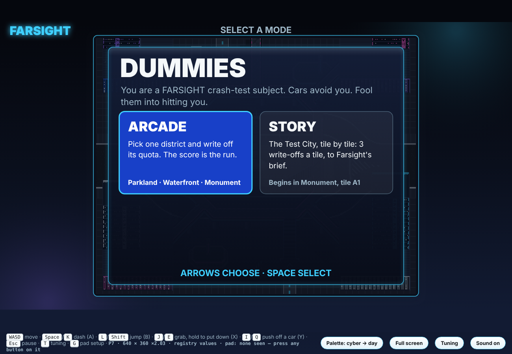
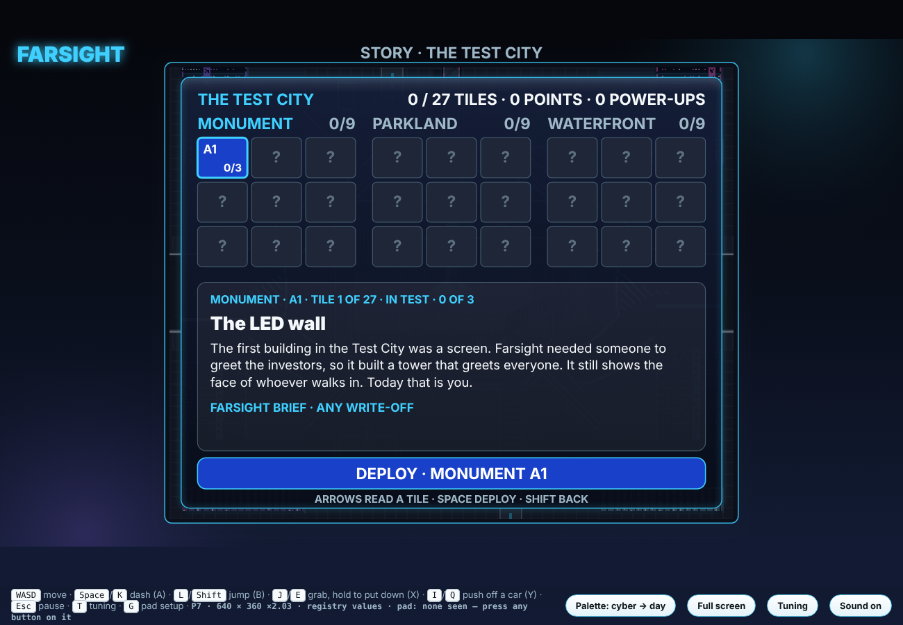
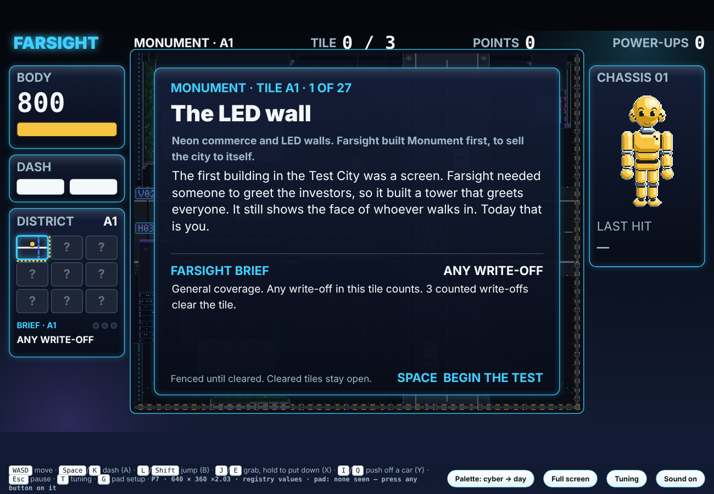
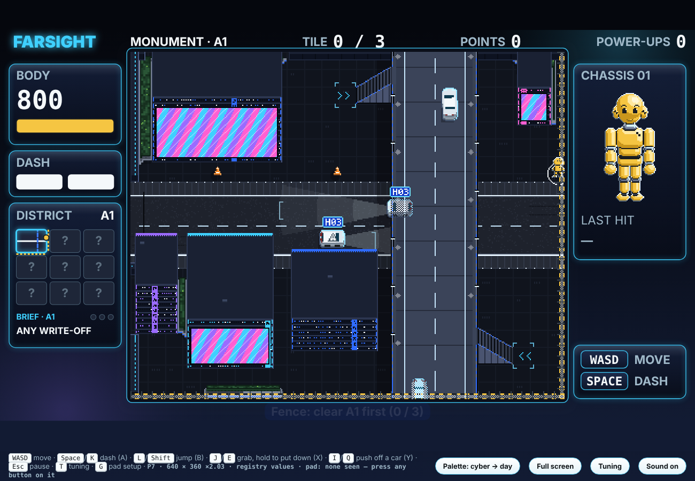
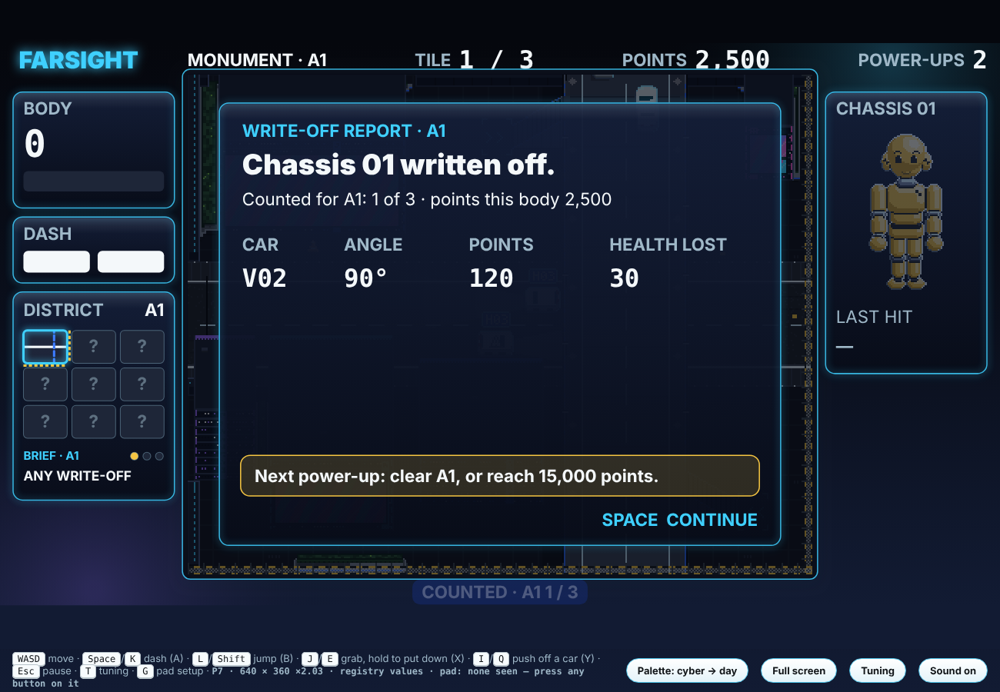

# DUMMIES — Prototype 7: Arcade and Story

**Prototype 7 · 28 October 2026 · Lawrence Lek** · Spec: GDD Edit 81 (proposed), on Prototype 6.10 (Edit 80). Prototypes 6.4–6.10 stay frozen in `../p6/`.

Prototype 7 adds a title with two modes.
- **ARCADE:** the 6.10 game. Pick Parkland, Waterfront or Monument; each district is a whole run.
- **STORY:** the Test City, tile by tile.
  - Monument, then Parkland, then Waterfront. 27 tiles.
  - Each tile has a short tale of how it came to be, and a brief from Farsight.
  - A tile is fenced until it is cleared. Cleared tiles stay open. The map opens as you go.

## Files

- **`dummies_p7.html`:** the game. Open in a browser; no server.
- **Live (GitHub Pages):** https://lawrencelek.github.io/ELVTR-Multiagent-Submission-5/ (game), `/jump/`, `/controls/`, `/p6-10/` (Prototype 6.10).
- **`p7_page.html`:** the same page for Claude's hosted preview (touch and keys; no gamepads).
- **`story.js`:** Story mode. `StorySim` extends the P6 player sim (`../p6/world6.js`): start tile, fences, the brief, clears, power-ups. Runs headless in Node.
- **`../../content/story/story.json`:** the story's content: the order of tiles, 27 tales, Farsight's briefs and gifts. Numbers are registry IDs.
- **`../p6/game.js`, `../p6/world6.js`, `../p6/sim.js`:** the shared game code. P7 adds the title, the story map, the tile card, fences and the story's HUD.
- **`build.py`:** `python3 build.py` → both pages. `../p6/build.py` now refuses: 6.10 is frozen.
- **`test_p7.js`:** `node test_p7.js [screenshot folder]` → the checks; screenshots into the folder.

## Title

| | Keys | Gamepad | Touch |
|---|---|---|---|
| Choose a mode | arrows | stick or d-pad | stick |
| Select | SPACE | A | A |
| Back | SHIFT | B | B |

- **ARCADE** → the district list and difficulty, as in 6.10. A cleared district ends the run: Licensed.
- **STORY** → the story map. **NEW STORY** appears once a story has begun; press it twice to erase.

## Story

- **Order** (user-decided, 28 October). Tile names are column-row: A1 is top left.
  - Monument: A1, B1, C1, C2, B2, A2, A3, B3, C3. The snake road.
  - Parkland: C1, C2, C3, B3, A3, A2, A1, B1, B2. With the highways, ending on the ring.
  - Waterfront: A1, B1, C1, C2, C3, B3, A3, A2, B2. Round the valley, ending at the circus.
- **A tile:** `story.tileWriteOffs` (3) counted write-offs clear it.
  - A write-off counts when its fatal hit meets the brief. Otherwise it scores and counts for nothing.
- **Fences:** a tile in test is fenced on every side. Fences hold walking, dashes, jumps and throws.
  - Clearing a tile drops its fences; the next tile opens. Entering it closes the fences behind.
  - Cleared tiles stay open. Walk back through them; write-offs there score only.
  - Drawn at the screen's edge: hazard rails, mesh, posts. On the district map: yellow dashes.
- **Power-ups:** the shop's currency in the story. Levels cost 1, 2, 3, as in Arcade.
  - A clear pays `story.clearPowerUps` (1). Every `story.pointsPerPowerUp` (15,000) points pays one more.
  - Some tiles carry a gift on arrival: an ability level, or `story.giftPowerUps` (1).
  - No power-ups to spend: the report goes straight to the next chassis.
- **No clock:** a district's traffic runs `story.shiftCars` (5,000) cars. No Failed test.
- **The map:** cleared tiles and the tile in test show. The rest read "?". The cursor reads any revealed tile's tale.
- **Saved** in this browser after every count, clear, gift and purchase. A reload resumes the tile in test.
- **The end:** clearing Waterfront B2 certifies the Test City.

### The 27 tiles

| # | District | Tile | Title | Brief: the fatal hit | Gift on arrival |
|---|---|---|---|---|---|
| 1 | Monument | A1 | The LED wall | ANY WRITE-OFF | — |
| 2 | Monument | B1 | The podium bridge | DROP ONTO A CAR | — |
| 3 | Monument | C1 | The LED drum | JUMP INTO A CAR | Legs 1 (jump) |
| 4 | Monument | C2 | The portal tower | ON A RAISED ROAD | — |
| 5 | Monument | B2 | The monument | CONE-BAITED CAR | Hands 1 (cones) |
| 6 | Monument | A2 | The neon arcade | PUSH OFF A CAR | Arms 1 (push) |
| 7 | Monument | A3 | The stacked cubes | COMBO ×2 (`story.task.comboEasy`) | — |
| 8 | Monument | B3 | The LED canyon | STRUCK, NOT DASHING | Battery 1 |
| 9 | Monument | C3 | The LED gateway | COMBO ×3 (`story.task.comboHard`) | — |
| 10 | Parkland | C1 | The lantern pavilion | DROP ONTO A CAR | +1 power-up (`story.giftPowerUps`) |
| 11 | Parkland | C2 | The amphitheatre | A VAN | — |
| 12 | Parkland | C3 | The arch and the roundabout | THROWN INTO A CAR | — |
| 13 | Parkland | B3 | The obelisk court | A POLICE CAR | — |
| 14 | Parkland | A3 | The belvedere | JUMP INTO A CAR | — |
| 15 | Parkland | A2 | The canal | ON A RAISED ROAD | — |
| 16 | Parkland | A1 | The reservoir terraces | PUSH OFF A CAR | — |
| 17 | Parkland | B1 | The cascade | CONE-BAITED CAR | — |
| 18 | Parkland | B2 | The ring over the pools | COMBO ×3 (`story.task.comboHard`) | — |
| 19 | Waterfront | A1 | The west portal | A BUS | +1 power-up (`story.giftPowerUps`) |
| 20 | Waterfront | B1 | The tunnel portal | JUMP INTO A CAR | — |
| 21 | Waterfront | C1 | The east portal | A POLICE CAR | — |
| 22 | Waterfront | C2 | The east beach terrace | DROP ONTO A CAR | — |
| 23 | Waterfront | C3 | The east pier tower | THROWN INTO A CAR | — |
| 24 | Waterfront | B3 | The stilt houses | PUSH OFF A CAR | — |
| 25 | Waterfront | A3 | The west pier tower | ON A RAISED ROAD | — |
| 26 | Waterfront | A2 | The west beach terrace | CONE-BAITED CAR | — |
| 27 | Waterfront | B2 | The circus | COMBO ×3 (`story.task.comboHard`) | — |
- **Briefs:** drop onto a car; jump into a car; on a raised road (Z1+); a car reacting to a cone; a push off one car into another; thrown into a car; struck while walking or standing; a combo link; a class of car.
- **Every brief is possible where it is set.** Checked from 90 s of traffic per district: the class runs there; raised traffic for "on a raised road"; a raised floor over traffic for a drop; cones for a cone brief.
- **Every brief's ability is gifted by its tile:** Legs 1 at Monument C1, Hands 1 at B2, Arms 1 at A2.

## HUD (story)

- **Top bar:** district · tile · level; TILE n / 3; POINTS; POWER-UPS.
- **District map:** revealed tiles only; fences as yellow dashes; under it, the brief and three pips.
- **Tile card** on arrival: the tile's number of 27, its title, its tale, the brief, the gift. A begins.
- **Report:** counted or not, and why; power-ups gained, or what earns the next.
- **Pause:** Resume · Story map · Show trace · Quit to title. The tile's count is kept; the body in play is lost.
- **Tuning (T):** `story.tileWriteOffs`, `story.clearPowerUps`, `story.pointsPerPowerUp`, `story.giftPowerUps`, `story.task.comboEasy`, `story.task.comboHard`. From the next deploy.

## Evidence

- `node test_p7.js docs` → 39/39.
  - Content: the three orders; each step to a neighbour; 27 tales, tasks, gifts; registry IDs; abilities gifted in time; every brief possible where set.
  - Headless: A1 to start, fenced E and S; a walk and a dash jump held at x 787; a real dash write-off counted; three clear A1, +1; B1 opens, closes behind; a dash misses B1's drop brief; back to cleared A1 (scores only); C1 installs Legs 1; the score's power-ups; resume on C3; Monument cleared → Parkland on C1, +1; Waterfront B2 certifies. Arcade: one district a run. No empty shop. 6.4–6.10 byte-identical.
  - Browser: the title; Arcade's pick; the map; the tile card; the fence; a report; the shop in power-ups; a reload resumes; a phone sideways; no page errors.
- `../p6/test_p610.js` → 47/47 (6.10's rules on the shared code). `../p6/test_sim.js` → 104/104. `../p6/test_p6.js` → 72/73 (Parkland's street-emptiness limit, as on 6.4).
- `../jump/test_jump.js` → 28/28. `../controls/test_controls.js` → 34/34.

## Known gaps

- Tales and briefs are proposals (status Proposed in `story.json`).
- The story is long: 27 tiles × 3 write-offs = 81 bodies. `story.tileWriteOffs` tunes it.
- A brief is judged on the fatal hit only.
- One save slot, in this browser only.
- Barks still name the district, not the tile.

## Build

`python3 build.py` → `dummies_p7.html` and `p7_page.html`.
